# feelm

> 본 영화는 **필름**에 한 칸씩 쌓이고, 취향은 **팝콘 버킷**에 맛별로 담긴다.
> 혼자서는 아직 맛보지 않은 취향을 발견하고, 여럿이서는 함께 볼 영화를 고르는 영화 추천 서비스

SSAFY 15기 2학기 특화 프로젝트(빅데이터 분산) · 팀 E106 · 서비스 주소 <https://j15e106.p.ssafy.io>

---

## 목차

1. [feelm 소개](#1-feelm-소개)
2. [주요 기능](#2-주요-기능)
3. [화면](#3-화면)
4. [시스템 아키텍처](#4-시스템-아키텍처)
5. [기술 스택](#5-기술-스택)
6. [실행 방법](#6-실행-방법)
7. [저장소 구조](#7-저장소-구조)
8. [문서](#8-문서)
9. [팀 구성](#9-팀-구성)

---

## 1. feelm 소개

영화 추천 서비스는 대부분 좋아했던 영화와 비슷한 영화를 반복해서 보여 주고, 내 취향이 어떤지는
보여 주지 않는다. 여럿이 함께 볼 영화를 고를 때는 한 사람의 취향만 반영되기 쉽다.

feelm은 감상과 평가를 두 가지로 시각화해 사용자가 자신의 취향을 직접 보게 한다.

- **필름** — 감상하고 평가를 마친 영화 한 편이 프레임 한 칸이 되어 필름에 이어 붙는다. 기록의 축이다.
- **팝콘 버킷** — 영화마다 8가지 팝콘 맛 중 하나가 정해지고, 평가할 때마다 그 맛의 팝콘이 한 알씩
  쌓인다. 맛별 양은 감상량, 맛별 평균 평점은 선호도를 나타낸다. 취향의 축이다.

추천은 세 방향으로 제공한다.

| 추천 | 설명 |
| --- | --- |
| **취향 맞춤** | 지금까지의 평가 전체를 바탕으로 좋아할 가능성이 높은 영화 |
| **취향 발견** | 기존 취향과 이어지면서 아직 맛보지 않은 팝콘 맛에 속하는 영화 |
| **파티 추천** | 파티원 각자의 취향 점수를 모아, 한 사람만이 아니라 모두가 만족할 가능성이 높은 영화 |

추천 모델은 MovieLens 32M 평점(약 3,200만 건)과 TMDb·KOBIS 메타데이터로 학습한 GBT(XGBoost) 모델이며,
대규모 평점의 전처리와 분산 실험은 **Hadoop HDFS와 Spark**로 처리한다. 모델과 학습 기준은
[v26 GBT 안내](./pipeline/docs/gbt-v26/README.md)를 따른다.

---

## 2. 주요 기능

| 영역 | 기능 |
| --- | --- |
| 계정 | 이메일 인증번호 가입, 로그인, 소셜 로그인(구글·카카오), 프로필 사진·닉네임, 회원 탈퇴 |
| 온보딩 | 영화 카드에 좋아요·별로예요를 골라 초기 취향 만들기, 구독 중인 OTT 설정 |
| 추천 | 오늘의 추천(취향 맞춤 + 취향 발견), 추천 이유 설명, 관심 없음, 추천 기록 |
| 영화 | 영화 상세, 비슷한 영화, 시청 가능한 OTT 바로가기, 키워드·필터 검색 |
| 감상 | OTT 바로가기 후 감상 확인, 별점과 한줄평 평가, 평가하면 프레임·팝콘 생성 |
| 취향 | 필름, 팝콘 버킷, 캐릭터 카드, 반기 취향 리포트(4컷 이미지 저장·공유) |
| 파티 | 파티 만들기·초대, 파티원 취향 비교, 팝콘 섞기, 파티 영화 추천 |
| 소셜 | 사용자 검색, 다른 사용자의 필름·팝콘 버킷 보기, 사용자 차단 |
| 알림 | 감상 확인·파티 초대 알림, 브라우저 푸시, 알림 수신 설정 |

링크 클릭만으로는 감상으로 치지 않는다. **평가까지 마친 시점에** 프레임과 팝콘이 만들어진다.
기능 요구사항 전체(FR-01~FR-40, NFR)는 [요구사항 정의서](./docs/requirements.md)에 있다.

---

## 3. 화면

### 모바일

| 취향 필름 | 오늘의 추천 | 영화 상세 | 평가 |
| --- | --- | --- | --- |
| 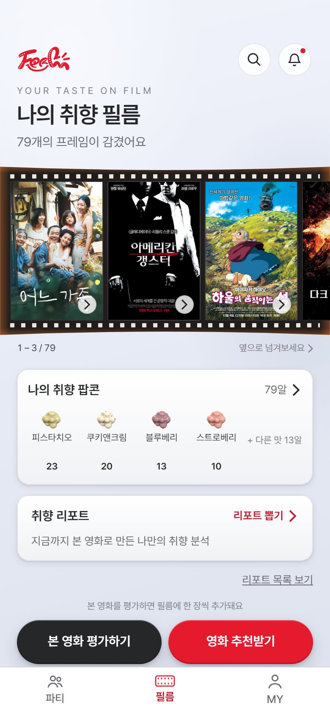 | 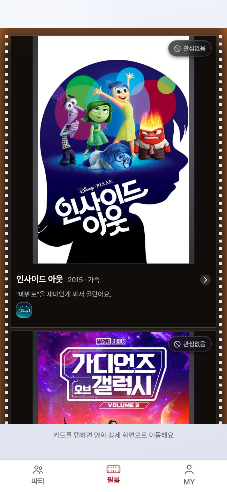 | 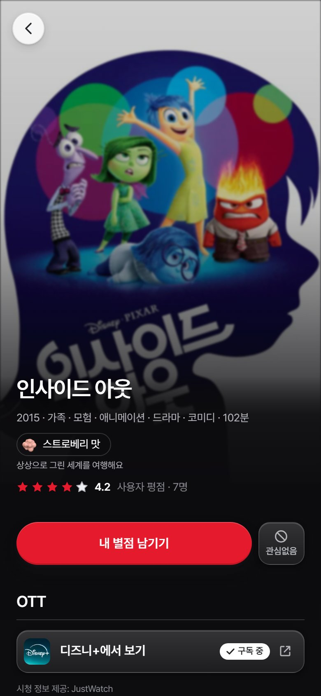 | 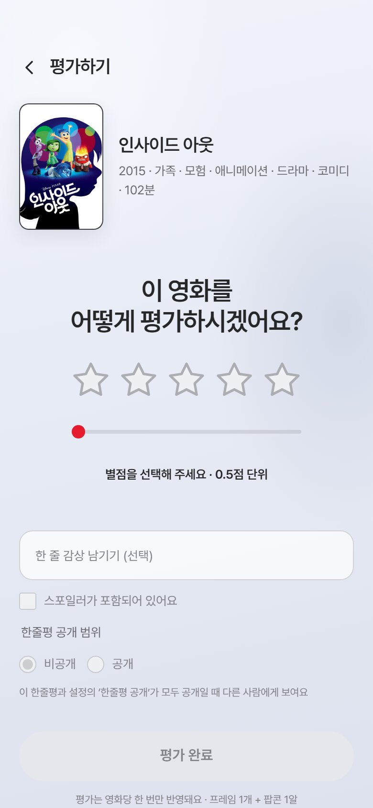 |

| 팝콘 버킷 | 파티팝콘 | 파티 믹스 팝콘 | MY |
| --- | --- | --- | --- |
| 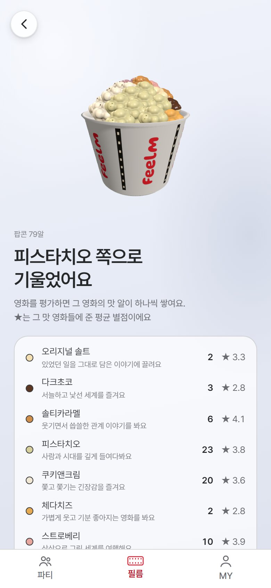 | 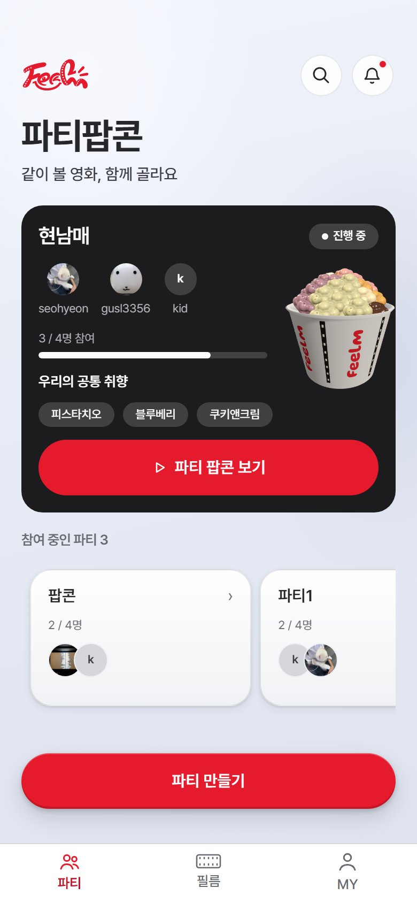 | 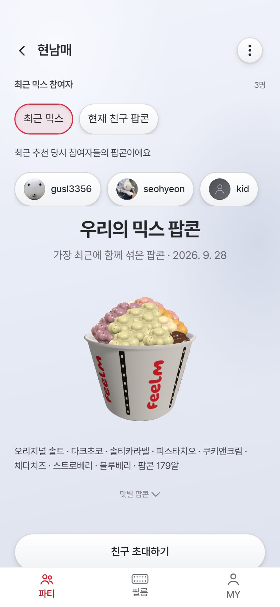 | 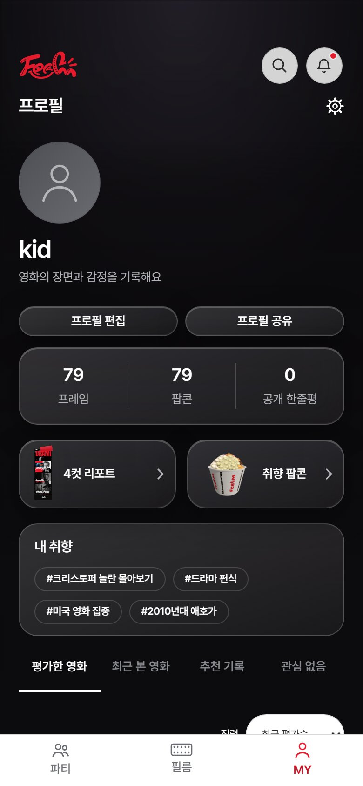 |

### PC

| 취향 필름 | 추천 영화 |
| --- | --- |
| 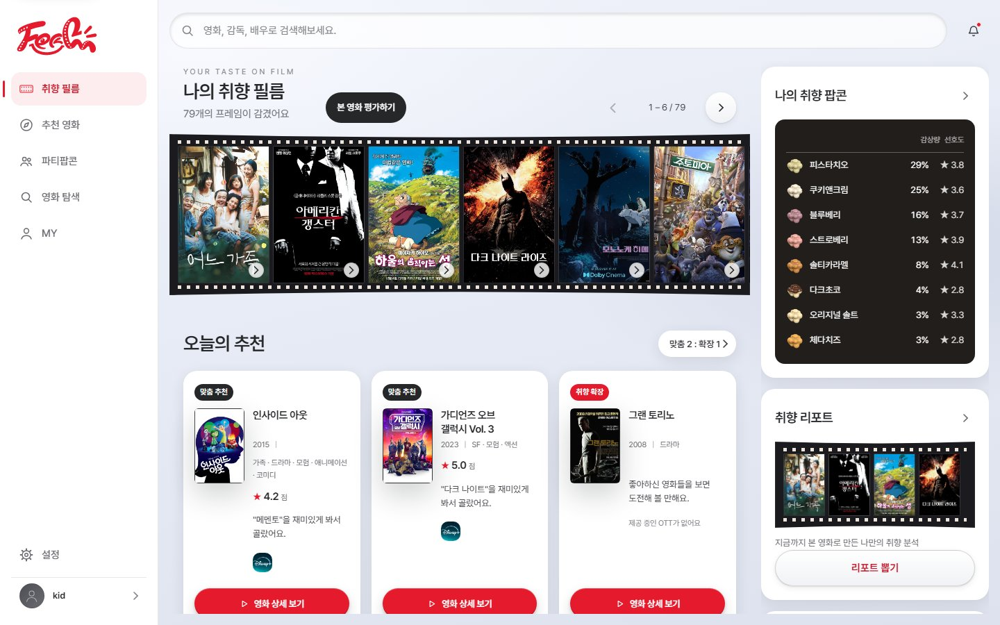 | 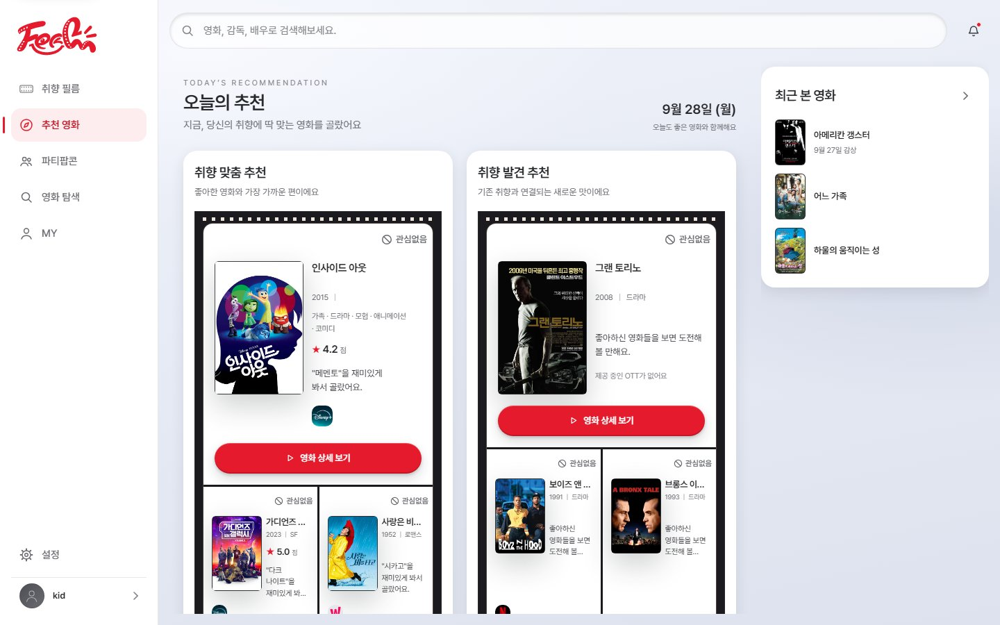 |

| 파티팝콘 |
| --- |
| 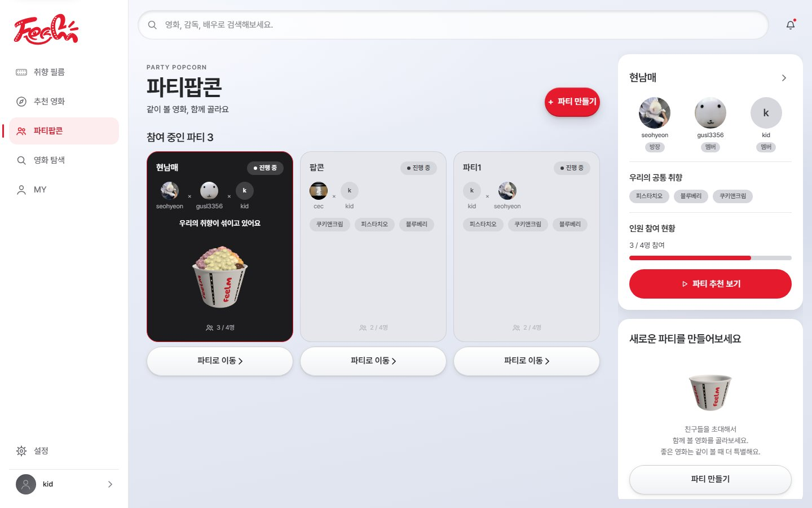 |

> 2026-09-28 배포 서비스에서 캡처했다. 설계 단계 목업 29개 화면은
> [00-overview.png](./frontend/docs/images/00-overview.png)와
> [화면 설계 문서](./frontend/docs/screens/README.md)에 있다.

---

## 4. 시스템 아키텍처

서비스 노드(J15E106)와 분산 처리 노드(J15E106A), EC2 2대로 운영한다.

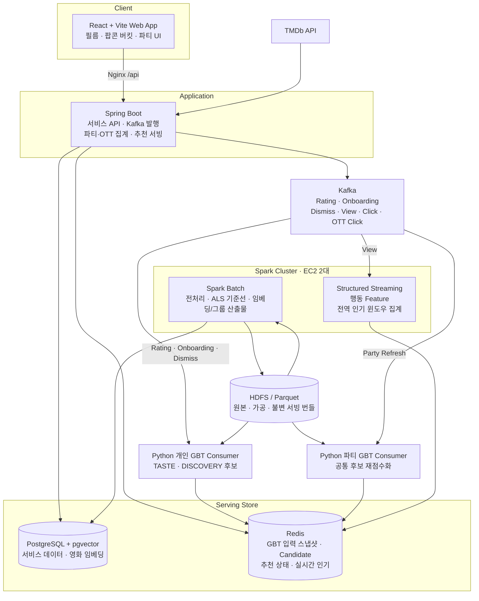

| 컴포넌트 | 역할 |
| --- | --- |
| **React + Vite** | 필름·팝콘 버킷·추천·파티 화면. PWA와 웹 푸시 지원 |
| **Spring Boot** | 서비스 REST API, 인증, Outbox 기반 Kafka 발행, 후보를 받아 최종 제외·정렬·세트 조립 |
| **PostgreSQL + pgvector** | 서비스 데이터와 영화 임베딩, 유사 영화 벡터 검색, 전문 검색 |
| **Redis** | 추천 후보·입력 스냅샷·추천 상태·실시간 인기, 로그인·메일 발송 제한 |
| **Kafka** | 평가·온보딩·관심 없음·조회·클릭 이벤트 전달 |
| **Python Consumer** | 이벤트를 받아 개인 GBT 점수로 TASTE 최대 500편·DISCOVERY 최대 100편을 계산해 Redis에 게시. 파티는 공통 후보를 파티원별로 재점수화 |
| **Spark / HDFS** | 원천·가공 데이터 저장, 대규모 전처리와 분산 실험, 서빙 번들 산출, 실시간 인기 집계 |
| **Prometheus · Grafana · Loki** | 메트릭·로그 수집과 알림 |

이벤트와 Redis 키 계약은 [스트리밍 계약](./docs/api/streaming-contract.md), 기술 결정은
[ADR 목록](./docs/adr/README.md)을 따른다.

---

## 5. 기술 스택

| 영역 | 기술 |
| --- | --- |
| **Frontend** | React 19, TypeScript 6, Vite 8, React Router 8, Vitest, ESLint, Prettier, openapi-typescript |
| **Backend** | Java 21, Spring Boot 4.1 (Web MVC, Security, Data JPA, Data Redis, Validation, Mail), Spring Kafka, Flyway, springdoc-openapi, JJWT, Gradle 9.7 |
| **Backend 테스트** | JUnit 5, Spring Boot Test, Testcontainers, Spotless |
| **Database** | PostgreSQL 17 + pgvector 0.8 (HNSW), pg_trgm 전문 검색, Redis 8.2 |
| **Messaging** | Apache Kafka 4.3 (KRaft) |
| **Big Data** | Hadoop HDFS 3.4, Apache Spark / PySpark 4.1, Parquet |
| **Recommendation** | Python 3.12, uv, XGBoost(CPU) 2.1, NumPy, PyArrow, confluent-kafka |
| **Infra** | AWS EC2 2대, Docker Compose, Nginx(HTTPS·리버스 프록시), GitLab CI/CD, Docker Hub |
| **Monitoring** | Prometheus, Grafana, Loki, Alloy, node·postgres·redis exporter |
| **External API** | TMDb API, KOBIS, 구글·카카오 OAuth, Brevo SMTP |
| **Collaboration** | GitLab, Jira, Notion, Mattermost |

정확한 버전은 [frontend/package.json](./frontend/package.json), [backend/build.gradle](./backend/build.gradle),
[분산 실행 기준](./infra/README.md#distributed-runtime-baseline)과 [Compose 파일](./infra/compose/)을 기준으로 한다.

---

## 6. 실행 방법

로컬에서는 PostgreSQL·Redis·Kafka를 Docker로 띄우고, 백엔드와 프론트엔드는 호스트에서 실행한다.

### 사전 준비

| 도구 | 버전 |
| --- | --- |
| Docker / Docker Compose | Docker Desktop 또는 WSL2 Ubuntu 24.04 |
| JDK | 21 |
| Node.js / npm | 22.22.0 이상 |
| Python / uv | 3.12 이상 (추천 Consumer를 실행할 때만) |

### 1) 인프라 컨테이너 기동

`infra/.env.example`을 `infra/.env`로 복사해 값을 채운다. Compose 파일이 서비스 노드 구성과 같아서
로컬에서도 `.env.example`의 필수 항목을 모두 채워야 기동된다.

| 값 | 로컬에서 넣을 값 |
| --- | --- |
| `POSTGRES_PASSWORD`, `DB_PASSWORD` | 같은 임의 비밀번호 |
| `REDIS_PASSWORD` | 임의 비밀번호 |
| `KAFKA_CLUSTER_ID` | `docker run --rm apache/kafka:4.3.1 /opt/kafka/bin/kafka-storage.sh random-uuid` 결과 |
| 나머지 필수 항목(노드 IP, 이미지, OAuth, 메일 등) | 로컬 기동에는 쓰이지 않으므로 임의 값 |

```bash
docker compose --env-file infra/.env \
  -f infra/compose/service.yml \
  -f infra/compose/local.yml \
  up -d postgres redis kafka

# Kafka Topic은 자동 생성하지 않으므로 한 번 만든다.
KAFKA_CONTAINER=feelm-kafka-local bash infra/scripts/ensure-kafka-topics.sh
```

PostgreSQL은 `127.0.0.1:5432`, Redis는 `127.0.0.1:6379`, Kafka는 `127.0.0.1:9092`에 열린다.

### 2) 백엔드

`backend/.env.example`을 `backend/.env`로 복사하고 다음 값을 채운다. 실행 디렉터리가 `backend`이면
`local` 프로파일이 `.env`를 자동으로 읽는다.

- `DB_PASSWORD`, `REDIS_PASSWORD` — `infra/.env`와 같은 값
- `JWT_SECRET`, `REPORT_IMAGE_SIGNING_SECRET` — 서로 다른 32바이트 이상 임의 값
- `MAIL_MODE=log` — 인증 메일을 보내지 않고 인증번호를 서버 로그에 남긴다

```bash
cd backend
./gradlew bootRun        # Windows: .\gradlew.bat bootRun
curl http://localhost:8080/actuator/health
```

- `JAVA_HOME`이 JDK 21을 가리켜야 한다.
- Flyway가 기동할 때 스키마를 자동으로 적용한다.
- Swagger UI는 `.env`에서 `SWAGGER_ENABLED=true`로 켠 뒤 <http://localhost:8080/swagger-ui.html>에서 연다.
- 로컬 DB에는 영화 데이터가 없어 검색·추천 결과가 비어 있다. 영화 적재는
  [TMDb 초기 데이터 적재](./backend/README.md#tmdb-초기-데이터-적재-스크립트)를 따른다.

### 3) 프론트엔드

```bash
cd frontend
npm ci
npm run dev
```

<http://localhost:5173/app/login>으로 접속한다. 개발 서버가 `/api`를 `http://localhost:8080`으로
넘기므로 별도 CORS 설정 없이 백엔드와 연결된다. 백엔드 주소가 다르면 `frontend/.env`에
`VITE_API_PROXY_TARGET`을 적는다. 포트는 백엔드 CORS 허용 주소와 맞춰 **5173**을 사용한다.

### 4) 추천 Consumer (선택)

추천 후보는 Python Consumer가 계산해 Redis에 게시한다. 로컬에서 추천까지 확인하려면 GBT 서빙 번들과
HDFS 연결이 필요하므로 [Consumer 안내](./pipeline/consumer/README.md)와
[GBT 실행 설정](./pipeline/consumer/GBT-644.md)을 따른다.

```bash
cd pipeline/consumer
uv run pytest
uv run feelm-foldin-consumer
```

### 테스트

저장소 루트에서 실행한다.

```bash
(cd backend && ./gradlew test)          # 백엔드. Testcontainers를 쓰므로 Docker가 필요하다
(cd frontend && npm run test:run && npm run lint && npm run format:check && npm run build)
(cd pipeline/consumer && uv run pytest && uv run ruff check .)
python -m pytest tests                  # 저장소 자동화 스크립트
```

### 배포

`develop` 대상 MR과 `develop` Push에서는 GitLab CI가 테스트와 빌드 검증을 실행한다. 배포는 `develop`을
`main`에 병합할 때 이루어지며, CI가 이미지를 빌드해 Docker Hub에 올린 뒤 서비스 노드와 분산 처리 노드에
배포한다. 서버 구성, 환경변수(GitLab CI/CD Variable), 롤백 절차는 [인프라 안내](./infra/README.md)를 따른다.

세부 실행 옵션은 각 디렉터리 안내를 참고한다.
[Backend](./backend/README.md) · [Frontend](./frontend/README.md) · [Infra](./infra/README.md) ·
[Pipeline](./pipeline/README.md)

---

## 7. 저장소 구조

```text
S15P21E106
├── frontend/         React + Vite 웹 앱, 랜딩 페이지(landing/), 화면 설계(docs/)
├── backend/          Spring Boot 서비스 API
├── pipeline/         추천 파이프라인
│   ├── consumer/     개인·파티 GBT 추천 Consumer (Python)
│   ├── spark/        Spark 전처리·분산 실험 작업
│   └── docs/         모델 학습·실행 기준
├── infra/            Docker Compose, Nginx, Kafka·HDFS·Spark·Redis 설정, 모니터링, 배포 스크립트
├── docs/             요구사항, ERD, API 명세, ADR, 협업 규칙
├── scripts/jira/     Jira 업무 생성 자동화
├── tests/            자동화 스크립트 테스트
├── .gitlab-ci.yml    CI/CD 파이프라인
└── AGENTS.md         AI 코딩 도구 작업 규칙
```

---

## 8. 문서

| 문서 | 내용 |
| --- | --- |
| [요구사항 정의서](./docs/requirements.md) | 기능·비기능 요구사항, 용어 정의 |
| [논리 ERD](./docs/erd.md) · [DB 스키마 규칙](./docs/db-schema-convention.md) | 데이터 모델과 마이그레이션 정책 |
| [API 명세](./docs/api/README.md) | REST API와 스트리밍 계약 |
| [ADR](./docs/adr/README.md) | 기술 결정 기록 |
| [v26 GBT 안내](./pipeline/docs/gbt-v26/README.md) · [학습 설명](./pipeline/docs/gbt-v26/TRAINING.md) | 추천 모델 기준과 학습 근거 |
| [Git 컨벤션](./docs/git-convention.md) · [개발 흐름](./docs/development-workflow.md) | 브랜치·커밋·MR 규칙, Jira-GitLab 작업 절차 |
| [AI 병렬 작업 규칙](./docs/ai-collaboration.md) · [AGENTS.md](./AGENTS.md) | 여러 작업자와 AI의 동시 작업 규칙 |
| [Secret 및 환경변수 관리](./docs/secret-environment-variables.md) | 자격 증명과 환경변수 취급 기준 |
| [Jira 업무 생성 자동화](./docs/jira/README.md) | 계획 YAML 기반 Jira 이슈 생성 |

기획 원본은 팀 Notion에서 관리하고, 확정된 계약과 규칙은 이 저장소의 `docs/`에 반영한다.

---

## 9. 팀 구성

| 분야 | 담당 |
| --- | --- |
| 프론트엔드·디자인 | 박은서, 박찬형 |
| 백엔드 개발 | 박시현, 김서현, 서유정 |
| 추천 알고리즘·Explainable AI(XAI) | 강현, 박찬형, 조은채 |
| 인프라·Jira | 조은채 |
