# feelm

> 감상한 영화를 **필름**으로 기록하고, 취향을 **팝콘 버킷**으로 시각화하며,
> 혼자서는 새로운 취향을 발견하고 여럿이서는 함께 볼 영화를 고르는 영화 추천 서비스

SSAFY 15기 2학기 특화 프로젝트(빅데이터 분산) · 팀 E106

---

## 목차

1. [프로젝트 개요](#1-프로젝트-개요)
2. [기획 배경](#2-기획-배경)
3. [핵심 가치와 차별점](#3-핵심-가치와-차별점)
4. [주요 기능](#4-주요-기능)
5. [화면 설계](#5-화면-설계)
6. [활용 데이터](#6-활용-데이터)
7. [시스템 아키텍처](#7-시스템-아키텍처)
8. [추천 파이프라인](#8-추천-파이프라인)
9. [검증 계획](#9-검증-계획)
10. [기술 스택](#10-기술-스택)
11. [저장소 구조](#11-저장소-구조)
12. [개발·협업 환경](#12-개발협업-환경)
13. [실행 방법](#13-실행-방법)
14. [산출물 문서](#14-산출물-문서)
15. [팀 구성 및 역할](#15-팀-구성-및-역할)

---

## 1. 프로젝트 개요

사용자의 영화 감상·평가 데이터를 분석해 개인 취향을 파악하고, 감상한 영화를 필름 형태로
시각화하는 영화 추천 서비스다.

ALS와 콘텐츠 기반 추천을 활용해 **취향 맞춤 추천 / 취향 발견 추천 / 유사 추천**을 제공하며,
여러 사용자가 함께 영화를 고를 수 있는 **파티 추천** 기능도 제공한다. 감상과 평가가 쌓일수록
필름이 확장되어 사용자가 자신의 취향을 발견해 나가도록 하는 것을 목표로 한다.

MovieLens 32M 규모의 평점 데이터를 **Hadoop/HDFS와 Spark로 분산 처리**하는 것이 본 프로젝트의
기술적 핵심이다.

### 핵심 용어

| 용어 | 정의 |
| --- | --- |
| **프레임(Frame)** | 감상·평가를 완료한 영화 1편의 기록 단위 |
| **필름(Film)** | 한 사용자의 전체 프레임 모음 및 그 시각화 화면 |
| **팝콘 버킷** | 사용자의 취향 분포를 팝콘 맛으로 시각화한 화면 |
| **팝콘 맛** | 장르를 기준으로 구분한 취향 축. 8개 예정 |
| **팝콘 맛 별 양** | 해당 맛의 팝콘 수로 **감상량**을 나타낸다 |
| **팝콘 맛 선호도** | 해당 맛의 평균 평점으로 **선호도**를 나타내며 감상량과 독립이다 |
| **새로운 맛** | 팝콘 수가 임계치 미만인 맛으로 발견 추천의 대상 |
| **발견** | 새로운 맛의 영화를 감상하고 **평가까지 완료**하는 행위 |
| **파티(Party)** | 함께 볼 영화를 고르기 위한 모임. 문서와 코드 모두 `Party`로 통일한다 |
| **후보(Candidate)** | Spark 배치가 사전 생성한 사용자별 Top-N 목록. 500편 기준 |

> 필름은 **기록 축**, 팝콘 버킷은 **취향 축**으로 분리한다.

---

## 2. 기획 배경

### 문제

- 기존 영화 추천은 사용자가 좋아했던 콘텐츠와 **비슷한 영화만 반복 추천**하는 경우가 많다.
- 사용자는 **자신의 영화 취향을 한눈에 파악하기 어렵다**.
- 친구·연인 등 **여러 명이 함께 볼 때 각자의 취향을 반영해 영화를 고르기 어렵다**.

### 해결 방향

| 대상 | 접근 |
| --- | --- |
| **개인** | 감상·평가 데이터로 취향을 해석하고 필름과 팝콘 버킷으로 시각화한다. 기존 취향뿐 아니라 아직 맛보지 않은 새로운 맛의 영화도 추천해 취향을 확장한다. |
| **파티** | 여러 사용자의 취향을 결합해 특정 한 명만 좋아하는 영화가 아니라 **모두가 함께 만족할 가능성이 높은 영화**를 추천한다. |

---

## 3. 핵심 가치와 차별점

> 단순히 영화를 추천받는 것을 넘어 **자신의 영화 취향을 발견하고 확장하며,
> 다른 사람과 함께 취향을 탐험하는 경험**을 제공한다.

| 구분 | 일반 OTT 추천 | 영화 선택·매칭 서비스 | **feelm** |
| --- | --- | --- | --- |
| 개인 영화 추천 | O | 일부 | O |
| 개인 취향 시각화 | 일부 | X | **O 필름 · 팝콘 버킷** |
| 새로운 취향 발견 | 제한적 | X | **O 취향 발견 추천** |
| 여러 명 취향 반영 | 제한적 | O | **O 파티 모드** |
| 파티 내 불만족 고려 | 제한적 | 단순 매칭 중심 | **O 최저 만족도·편차 반영** |
| 추천 근거 설명 | 제한적 | X | **O XAI** |
| 대규모 평점 분산 분석 | 내부 기술 | 불명 | **O 프로젝트 핵심** |

---

## 4. 주요 기능

### 1차 MVP

| ID | 구분 | 기능 | 요구사항 |
| --- | --- | --- | --- |
| FR-01 | 사용자 | 회원 관리 | 회원가입, 로그인, 로그아웃 |
| FR-02 | 온보딩 | 초기 취향 설정 | 최초 가입 시 영화 포스터 선택·평가로 초기 취향 데이터 생성 |
| FR-03 | 온보딩 | OTT 설정 | 구독 중인 OTT 설정 |
| FR-04 | 취향 | 취향 분석 | 평가 데이터를 장르·국가·시대·감독 등으로 분석 |
| FR-05 | 취향 | 취향 키워드 추출 | 분석 수치를 사전 정의된 취향 키워드 3~5개로 변환 |
| FR-06 | 취향 | 팝콘 버킷 시각화 | 맛별 팝콘 수와 팝콘 맛 선호도를 시각화 |
| FR-07 | 취향 | 프레임 생성 | 감상 확인과 평가 완료 시 프레임을 생성해 필름에 추가 |
| FR-08 | 취향 | 프레임 상세 조회 | 프레임 선택 시 영화 정보·평가·감상 기록 확인 |
| FR-09 | 취향 | 팝콘 생성 | 감상 확인과 평가 완료 시 해당 맛에 팝콘 1알 추가 |
| FR-10 | 추천 | 개인 맞춤 추천 | 사용자 데이터 기반으로 선호 가능성이 높은 영화 추천 |
| FR-11 | 추천 | 유사 영화 추천 | 장르·태그·줄거리·감독·배우 기반 유사 영화 추천 |
| FR-12 | 추천 | 취향 발견 추천 | 기존 취향과 연결되면서 새로운 맛에 속하는 영화 추천 |
| FR-13 | 추천 | 추천 설명(XAI) | 추천 결과의 주요 근거를 사용자에게 설명 |
| FR-14 | 검색 | 영화 검색 | 영화명·배우·감독 등 키워드로 검색 |
| FR-15 | 검색 | 영화 필터링 | 장르·국가·개봉연도·OTT 조건으로 필터링 |
| FR-16 | OTT | OTT 시청 연결 | 시청 가능한 OTT 정보 제공 및 외부 페이지 연결. 구독 정보 기준 정렬 |
| FR-17 | 감상 | 링크 클릭 기록 | 보러가기 행동을 `링크 클릭함` 상태로 기록 |
| FR-18 | 감상 | 감상 확인 | 링크 클릭 2일 후 접속 시 감상 여부 확인. 7일간 미확인 시 만료 처리 |
| FR-19 | 감상 | 감상 기록 | 감상한 영화에 별점 기록 |
| FR-20 | 파티 | 파티 생성 | 여러 사용자가 함께 사용할 파티 생성 |
| FR-21 | 파티 | 파티 취향 분석 | 파티원의 공통 취향과 차이점을 분석해 제공 |
| FR-22 | 파티 | 파티 영화 추천 | 파티원 취향을 고려해 함께 보기 좋은 영화 추천 |

### 2차 MVP

| ID | 구분 | 기능 |
| --- | --- | --- |
| FR-23 | 리포트 | 반기 단위 감상 데이터와 취향 변화 리포트 제공 |
| FR-24 | 리포트 | 취향 리포트를 카드 형태로 외부 공유 |
| FR-25 | 소셜 | 공개 설정한 사용자의 필름과 팝콘 버킷 조회 및 비교 |
| FR-26 | 소셜 | 영화별 한줄평 조회·작성 |
| FR-27 | 트렌드 | 전체 사용자 평가 데이터 기반 급상승 영화 제공 |

### 확장 기능

| ID | 구분 | 기능 |
| --- | --- | --- |
| FR-28 | 랭킹 | 팝콘 수와 새로운 맛 발견 횟수 기준 사용자 랭킹 |
| FR-29 | 탐험 | 장르·국가·시대·감독 관람 조건 충족 시 배지 제공 |
| FR-30 | 추천 | 날씨·계절·기념일·트렌드를 반영한 오늘의 영화 |
| FR-31 | 커뮤니티 | 감상 의견과 추천을 공유하는 커뮤니티 |
| FR-32 | 취향 | 새로운 맛의 팝콘이 추가된 경우 발견 표시 |

### 비기능 요구사항

| ID | 구분 | 요구사항 |
| --- | --- | --- |
| NFR-01 | 성능 | 자주 조회되는 추천 결과는 캐싱을 활용해 빠르게 제공한다 |
| NFR-02 | 빅데이터 저장 | 대규모 영화·평점 데이터를 Hadoop/HDFS 기반으로 분산 저장한다 |
| NFR-03 | 분산처리 | Spark로 대규모 전처리와 추천 모델 학습을 분산 처리한다 |
| NFR-04 | 확장성 | 추천 알고리즘과 서비스 백엔드를 독립적으로 변경·확장한다 |
| NFR-05 | 안정성 | 추천 장애 시에도 영화 조회·평가 등 핵심 기능은 사용할 수 있다 |
| NFR-06 | 데이터 정합성 | 평가와 감상 기록 등 주요 데이터의 정합성을 보장한다 |
| NFR-07 | 보안 | 인증되지 않은 사용자의 개인 취향과 비공개 감상 기록 접근을 차단한다 |

### 감상 상태 흐름

링크 클릭은 감상 확정이 아니며 **평가까지 완료한 시점에만** 프레임과 팝콘이 생성된다.

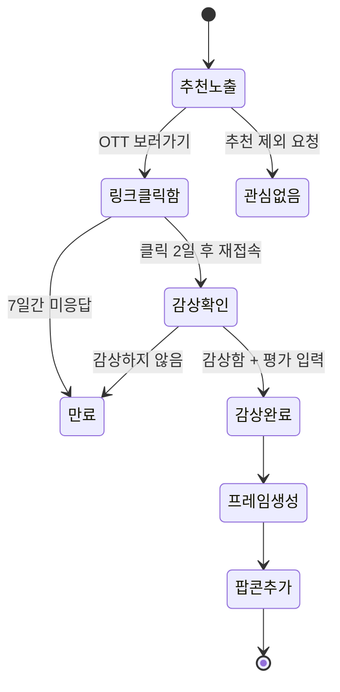

> `관심없음`은 평가가 아니므로 평점 테이블에 저장하지 않으나 추천 로직에는 반영한다.
> `만료`는 신호로 활용하지 않는다.

---

## 5. 화면 설계

와이어프레임은 29개 화면으로 구성한다. 아래는 주요 화면이며 전체 목록은 이어지는 표에 있다.

- 원본 목업: [frontend/docs/FEELM-UI-Mockup.html](./frontend/docs/FEELM-UI-Mockup.html) — 클론 후 브라우저로 연다
- 전체 캔버스 한 장 보기: [00-overview.png](./frontend/docs/images/00-overview.png)

### 온보딩과 초기 취향

| ① 앱 홈 | ④ 취향 초기 설정 | ④-1 OTT 설정 | ⑤ 초기 결과 추천 |
| --- | --- | --- | --- |
| 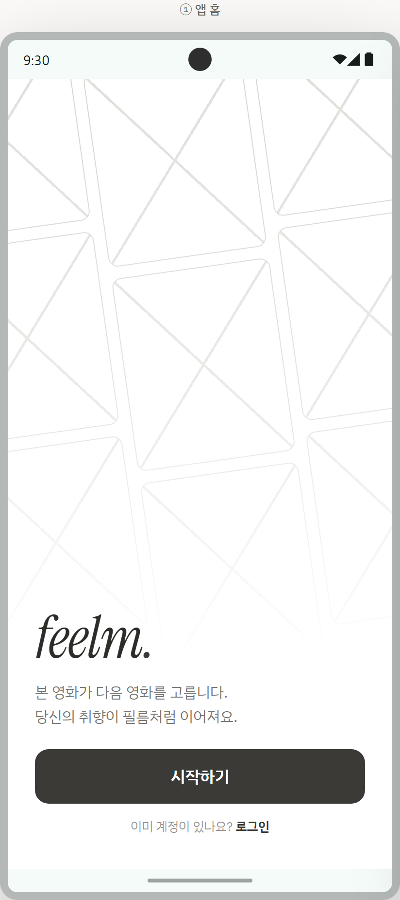 | 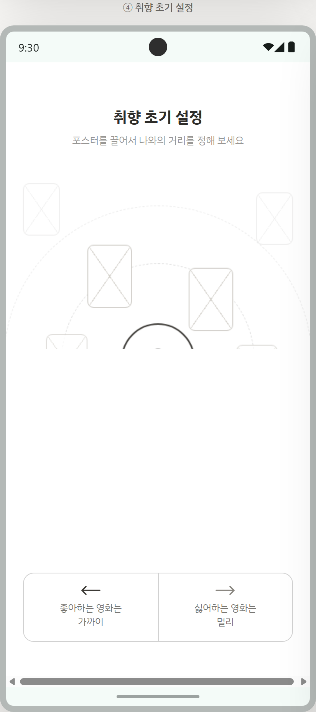 | 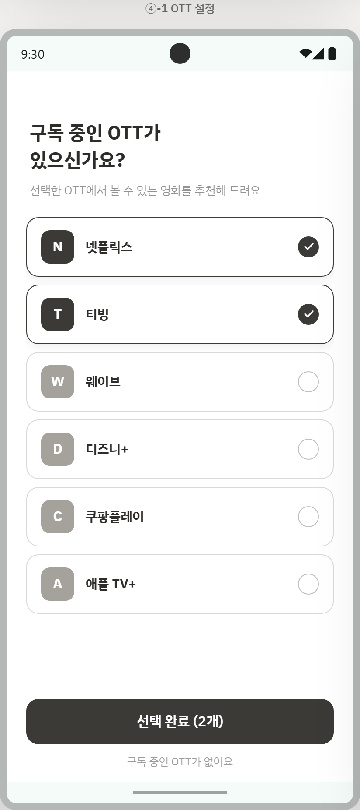 |  |

### 추천과 감상 기록

| ⑥ 취향 맞춤·확장 추천 | ⑥-2 영화 상세 | ⑥-4 평가 | ⑥-5 필름에 기입 |
| --- | --- | --- | --- |
| 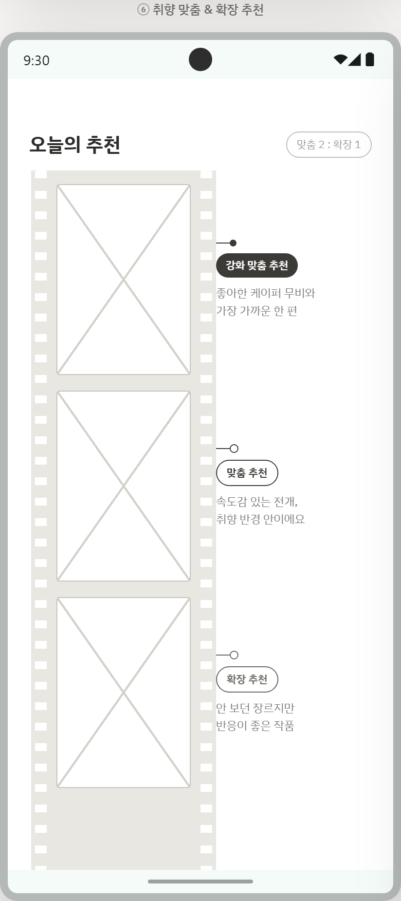 | 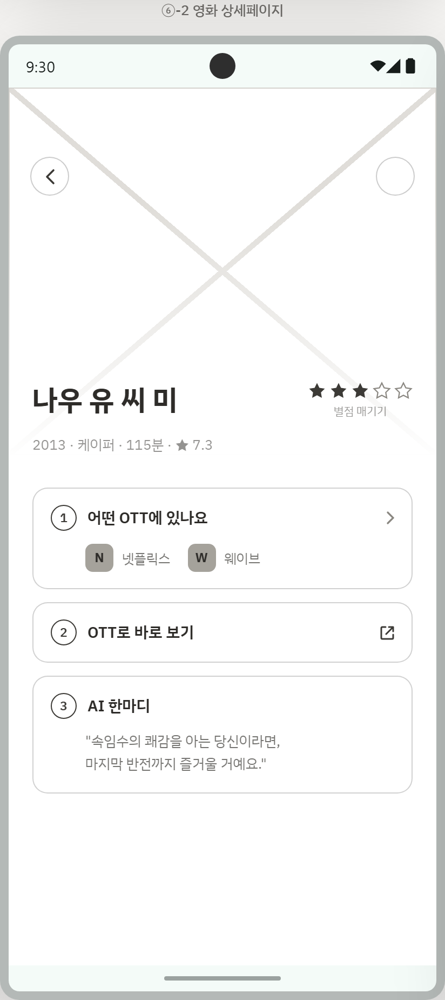 | 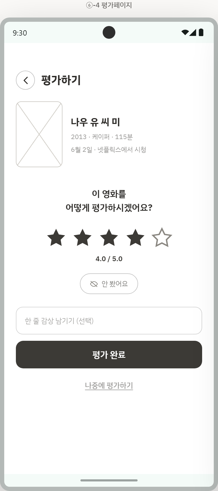 | 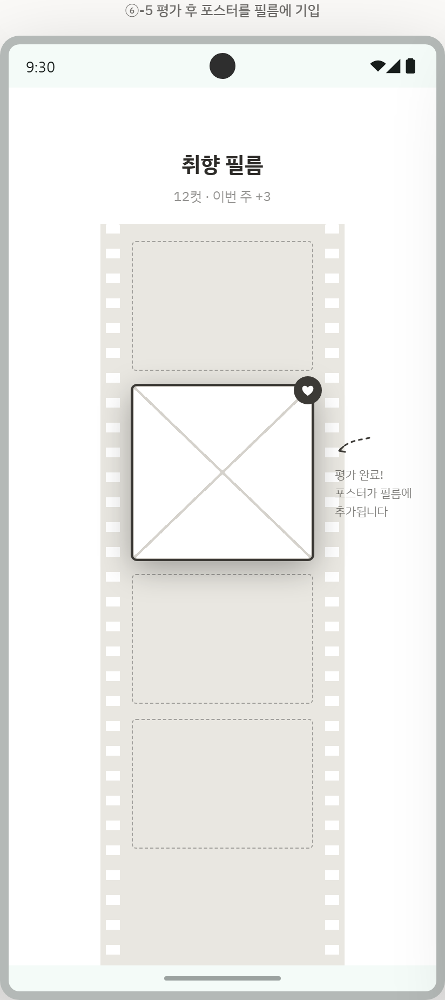 |

### 취향 시각화와 파티

| ⑨ 팝콘 버킷 | ⑦ 취향 리포트 | ⑧ 파티 모드 | ⑪ 프로필 대시보드 |
| --- | --- | --- | --- |
| 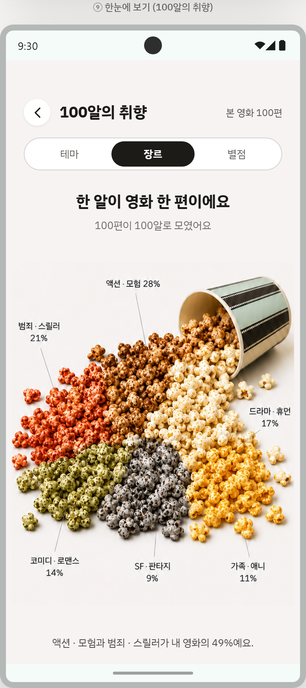 | 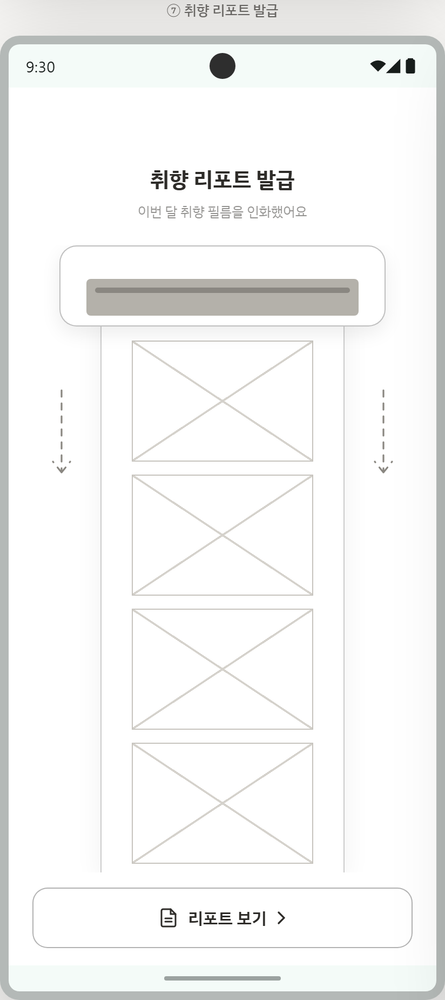 | 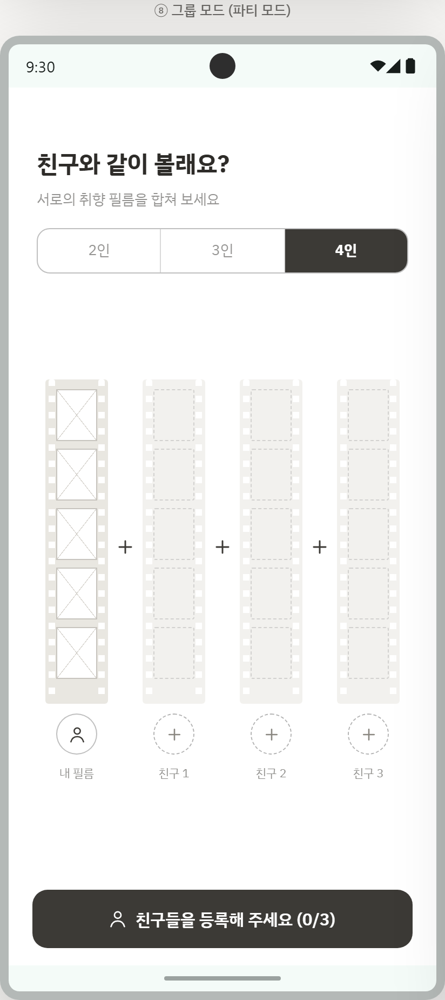 | 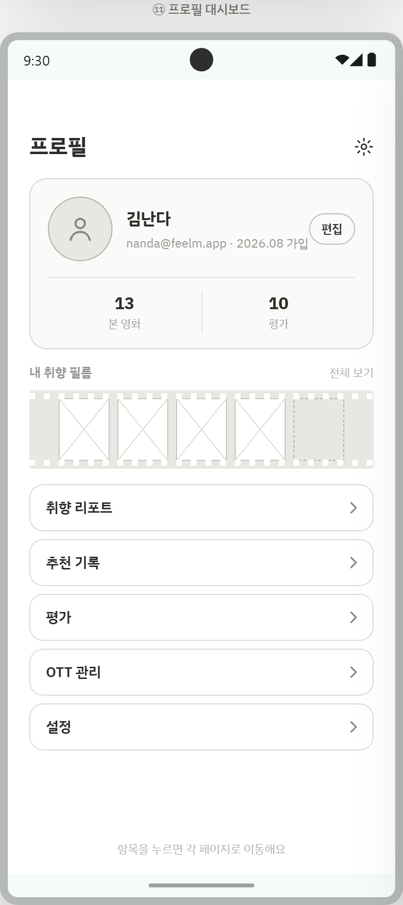 |

### 전체 화면 목록

| 화면 | 이미지 | 화면 | 이미지 |
| --- | --- | --- | --- |
| ① 앱 홈 | [01](./frontend/docs/images/01-home.png) | ⑦ 취향 리포트 발급 | [15](./frontend/docs/images/15-report-issue.png) |
| ② 회원가입 | [02](./frontend/docs/images/02-signup.png) | ⑦-1 취향 리포트 상세 | [16](./frontend/docs/images/16-report-detail.png) |
| ③ 회원가입 완료 | [03](./frontend/docs/images/03-signup-done.png) | ⑧ 파티 모드 | [17](./frontend/docs/images/17-party-mode.png) |
| ⑫ 로그인 | [04](./frontend/docs/images/04-login.png) | ⑧-1 공통 취향 새 필름 현상 | [18](./frontend/docs/images/18-party-film.png) |
| ④ 취향 초기 설정 | [05](./frontend/docs/images/05-taste-onboarding.png) | ⑨ 한눈에 보기(100알의 취향) | [19](./frontend/docs/images/19-popcorn-bucket.png) |
| ④-1 OTT 설정 | [06](./frontend/docs/images/06-ott-setup.png) | ⑩ 검색 홈 | [20](./frontend/docs/images/20-search-home.png) |
| ⑤ 초기 결과 추천 | [07](./frontend/docs/images/07-initial-recommend.png) | ⑩-1 영화 검색 결과 | [21](./frontend/docs/images/21-search-result.png) |
| ⑥ 취향 맞춤·확장 추천 | [08](./frontend/docs/images/08-recommend-feed.png) | ⑪ 프로필 대시보드 | [22](./frontend/docs/images/22-profile-dashboard.png) |
| ⑥-1 카드 상호작용 | [09](./frontend/docs/images/09-card-interaction.png) | ⑪-1 취향 리포트 | [23](./frontend/docs/images/23-profile-report.png) |
| ⑥-2 영화 상세페이지 | [10](./frontend/docs/images/10-movie-detail.png) | ⑪-1-a 취향 리포트 상세 | [24](./frontend/docs/images/24-profile-report-detail.png) |
| ⑥-3 평가 알림 메시지 | [11](./frontend/docs/images/11-rating-nudge.png) | ⑪-2 추천 기록 | [25](./frontend/docs/images/25-recommend-history.png) |
| ⑥-4 평가페이지 | [12](./frontend/docs/images/12-rating.png) | ⑪-3 평가 | [26](./frontend/docs/images/26-ratings.png) |
| ⑥-5 평가 후 필름에 기입 | [13](./frontend/docs/images/13-frame-added.png) | ⑪-4 평가 안 남긴 영화 | [27](./frontend/docs/images/27-unrated.png) |
| ⑥-6 필름 추가 알림 | [14](./frontend/docs/images/14-frame-alert.png) | ⑪-5 OTT 관리 | [28](./frontend/docs/images/28-ott-manage.png) |
|  |  | ⑪-6 설정 | [29](./frontend/docs/images/29-settings.png) |

> ⑩ 검색 홈과 ⑩-1 영화 검색 결과는 화면 구성이 미정이다.
> 이미지는 목업 원본에서 캡처한 결과이며 목업이 갱신되면 다시 캡처해 교체한다.

---

## 6. 활용 데이터

| 데이터 | 활용 |
| --- | --- |
| [MovieLens 32M](https://grouplens.org/datasets/movielens/) | 사용자-영화 평점 기반 취향 분석 및 ALS 학습 |
| [TMDb API](https://developer.themoviedb.org/) | 포스터·줄거리·감독·배우·국가·키워드 등 영화 메타데이터 |
| [IMDb Dataset](https://developer.imdb.com/non-commercial-datasets/) | 감독·배우·연도 등 추가 메타데이터 |

### MovieLens 32M 규모

| 항목 | 규모 |
| --- | --- |
| 평점 | 약 3,200만 건 |
| 사용자 | 약 20만 명 |
| 영화 | 약 8.7만 편 |
| 태그 | 약 200만 건 |

> MovieLens 사용자와 서비스 사용자는 **완전히 분리**한다. MovieLens 사용자 ID는 학습 원천에만
> 두고 서비스 `user_id`와 연결하지 않으며 영화만 TMDb 링크를 기준으로 매핑한다.
> 서비스 사용자는 평가 기반 **fold-in**으로 벡터를 생성한다.

---

## 7. 시스템 아키텍처

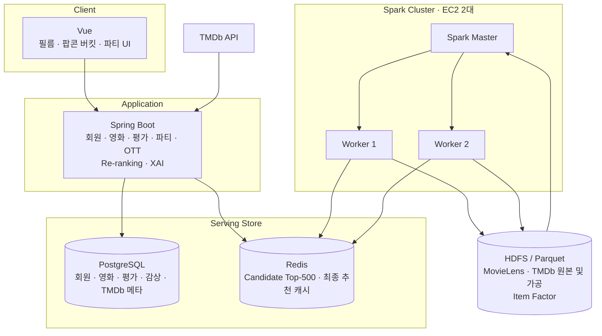

### 컴포넌트 역할

| 컴포넌트 | 역할 |
| --- | --- |
| **Spark / PySpark** | ALS 학습, 데이터 전처리, Candidate 생성 등 무거운 배치 계산 |
| **HDFS / Parquet** | MovieLens·TMDb 원본 및 가공 데이터, Item Factor 저장 |
| **Redis** | 사전 계산한 Candidate와 추천 결과의 빠른 저장·조회 |
| **PostgreSQL** | 사용자·영화·평가 등 영속 데이터 저장 |
| **Spring Boot** | 회원·영화·평가·파티 등 서비스 API 및 추천 결과 전달 |
| **Vue** | 필름·팝콘 버킷·파티 추천 UI |

### 미확정 사항

- **FastAPI 도입 여부는 미정이다.** 위 다이어그램은 FastAPI 없이 Re-ranking과 XAI를 Spring Boot
  또는 Spark 배치가 담당하는 구성이다. FastAPI를 도입하면 Fold-in·Re-ranking·XAI를 Python 계층으로
  분리하고 Spring Boot는 최종 응답만 담당한다.
- 물리 DB와 저장소 제품은 논리 설계 확정 이후 구현 전에 결정한다.
- 리포트 기능의 결과 이미지는 S3 호환 객체 스토리지에 저장하며 로컬·자체 호스팅은 MinIO를 사용할 수 있다.

### Spark 자원 계획

| 항목 | 값 |
| --- | --- |
| EC2 #1 | 8 vCPU / 32GB → Worker 1: 3 Core / 12~14GB |
| EC2 #2 | 8 vCPU / 32GB → Worker 2: 5 Core / 20GB |
| Executor | 2 Core / 8GB |
| EBS | 각 100~200GB SSD |

---

## 8. 추천 파이프라인


### 추천 종류

| 추천 | 방식 |
| --- | --- |
| **취향 맞춤 추천** | ALS와 콘텐츠 기반의 Hybrid로 기존 취향과 가까운 영화를 추천 |
| **취향 발견 추천** | 팝콘 수가 임계치 미만인 새로운 맛 중 선호 가능성이 있는 영화를 추천 |
| **유사 추천** | 영화 상세 화면에서 콘텐츠 특성이 유사한 영화를 추천 |
| **파티 추천** | 파티원 예상 선호도를 평균·최저 만족도·편차 페널티로 결합해 추천 |

> ALS 잠재 벡터 차원은 64 예정이며 Candidate는 사용자별 500편 기준이다.
> 새로운 맛 임계치와 적합도 표기 방식은 확정이 필요하다.

---

## 9. 검증 계획

### 개인 추천

> 사용자가 선호할 영화를 추천 목록 상위에 잘 제시하는가?

| 축 | 지표 |
| --- | --- |
| 알고리즘 | **NDCG@10** — 선호할 영화를 상위에 배치했는지 |
| 알고리즘 | **Recall@10** — 실제 선호 영화 중 얼마나 찾아냈는지 |
| 사용자 | 베타테스트로 추천 결과가 개인 취향과 맞는지 확인 |

### 파티 추천

> 특정 사용자가 크게 불만족하지 않으면서 모두가 함께 만족할 영화를 추천하는가?

비교 후보: `Average` → `Least Misery` → `개선 파티 추천`

| 축 | 지표 |
| --- | --- |
| 알고리즘 | 평균 만족도 유지 또는 상승 |
| 알고리즘 | **최저 만족도 상승** |
| 알고리즘 | **사용자 간 만족도 편차 감소** |
| 사용자 | 실제 파티를 대상으로 추천 결과 만족도 확인 |

### 분산 처리

> 데이터 규모가 커질 때 Spark 분산 처리가 실제 처리 성능을 개선하는가?

데이터 `1M → 10M → 32M`, Worker `1 → 2 → N` 으로 확장하며 측정한다.

| 지표 | 기대 |
| --- | --- |
| 처리 시간 | 감소 |
| Speedup | 증가 |
| Throughput | 증가 |

---

## 10. 기술 스택

| 영역 | 기술 | 상태 |
| --- | --- | --- |
| 분산 저장 | Hadoop HDFS, Parquet | 확정 |
| 분산 처리 | Apache Spark / PySpark | 확정 |
| 추천 | ALS, 콘텐츠 기반, Hybrid | 확정 |
| 파티 추천 | Average / Least Misery / 개선식 | 비교 후 확정 |
| Backend | Spring Boot | 확정 |
| 추천 서빙 | FastAPI | **미정** |
| DB | PostgreSQL | 확정 |
| Cache | Redis | 확정 |
| Frontend | Vue | 확정 |
| 영화 정보 | TMDb API | 확정 |
| 객체 스토리지 | S3 호환 스토리지 / MinIO | 리포트 기능 시점 |
| Infra | AWS EC2 2대 | 확정 |
| 협업 | GitLab, Jira, Notion | 확정 |

---

## 11. 저장소 구조

```text
S15P21E106
├── backend/          Spring Boot 서비스 API
├── frontend/         Vue 웹 클라이언트
│   └── docs/         와이어프레임 목업과 화면 캡처
├── recommendation/   추천 알고리즘 및 Spark 배치 코드
├── data/             데이터 수집·전처리 및 데이터셋 관리
├── infra/            인프라 구성과 배포 자료
├── scripts/          운영 스크립트
│   └── jira/         Jira 업무 생성 자동화
├── tests/            자동화 스크립트 테스트
├── docs/             협업 규칙 및 설계 문서
├── AGENTS.md         AI 코딩 도구 기본 규칙
└── CLAUDE.md         Claude Code 진입 문서
```

각 디렉터리의 세부 규칙은 해당 디렉터리의 `README.md`를 따른다.

---

## 12. 개발·협업 환경

| 문서 | 내용 |
| --- | --- |
| [Git 컨벤션](./docs/git-convention.md) | 브랜치 전략, 커밋 메시지, MR 규칙 |
| [Jira-GitLab 개발 흐름](./docs/development-workflow.md) | 업무 생성부터 병합까지의 작업 절차 |
| [AI 병렬 작업 및 충돌 방지 규칙](./docs/ai-collaboration.md) | 여러 작업자와 AI의 동시 작업 시 충돌 예방 |
| [Secret 및 환경변수 관리 규칙](./docs/secret-environment-variables.md) | 자격 증명과 환경변수 취급 기준 |
| [Jira 업무 생성 자동화](./docs/jira/README.md) | 계획 YAML 기반 Jira 이슈 생성 |

### 기본 원칙

- 하나의 브랜치에는 **하나의 Jira 업무 항목**만 포함한다.
- 작업 브랜치는 최신 `develop`에서 생성하고 브랜치 이름에 **Jira Issue Key**를 포함한다.
- `main`과 `develop`에는 직접 Push하지 않고 Merge Request로만 병합한다.
- API 계약, DB Schema, 공통 타입, 환경 변수, 인프라·보안 정책은 임의로 결정하지 않는다.
- 최종 승인과 병합은 사람이 판단한다.
- AI 코딩 도구는 작업 전에 루트의 [AGENTS.md](./AGENTS.md)를 확인한다.

---

## 13. 실행 방법

> 서비스 애플리케이션은 설계 단계이며 실행 절차는 구현 착수 시점에 추가한다.
> 현재 저장소에서 실행할 수 있는 것은 Jira 업무 생성 자동화 스크립트다.

### Jira 업무 생성 자동화

```bash
python -m venv .venv
python -m pip install -r scripts/jira/requirements.txt

cp .env.example .env   # JIRA_BASE_URL, JIRA_PROJECT_KEY, JIRA_EMAIL, JIRA_API_TOKEN 입력
python scripts/jira/create_issues.py --check
python scripts/jira/create_issues.py --file docs/jira/plans/example.yml
```

기본 실행은 미리보기이며 `--apply`를 명시한 경우에만 Jira를 변경한다. `.env`와 실제 자격 증명은
Git에 추가하지 않는다. 자세한 사용법은 [docs/jira/README.md](./docs/jira/README.md)를 참고한다.

### 테스트

```bash
python -m pytest tests
```

---

## 14. 산출물 문서

| 산출물 | 상태 |
| --- | --- |
| 요구사항 정의서 | 검토 중 |
| 최종 요구사항 정의서 | 작성 중 |
| 데이터 저장 정책 및 논리 ERD | 검토 중 · 물리 DB는 구현 전 확정 |
| API 설계(OpenAPI/Swagger) | 진행 중 |
| 와이어프레임 | 29개 화면 · [화면 설계](#5-화면-설계) 참고 · 검색 화면 미정 |
| 추천 구조 설계 | 검토 중 · FastAPI 도입 여부 미정 |

기획과 설계 원본은 팀 Notion에서 관리하며, 확정된 계약과 규칙은 이 저장소의 `docs/`에 반영한다.

---

## 15. 팀 구성 및 역할

| 이름 | 담당 |
| --- | --- |
| 조은채 | 빅데이터 분산처리·최적화, Spark 추천 로직, 인프라·분산 DB |
| 서유정 | 빅데이터 분산 처리 |
| 박찬형 | 빅데이터 추천 로직 개선, AI |
| 강현 | 백엔드 추천 결과 서빙, 행동 데이터 연동 |
| 박시현 | 백엔드 평가·기록·필름 반영 |
| 김서현 | 백엔드 감상·평가 상태 관리 및 추천 연동 |
| 박은서 | 프론트엔드, UI/UX 디자인 |

### 초기 단계 분담

| 작업 | 담당 |
| --- | --- |
| 인프라, 분산 DB | 조은채 |
| 요구사항 정의 | 강현, 김서현, 박시현, 서유정 |
| 와이어프레임 | 박은서, 박찬형 |

### 이후 단계 분담

| 작업 | 담당 |
| --- | --- |
| 추천 알고리즘, Explainable AI | 강현, 박찬형, 조은채 |
| 백엔드·프론트엔드 기능별 개발 | 박시현, 김서현, 서유정 |
| 메인 화면 프론트엔드, 디자인 | 박은서 |
