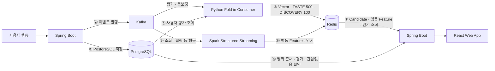

# 이벤트·Redis 계약 — Spring Boot ↔ Python Consumer ↔ Spark Structured Streaming

[ADR-0017](../adr/0017-python-foldin-spark-trending-split.md)에 따라 사용자 단위 Fold-in과 전역 인기 집계를
각각 Python Consumer와 Spark Structured Streaming으로 분리합니다. 이 문서는 Spring Boot, Python Consumer와
Spark가 주고받는 **Kafka 이벤트 스키마와 Redis 키 구조**의 계약 기준 문서입니다.

**클라이언트에 공개되는 API가 아니며**, 공개 계약은 [API 명세](./README.md)를 따릅니다.

> ADR-0012 시절의 [내부 API 명세](./internal.md)(Spring ↔ FastAPI)를 대체합니다. 해당 문서의 `inputVersion` 신호 분류,
> 세트 버퍼 운영, 장애 격리 기준은 이 문서에 계승했습니다.

## 1. 전체 흐름



**①이 ②보다 먼저**여야 합니다. 순서가 바뀌면 Python Consumer가 ③에서 조회할 때 방금 저장한 평가가 보이지 않습니다.
Python Consumer는 ④에서 `vector`·`candidates`와 version 키를 원자적으로 갱신합니다.

## 2. 책임 경계

| 항목 | 주체 | 근거 |
|---|---|---|
| 사용자 행동 이벤트 발행 | Spring Boot | PostgreSQL 저장 성공 후 발행 |
| Candidate 게시 완료 알림 발행 | Python Consumer | Redis 원자 게시와 Kafka 확인 이후 원본 Offset 커밋 |
| Fold-in · User Vector 계산 | Python Consumer | ADR-0017 |
| TASTE 최대 500편 · DISCOVERY 최대 100편 갱신 | Python Consumer | ADR-0017, S15P21E106-415 |
| 행동 Feature 집계 | Spark Streaming | ADR-0017 |
| 전역 인기 영화 윈도우 집계 | Spark Streaming | FR-27, ADR-0017 |
| **후보 점수 정렬 · 결정적 동점 셔플** | **Spring Boot** | 추천시스템 점수에 행동 가중치를 다시 적용하지 않음 |
| **서비스 DB 미존재 · 평가 · 관심없음 제외 필터** | **Spring Boot** | 아래 2.1 |
| 구조화 추천 근거 원본 저장 | Spring Boot | Consumer의 `reasons[]`를 세트 항목에 스냅샷 |
| 세트 버퍼 저장 · 노출 | Spring Boot | API-045 처리 규칙, `recommendation_items` |
| 파티 raw Candidate 계산 | Spark Structured Streaming | `feelm.party-refresh.v1` 입력을 계산해 Redis에 게시 |
| 파티 추천 최종 재정렬 · OTT 구독 추천 집계 | Spring Boot | 파티 raw Candidate와 사용자별 Redis `candidates`를 각각 사용 |
| 유사 영화 조회 · 취향 분석 집계 | Spring Boot | ADR-0017 |

### 2.1 제외 필터를 Spring이 담당하는 이유

Spring은 서비스 DB에 없는 영화, 평가한 영화와 관심없음 영화를 최종 후보에서 제외합니다.
감상·OTT 클릭 이력은 제외나 재가중에 사용하지 않습니다.

Spark가 미리 제외하려면 제외 목록의 복제본을 상태로 유지해야 하며, 다음 문제가 생깁니다.

- Streaming 지연 중에는 방금 평가·관심없음 처리한 영화가 추천에 그대로 노출된다
- 원본과 복제본이 어긋날 때 판정 기준이 필요하다
- Checkpoint 유실 시 제외 목록이 통째로 사라져 이미 본 영화가 다시 추천된다

제외는 순위를 바꾸지 않고 항목만 덜어내므로, 제외 위치를 옮겨도 추천 품질은 달라지지 않습니다.
**추천 품질에 기여하는 관심없음 신호는 추천시스템이 반영**하고,
**최종 평가·관심없음 노출 필터는 Spring이 조회 시점에 적용**합니다.

### 2.2 Python Consumer가 PostgreSQL을 직접 조회하는 범위

Fold-in은 사용자의 평가 전체를 입력으로 하며, Python Consumer는 이를 **읽기 전용 롤**로 PostgreSQL에서 조회합니다.

- 대상: `ratings`(`user_id`, `movie_id`, `score`), `onboarding_preferences`(`user_id`, `movie_id`, `preference`),
  `watch_records`의 확정 감상 상태, `user_movie_dismissals`. DISCOVERY 그룹은 PostgreSQL의
  `representative_flavor_id`가 아니라 같은 세대의 immutable `group-serving-artifacts-v1`에서 읽는다
- 쓰기 권한을 부여하지 않으며 서비스 테이블을 갱신하지 않는다
- 이벤트의 `movieId`·`score`는 로깅·디버깅용 참고값이며 계산에는 조회 결과를 사용한다
- 평가·온보딩 이벤트마다 현재 평가·온보딩을 repeatable-read snapshot으로 다시 읽는다. DISCOVERY
  산출물을 활성화한 경우 확정 감상·관심없음도 같은 snapshot에서 읽는다. 재전달된 이벤트도 같은
  PostgreSQL 상태와 같은 산출물 revision이면 같은 결과를 계산하며, 이벤트 payload의 과거 값으로
  현재 상태를 덮어쓰지 않는다

이 경계는 [내부 API 명세](./internal.md)에서 합의한 "pgvector 읽기 전용 롤 직접 조회" 패턴을 `ratings`까지 넓힌 것입니다.

#### 후보 메타데이터의 출처

Consumer 후보에는 영화 표시용 메타데이터를 넣지 않고 구조화된 `reasons[]`만 전달합니다. Spring은 영화
제목과 장르 등 사용자 표시용 정보를 PostgreSQL 원본에서 조회합니다.

| 데이터 | 출처 | 이유 |
|---|---|---|
| 영화 대표 맛(`representative_flavor_code`) | **HDFS immutable movie metadata snapshot** | 후보와 같은 artifact revision으로 읽는다 |
| 영화별 OTT 제공처·사용자 클릭 | **PostgreSQL** | `movie_ott_providers`·`otts`·`watch_records`가 원본이며 Spring이 재정렬 시 조회한다 |

`TASTE`는 사용자의 평가·온보딩 선호를 Fold-in에 반영한 기본 순위 최대 500편이다. `DISCOVERY`는
`group-serving-artifacts-v1`의 고정 8×128 영화 그룹으로 만드는 별도 순위다. 상위 `taste_id` 0~7은
`FLAVOR_A`~`FLAVOR_H`와 대응하지만, 저이력·신규성 판정과 후보 선발은 내부 `child_id`·`group_id`
기준이며 공개 팝콘 수를 사용하지 않는다.
사용자가 평가하거나 확정 감상한 매핑 영화 중 그룹별 이력이 2편 이하이면서 전체 매핑 감상의 20%
이하인 그룹만 대상으로 한다. 평가 영화가 속한 고정 그룹 대표로 사용자 방향을 만들고, 방향이 없으면
온보딩의 `LIKE 대표 합 - DISLIKE 대표 합`을 사용한다. 방향과 그룹 대표의 내림차순 내적으로 공급
그룹을 정렬한다. 먼저 상위 10개 그룹에서 그룹별 10편을 모집하고, 100편이 모자라면 다음 적격
그룹을 탐색한 뒤 모든 적격 그룹의 최초 10편을 사용해도 부족할 때 그룹별 11번째 이후 후보를
모집한다. 모집된 전체 최대 100편만 현재 개인 점수로 최종 정렬해 게시한다.
`taste`와 `discovery`는 독립 순위이므로 서로 같은 영화가 있을 수 있으며 Spring이 TASTE 2편을
먼저 예약한 뒤 DISCOVERY의 공통 중복을 건너뛴다.

#### 구현·운영 책임 경계

- S15P21E106-415: Consumer의 DISCOVERY 후보 생성과 로컬 정책 검증
- S15P21E106-471: Redis Candidate v3 `taste`/`discovery` 그룹화와 `generationId` writer 기준선
- S15P21E106-481: TASTE 후보별 구조화 `reasons[]`를 추가한 Candidate v4 writer·payload 기준선
- S15P21E106-488: 전체 평가 또는 온보딩 이력으로 계산한 저이력 그룹 적합도·상위 기여 비율을
  DISCOVERY 전용 `reasons[]` 원소로 추가한 Candidate v5 writer·payload 기준선
- S15P21E106-505: 입력 수 제한 제거, TASTE 500·DISCOVERY 100 후보 게시와 그룹 부족분 보충,
  `DISCOVERY_PERSONAL_SCORE`를 추가한 현재 Candidate v6 writer·payload 계약. Spring reader·조립은
  Backend 소비 계약
- S15P21E106-482: 그룹·그룹 내부 대중성 번들의 HDFS 게시, 두 URI 활성화와 rollback 검증
- S15P21E106-483: 개인 후보 보충 순서를 개선하고 후보 모집단 밖까지 확장하는 별도 POPULAR fallback.
  `discovery-popularity`와 다른 산출물

맛 배정은 439의 고정 131차원 전처리와 `top_centers`를 사용합니다(ADR-0020). 신규 영화는
`top_x=L2(concat(g,0×k,0×t))`와 고정 중심의 거리로 배정하며 fit이나 estimator `predict`를 하지
않습니다. `group_mapped=true`일 때만 `movies.representative_flavor_id`에 저장합니다. 배치 스냅샷과
PostgreSQL 집계는 동일한 `FLAVOR_A`~`FLAVOR_H` 체계를 사용합니다.

- 배치 스냅샷의 신선도는 하루이며, 신규 영화는 다음 야간 배치 이후 추천 대상이 된다
- `movies` · `genres` · `movie_genres` · `popcorn_flavors`는 Python Consumer와 Spark가 PG에서 직접 조회하지 않는다

#### 매번 전체를 재계산해도 되는 이유

Fold-in은 Spark ALS-WR 정규화와 같은 `x = (Σ yᵢyᵢᵀ + λmI)⁻¹ (Σ rᵢyᵢ)` 이며,
`m`은 Factor를 가진 입력 수입니다. A와 B가 모두 합이므로 증분 누적도 가능합니다.
그러나 누적값을 별도 저장소나 Streaming 상태로 유지해야 하고, 평가 수정·삭제 시 이전 값 차감,
재학습 시 무효화, 중복 이벤트에 대한 이중 반영 방지가 각각 필요합니다.

전체 재계산을 선택한 이유는 절약되는 비용이 크지 않기 때문입니다. 참고 측정값(단일 노드 numpy, `k=64`,
영화 87,000편 기준이며 EC2 실측이 아님)은 다음과 같습니다.

| 단계 | 평가 500편 | 평가 수에 비례 |
|---|---|---|
| Fold-in 재계산(A·b + 선형 풀이) | 약 0.12ms | 비례하나 미미 |
| 후보 전체 점수 계산 | 약 0.63ms | 무관(고정) |
| Top-500 추출 | 약 0.30ms | 무관(고정) |

지배적인 비용은 사용자 벡터가 바뀔 때마다 어차피 수행해야 하는 후보 점수 계산이며, 증분 방식으로
절약되는 부분은 전체의 10% 미만입니다. 실제로는 Structured Streaming의 micro-batch 고정 오버헤드가
이보다 훨씬 크므로, 상태를 두지 않는 단순한 구조를 우선합니다.

## 3. 공통 규약

- 직렬화: JSON UTF-8. 키는 camelCase, 열거형은 UPPER_SNAKE_CASE — 공개 API 규약과 동일
- 시각: ISO 8601 UTC 문자열. 예 `2026-08-31T07:21:00Z`
- 식별자: 64bit 정수. `movieId`는 **서비스 DB 영화 ID**이며 MovieLens ID는 모델 내부 매핑에만 사용한다(S15P21E106-118)
- Topic 이름: `feelm.<이벤트>.v1`. 계약이 깨지는 변경만 `v2`를 병행했다가 이전 버전을 제거한다
- 파티션 키: 사용자 단위 이벤트는 `userId`. 같은 Topic의 같은 Partition 안에서 Kafka에 실제 기록된 순서를 보장한다
- Redis 키 이름: `feelm:<대상>:<식별자>:<용도>`
- Consumer Group: Python Fold-in과 Spark Streaming은 서로 다른 Group을 사용하며 Offset·Checkpoint를 공유하지 않는다

## 4. Kafka 이벤트

### 4.1 Topic 목록

| Topic | eventType | 발행 시점 | 처리 | 신호 |
|---|---|---|---|---|
| `feelm.rating.v1` | `RATING` | 별점 등록·수정·삭제 | Fold-in → TASTE 최대 500편·DISCOVERY 최대 100편 | 강함 |
| `feelm.rating.v1` | `ONBOARDING` | 초기 취향 제출(API-024) | 위와 동일 | 강함 |
| `feelm.dismiss.v1` | `DISMISS` | 관심없음(API-047) | 부정 신호로 점수 반영 | 중간 |
| `feelm.view.v1` | `VIEW` | 영화 상세 조회 | 행동 Feature · 전역 인기 집계 | 약함 |
| `feelm.recommendation-click.v1` | `RECOMMENDATION_CLICK` | 추천 카드 클릭 | 행동 Feature 집계 | 약함 |
| `feelm.ott-click.v1` | `OTT_CLICK` | 보러가기 클릭(API-033) | 행동 Feature 집계 | 약함 |
| `feelm.candidate-updated.v1` | 토픽 자체가 Candidate 갱신을 표시 | Python Consumer의 Redis Candidate 게시 성공 직후 | Spring이 관련 파티 갱신을 시작할 때 사용할 알림 | 게시 완료 |
| `feelm.party-refresh.v1` | 토픽 자체가 파티 입력 갱신을 표시 | 파티 구성 또는 개인 Candidate 갱신 후 Spring 발행 | Spark가 파티 raw Candidate를 Redis에 게시 | 강함 |

별점 등록이 감상을 의미하므로 별도의 감상 이벤트는 두지 않습니다. 감상 기록 자체는 Spring이 PostgreSQL에서 직접 사용합니다.

### 4.2 공통 봉투

사용자 행동 이벤트는 같은 봉투 구조를 사용합니다. Candidate 게시 완료 알림은 §4.3의 전용 최소 형식을 사용합니다.

```json
{
  "eventId": "0f3c9a1e-6b2d-4f77-9a10-5c2b8e41d0aa",
  "eventType": "RATING",
  "occurredAt": "2026-08-31T07:21:00Z",
  "userId": 1024,
  "payload": {}
}
```

| 필드 | 타입 | 설명 |
|---|---|---|
| `eventId` | string(UUID) | 발행 시 1회 생성. **멱등 처리 기준** |
| `eventType` | enum | 4.1의 값 |
| `occurredAt` | string | 사용자 행동 시각(UTC) |
| `userId` | number | 파티션 키와 동일 |
| `payload` | object | 이벤트별 본문 |

### 4.3 이벤트별 payload

**`RATING`**

```json
{ "action": "CREATE", "movieId": 550, "score": 4.5 }
```

- `action`: `CREATE` / `UPDATE` / `DELETE`. `DELETE`는 `score`를 생략한다
- `CREATE`·`UPDATE`의 `score`는 API-036과 같은 0.5~5.0점, 0.5점 단위의 JSON 숫자다. DB 조회·이벤트 직렬화·Fold-in 입력에서 정수로 절삭하지 않는다
- Python Consumer는 `action`을 계산에 사용하지 않고 로깅에만 사용한다. 어떤 값이든 처리는 "해당 사용자 Fold-in 재계산"으로 동일하다

**`ONBOARDING`**

```json
{ "preferenceCount": 12 }
```

- 개별 선택 내용은 싣지 않는다. Python Consumer가 `onboarding_preferences`를 조회한다

**`DISMISS`**

```json
{ "movieId": 550, "recommendationItemId": 3301 }
```

- 노출 제외 용도가 아니라 **점수 감점 신호**다. 제외는 Spring이 `user_movie_dismissals`로 처리한다

**`VIEW`**

```json
{ "movieId": 550, "dwellMs": 8200 }
```

- `dwellMs`는 선택. 측정하지 않으면 생략한다

**`RECOMMENDATION_CLICK`**

```json
{ "movieId": 550, "recommendationItemId": 3301, "recommendationSetId": 7001, "position": 2 }
```

**`OTT_CLICK`**

```json
{ "movieId": 550, "ottId": 1, "watchRecordId": 5501 }
```

**Candidate 게시 완료 알림 — `feelm.candidate-updated.v1`**

```json
{ "userId": 1024 }
```

- Kafka 키는 `userId`의 UTF-8 십진 문자열(예: `"1024"`), 값은 위 JSON이다. `null` 값·빈 payload·공통 봉투를 사용하지 않는다.
- Python Consumer가 `vector`·`candidates`의 원자 게시에 성공한 뒤 발행한다. Kafka 수신 자체가 후보 갱신 알림이며 `occurredAt`을 비교하지 않는다.
- 알림은 중복되거나 더 새 Candidate 게시 뒤 도착할 수 있다. Spring은 관련 활성 파티별 지속성 있는 refresh 요청을 DB에 저장한 뒤 수신 offset을 확정한다. 대기 중 중복 요청은 파티별로 합친다. 처리 작업자는 현재 Redis 값을 다시 읽고, 파티원별 `vector`·`candidates`를 한 번의 Redis 읽기로 가져와 두 값의 `generationId`·`modelVersion` 일치를 확인한다.
- Spring은 이 최신 전체 입력으로 `feelm.party-refresh.v1` 이벤트를 만든다. 벡터와 후보 목록은 Candidate 게시 완료 알림에 싣지 않는다. 파티 구성 변경 때도 같은 DB 요청을 저장한다. Redis 장애나 불완전 입력은 요청을 남겨 재시도하며 파티 API를 실패시키지 않는다. 종료된 파티의 요청은 계산 이벤트 없이 정리한다.

**파티 입력 갱신 — `feelm.party-refresh.v1`**

```json
{
  "partyId": 9001,
  "inputId": "sha256:<party-snapshot-digest>",
  "members": [
    {"userId": 1024, "vector": [0.1, 0.2], "candidateMovieIds": [550, 807]}
  ]
}
```

- Kafka 키는 `partyId`를 Kafka `LongSerializer`로 직렬화한 8바이트 정수다. 값은 위 전용 JSON이며 공통 사용자 이벤트 봉투를 사용하지 않는다. 멤버는 1~4명, `userId` 오름차순이고 `candidateMovieIds`는 사용자 선호 순서의 중복 없는 최대 600개다. 빈 vector는 허용한다.
- Spring은 각 파티원의 Redis vector·candidates를 한 번에 읽어 같은 `generationId`·`modelVersion`인지 확인한다. 모든 파티원 모델 버전이 현재 Spark SERVING 모델과 같을 때만 발행한다.
- `inputId`는 Spring이 `partyId`, 모델 버전, 정렬된 파티원 `userId`·`generationId`에서 결정적으로 만든 식별자다. Spark는 이를 그대로 결과에 돌려주고 자신이 로드한 `modelVersion`도 기록한다. Spring은 결과를 사용할 때 현재 파티 구성·사용자 세대로 `inputId`를 다시 만들고 결과의 모델 버전도 현재 모델과 비교한다.
- Kafka 이벤트에는 `modelVersion`과 파티원별 `generationId`를 싣지 않는다. 모델 교체 중에는 새 모델의 입력을 이전 Spark 작업에 보내지 않도록 배포 순서를 조정한다.
- 파티별 대기 요청은 하나로 합치되, 처리 완료 후 같은 `inputId`가 다시 발행될 수 있다. Spark는 해당 파티 Redis 값을 원자적으로 교체하며 Spring은 조회 시 현재 `inputId`와 모델 버전을 다시 비교한다.
- 파티 refresh 아웃박스는 같은 파티의 앞선 이벤트가 Kafka에 기록되고 `PUBLISHED`로 확정될 때까지 후속 이벤트를 발행하지 않는다. 다른 파티와 사용자 이벤트의 발행은 계속한다. 현재 Spark 파티 작업은 배치 내부 offset 정렬을 하지 않으므로 배포 시 `--max-records-per-trigger 1`로 배치당 입력을 한 건으로 제한한다. Kafka 순서대로 Redis 결과가 게시되는지 연동 검증한다.

### 4.4 멱등 처리와 재처리

Kafka는 장애 상황에서 같은 메시지를 두 번 전달할 수 있습니다(at-least-once). 신호 종류별로 기준이 다릅니다.

| 신호 | 멱등 방식 |
|---|---|
| `RATING` · `ONBOARDING` | **자연 멱등.** Python Consumer가 PostgreSQL을 다시 읽어 전체를 재계산하므로 몇 번 처리해도 결과가 같다 |
| `DISMISS` · `VIEW` · `RECOMMENDATION_CLICK` · `OTT_CLICK` | 누적 집계라 중복 시 값이 부풀어 오른다. `eventId` 기준 중복 제거를 적용한다 |
| `feelm.candidate-updated.v1` 알림 | 상태 갱신 알림이다. Spring이 현재 Redis 세대와 마지막 처리 세대를 비교해 중복 재계산을 줄일 수 있다 |

- 중복 제거는 Structured Streaming의 watermark 기반 `dropDuplicates(["eventId"])`로 처리한다
- 중복 판정 창은 설정값(기본 10분). 창을 벗어난 재처리는 약한 신호 Feature가 소폭 부풀 수 있으나 허용한다
- Python Consumer의 재시작 위치는 전용 Consumer Group Offset으로, Spark의 재시작 위치는 전용 Checkpoint로 각각 보존한다(ADR-0017)
- Python Consumer가 연속된 같은 `userId`의 `RATING`을 함께 가져오면 `userId`로 묶어 마지막 DB 상태 기준 1회만 계산할 수 있다

Python Consumer는 **Redis `vector`·`candidates` 기록과 Candidate 게시 완료 알림의 Kafka 전달 확인이 모두 성공한 뒤**
원본 `RATING`/`ONBOARDING` Offset을 커밋합니다. 중간 실패로 재시도되면 같은 DB 상태를 다시 읽고
새 `generationId`로 게시할 수 있으므로 완료 알림은 at-least-once로 취급합니다.

### 4.5 순서 보장

- 파티션 키가 `userId`이므로 같은 Topic에서 한 사용자의 이벤트는 같은 Partition에 기록된다
- Kafka는 해당 Partition에 Producer가 실제로 기록한 순서를 유지하지만, [ADR-0018](../adr/0018-polling-transactional-outbox.md)의
  독립 재시도로 인해 사건 발생 순서와 실제 발행·도착 순서는 달라질 수 있다
- 서로 다른 Topic 또는 사용자 사이의 순서는 보장하지 않으며 필요하지도 않다
- Consumer는 도착 순서만으로 최신 상태를 판단하지 않는다. 강한 신호는 PostgreSQL 최신 상태를 다시 읽고,
  시간 기준이 필요한 신호는 `occurredAt`을 사용한다
- Spring은 PostgreSQL 커밋 성공 후 발행한다. 커밋 실패 시 발행하지 않는다

> 장기 지연된 약한 신호가 Spark watermark 밖으로 밀리거나 중복 판정 창을 벗어나 재발행될 수
> 있다. 영구 유실 방지를 우선해 이를 허용하며, 구체적인 허용 지연과 중복 판정 창은 실측 후 조정한다.

### 4.6 Candidate 갱신과 Spring 서빙 재정렬

강한 신호의 최종 경로는 다음 순서로 고정합니다.

1. Spring이 `RATING` 또는 `ONBOARDING`을 발행한다.
2. Python Consumer가 PostgreSQL을 다시 읽어 User Vector와 후보를 재계산한다.
3. Python Consumer가 ALS·콘텐츠 지원 범위별 백분위를 결합한 TASTE 최대 500편을 만들고, 그룹 산출물을
   활성화한 경우 DISCOVERY 최대 100편도 만든다. Spring은 서비스 DB 미존재·평가·관심없음 후보만
   제외하고 종류별 점수 정렬과 동점 결정적 셔플 후 타입별 최대 20편을 독립 저장한다. Consumer의
   구조화 `reasons[]`는 원본 그대로 스냅샷한다.
4. Python Consumer가 `feelm:user:{userId}:candidate-version`, `feelm:user:{userId}:vector`, `feelm:user:{userId}:candidates`을 Lua 스크립트 한 번으로 원자적으로 기록한다. `candidate-version` String은 성공한 게시마다 증가하는 게시 순번이며, `vector`와 `candidates` JSON은 같은 `candidateVersion`(형식 버전)과 `generationId`(한 번의 생성 결과 식별자)를 가진다.

Consumer group에서 partition을 새로 assign받은 Consumer는 먼저 partition별 fencing key에 새 CSPRNG opaque
token을 설치한다. 후보 게시 Lua와 corrupt/partial 3키 복구 Lua는 전달된 token이 현재 key와 일치할 때만
결과를 바꾼다. 따라서 새 소유자가 token을 설치한 뒤 이전 소유자의 늦은 PostgreSQL snapshot은 **Redis
게시·복구 삭제**를 할 수 없다. 이 Redis fence는 Kafka offset commit을 검증하지 않는다. offset commit의
거부는 Kafka group coordinator의 generation에만 의존하며, Consumer는 synchronous commit 실패 시 offset을
커밋하지 않고 재처리한다. 실제 Kafka rebalance에서 old member commit 거부·재처리가 일어나는지는 아직
broker E2E로 검증하지 않았다.

assign의 여러 claim 중 하나라도 Redis 오류가 나면 Consumer는 fail-closed로 종료한다. 성공한 선행 claim은
새 token으로 남을 수 있으나 local ownership·assign·offset commit은 시작하지 않으며, supervisor 재시작 뒤
새 assignment에서 모든 partition을 다시 claim한다.

Spark Streaming은 이 경로에 참여하지 않습니다. Spark는 여러 사용자 행동을 집계해 `behavior`와 전역 인기 결과를 갱신하고,
Spring은 **다음 개인 추천 세트 생성 시** `candidates.taste` 최대 500편과 `candidates.discovery`
최대 100편, 최신 `behavior`를 읽어 제외·경량 가중치 재정렬과 TASTE 2 + DISCOVERY 1 조립을 수행합니다.
약한 신호만으로 현재 세트 버퍼를 무효화하지 않으므로 반영 시점은 Spark 집계 완료 후 사용자의 다음 세트 생성이며,
Python Consumer를 다시 실행하거나 전체 사용자를 주기적으로 재계산하지 않습니다.

Spring은 `candidates` JSON을 한 번 읽어 해당 버전의 후보 전체를 재정렬합니다. 후보 키가 없거나 유효하지 않으면 짧은 재시도 후 `503 RECOMMENDATION_UNAVAILABLE`을 반환합니다. 기존 저장 세트 이력은 변경하지 않습니다.

## 5. Redis 키

### 5.1 키 목록

| 키 | 타입 | 쓰기 | 읽기 | TTL |
|---|---|---|---|---|
| `feelm:user:{userId}:candidate-version` | String(정수) | Python Consumer | Python Consumer | 없음 |
| `feelm:user:{userId}:vector` | String(JSON) | Python Consumer | Python Consumer · Spring(파티 입력 생성) | 없음 |
| `feelm:user:{userId}:candidates` | String(JSON) | Python Consumer | Python Consumer · **Spring** | 없음 |
| `feelm:party:{partyId}:candidates` | String(JSON) | Spark Structured Streaming | Spring | 없음 |
| `feelm:consumer-fence:{groupId}:{topic}:{partition}` | String(opaque CSPRNG token) | Python Consumer | Python Consumer | 없음 |
| `feelm:user:{userId}:behavior` | Hash | Spark | Spark · **Spring** | 키 단위 8일 · 필드는 일자 버킷(5.3) |
| `feelm:model:current` | String(JSON) | Spark Batch | Python Consumer · Spring | 없음 |

**Spring은 개인 추천에 사용자 `candidates` · `behavior` · `model:current`를 읽습니다.** 파티 입력
생성 시 사용자 `vector`·`candidates`를 함께 읽고, 파티 결과에는 별도 파티 `candidates`를 읽습니다.

`consumer-fence`는 Consumer group 안에서 Kafka partition마다 assign할 때 새 CSPRNG opaque token으로 교체하는
fencing key다. Consumer는 결과 게시와 corrupt/partial state 복구 삭제 때 자신이 assign에서 받은 token과
Redis의 현재 token이 Lua 안에서 같은지 검증한다. Spring은 후보 결과만 읽으며 이 내부 key를 읽지 않는다.
fence key가 delete되거나 Redis가 빈 상태로 재시작하면 이전 token은 즉시 거부되고 다음 assign의 token도
이전 token과 재사용되지 않는다. 다만 Redis가 fence key를 포함한 **과거 값으로 복원**되는 장애는 durable
monotonic coordinator 없이는 구별할 수 없으므로 이 계약의 fencing 보장 범위 밖이다.

| Spring이 읽는 키 | 용도 |
|---|---|
| 사용자 `candidates` | 개인 추천 후보 · 파티 Spark 입력 스냅샷 · **OTT 구독 추천**(API-068) |
| 파티 `candidates` | Spark가 계산한 파티 raw Candidate. Spring이 제외·부가 신호를 반영해 최종 재정렬 |
| `behavior` | 새 개인 추천 세트를 만들 때 `candidates`에 적용할 최근 행동 Feature |
| `model:current` | `modelVersion` 확인과 이력 저장 |

Spring은 개인 추천 후보를 재정렬하고, OTT에서는 사용자별 점수를 집계합니다. 파티에서는 Spark가
별도 게시한 raw Candidate를 현재 `inputId`·모델 버전 확인 후 재정렬합니다.

### 5.2 값 구조

**`feelm:user:{userId}:vector`**

```json
{
  "modelVersion": "als-2026-09-05",
  "candidateVersion": 6,
  "generationId": "550e8400-e29b-41d4-a716-446655440000",
  "vector": [0.132, -0.041, "... 64개"],
  "ratingCount": 42,
  "factorBackedInputCount": 39,
  "updatedAt": "2026-08-31T07:21:03Z"
}
```

**`feelm:user:{userId}:candidates`** — Spring이 파티 입력·OTT 집계에 읽는 후보 점수

```json
{
  "modelVersion": "als-2026-09-05",
  "candidateVersion": 6,
  "generationId": "550e8400-e29b-41d4-a716-446655440000",
  "taste": [{
    "movieId": 807,
    "score": 4.32,
    "reasons": [{
      "code": "SHARED_GENRE",
      "sourceMovieIds": [550],
      "matchedGenreCodes": ["THRILLER"]
    }]
  }],
  "discovery": [{
    "movieId": 912,
    "score": 3.91,
    "reasons": [{
      "code": "DISCOVERY_AGGREGATE_AFFINITY",
      "directionSource": "RATING",
      "contributorCount": 12,
      "topContributors": [
        {"movieId": 550, "relation": "POSITIVE_ALIGNMENT"},
        {"movieId": 771, "relation": "NEGATIVE_CONTRAST"}
      ],
      "topContributionCoverage": 0.43,
      "viewedCountInGroup": 0,
      "affinityRank": 2,
      "popularityRankInGroup": 1
    }]
  }, {
    "movieId": 913,
    "score": 3.82,
    "reasons": [{
      "code": "DISCOVERY_PERSONAL_SCORE",
      "sourceMovieIds": [550],
      "matchedGenreCodes": ["THRILLER"]
    }]
  }],
  "updatedAt": "2026-08-31T07:21:03Z"
}
```

- `taste`는 TASTE 상위 500편, `discovery`는 최대 100편이다. 그룹 기반 후보를 먼저 사용하고 부족분은
  TASTE 상위 500편 밖의 개인 후보, TASTE와 중복되는 개인 후보 순으로 채운다. 서비스 가능한 고유
  후보가 100편 이상이면 `discovery`는 정확히 100편이다. Spring은 두 배열을 직접 읽으며 항목의 중복
  `type` 필드는 두지 않는다.
- `score`는 별점이나 사용자 간 절대 비교값이 아니라 **같은 사용자·같은 생성 결과 안의 상대 순위
  점수**다. 값이 클수록 해당 배열 안에서 먼저 추천한다는 순서만 계약으로 보장한다.
- 계산식과 범위는 현재 고정하지 않는다. Consumer는 활성 모델이 만든 상대 점수를 추가 정규화하지
  않고 게시하므로 ALS 전용·ALS+콘텐츠·향후 다른 모델의 값 범위가 서로 다를 수 있다. 여러 모델의
  점수를 한 목록에서 통합하거나 사용자 간 값을 집계해야 할 때 별도 정규화·버전 계약을 확정한다.

- 콘텐츠 산출물이 설정되면 MovieLens에 연결되지 않은 영화(평점이 없어 ALS Factor가 없는 영화)도
  후보에 포함된다. 한 컴포넌트만 지원하는 영화는 그 컴포넌트의 순위를 그대로 받는다(S15P21E106-315 규칙).
- 동점은 같은 값을 받고, 동일 점수 안의 결정론적 순서는 `movieId` 오름차순이다.
- **유효 입력 수로 후보 계산을 제한하지 않는다.** 서로 다른 평가·온보딩 입력이 1편뿐이어도 가용한
  ALS·콘텐츠 성분으로 후보를 게시한다. 입력이 없거나 그 이력으로 어떤 성분도 사용자 프로필을 만들지
  못하면 ALS에 매핑된 서비스 영화와 콘텐츠 지원 영화의 합집합에 모두 `0.0`을 부여하고 `movieId`
  오름차순으로 TASTE를 게시한다. 후보 모집단 자체가 비어 있을 때만 세 키를 갱신하지 않는다.
- 온보딩 LIKE/DISLIKE는 실제 별점 행으로 저장하지 않는다. ALS fold-in adapter에서 각각
  `4.271231616529622`, `2.798442509805467`을 반올림 없이 사용하며 같은 영화에 실제 별점이 생기면
  해당 온보딩 입력을 제거한다. 콘텐츠·발견 방향에서는 이를 연속 별점으로 해석하지 않고 LIKE/DISLIKE
  이진 방향만 사용한다.
- 후보 모집단 자체가 비어 게시를 생략할 때 해당 사용자 키는 **없거나 이전 값 그대로**이며
  `candidate-version` 게시 순번과 `generationId`도 바뀌지 않는다. 따라서 Spring은 `inputVersion`이
  올랐는데 마지막으로 확인한 후보 스냅샷의
  `generationId`가 그대로인 상태를 **"새 추천이 아직 없음"**
  으로 다루고 자체 기본 목록을 사용한다. 정상 산출물에서는 후보 모집단이 비지 않으므로 이 상태는
  산출물·매핑 이상 여부를 함께 점검한다.
- **동점은 흔하고 사용자에 따라 정도가 크게 다르다.** 실측 기준 상위 500편에서 서로 다른 점수가
  400개 이상인 사용자도 있고 30개 미만(최대 244편 동점)인 사용자도 있다. 같은 점수 안의 순서는
  `movieId` 오름차순일 뿐 선호 순서가 아니므로, **노출 순서는 Spring의 재정렬 결과를 따른다.**
  같은 이유로 상위 500 컷은 동점 무리의 중간을 자를 수 있으며, 그때 탈락 여부도 `movieId`가 정한다.
- **`score`의 최종 의미와 파티 집계식은 아직 합의되지 않았다.** 위 정의는
  모델 교체에 영향받지 않는 잠정 기준이며, 파티 소비 규칙 합의 시 이 절과 party.md를 함께 고친다.
  OTT 구독 추천의 소비 범위와 대표 영화 정렬은 recommendation.md API-068을 따른다.
- `candidateVersion`은 Candidate JSON 형식·구성 규칙과 허용 `reasons[].code` 버전이며 현재 `6`으로
  고정되어 후보 재생성만으로 바꾸지 않는다. `candidate-version` Redis String은 성공한 후보 게시마다
  1씩 증가하는 내부 게시 순번이다. `generationId`는 매 생성 실행마다 새로 발급하는 고유 식별자다.
- OTT 구독 추천(API-068)은 `taste` 최대 500편 전체에서 현재 사용자에게 제공 가능한 미감상·미관심없음
  영화를 OTT 제공처별로 집계한다. `discovery`는 사용하지 않으며 점수 임계치나 추가 상위 편수 제한을
  적용하지 않는다. 취향 입력이 없어 `0.0` 동점 후보가 게시된 경우에도 같은 범위로 집계한다.

**`feelm:user:{userId}:behavior`**

| 필드 | 의미 |
|---|---|
| `viewCount:{movieId}:{yyyyMMdd}` | 해당 일자의 상세 조회 횟수 |
| `genreAffinity:{genreCode}:{yyyyMMdd}` | 해당 일자의 조회·클릭 기반 장르 가중치 |
| `dismissedGenre:{genreCode}:{yyyyMMdd}` | 해당 일자의 관심없음 감점 가중치 |
| `updatedAt` | 최종 갱신 시각 |

**필드 이름에 일자(`yyyyMMdd`, UTC)를 포함합니다.** Redis는 Hash 필드 단위 만료를 제공하지 않으므로
"최근 7일"을 TTL로 표현할 수 없기 때문입니다. 대신 다음 세 가지를 조합합니다.

| 장치 | 동작 | 해결하는 문제 |
|---|---|---|
| 일자 버킷 필드 | 쓰기는 오늘 버킷에만 `HINCRBY` | 오래된 행동이 값에 섞이지 않는다 |
| 집계 시 최근 7개 버킷만 합산 | Spark가 오늘부터 6일 전까지의 필드만 읽는다 | 만료를 기다리지 않고 즉시 "최근 7일"이 성립한다 |
| 야간 배치의 `HDEL` 정리 | 7일보다 오래된 필드를 삭제 | 활성 사용자의 Hash가 무한히 커지지 않는다 |

키 단위 TTL 8일은 쓰기마다 갱신하며, **비활성 사용자의 키를 자동으로 없애는 용도**입니다.
집계 범위(7일)보다 하루 길게 둬 정리 배치가 돌기 전에 키가 사라지는 경우를 막습니다.

- 버킷 크기(일), 집계 창(7일), 키 TTL(8일)은 모두 설정값이다
- 구체적인 Feature 목록과 가중치는 Re-ranking 설계에서 확정한다([미정 사항](#미정-사항))

**후보 부가 정보와 Spring 처리**

`candidates.taste` 항목은 `movieId`, `score`, `reasons`를 포함한다. TASTE `reasons[].code`는 `SHARED_GENRE` 또는
`TOP_RATED_SOURCE`다. 전자는 `sourceMovieIds`의 고평점 입력 영화와 후보가 공유하는 `matchedGenreCodes`를,
후자는 공통 장르가 없을 때 가장 높은 평가 입력 영화를 뜻하며 `matchedGenreCodes`는 빈 배열이다.

`candidates.discovery` 항목은 `movieId`, `score`, DISCOVERY 전용 `reasons`를 포함한다. 대표 맛 같은 영화
표시용 메타데이터는 Candidate에 중복 저장하지 않고 Spring이 PostgreSQL에서 조회한다.
`reasons[].code`는 `DISCOVERY_AGGREGATE_AFFINITY`이며 필드는 다음과 같다.

| 필드 | 의미 |
|---|---|
| `directionSource` | 전체 평가로 방향을 만들었으면 `RATING`, 평가 방향을 만들 수 없어 전체 온보딩을 사용했으면 `ONBOARDING` |
| `contributorCount` | 후보 그룹 적합도에 양의 기여를 한 입력 영화 전체 수 |
| `topContributors` | 양의 기여도 내림차순, 동점 `movieId` 오름차순 상위 3개. `relation`은 `POSITIVE_ALIGNMENT` 또는 `NEGATIVE_CONTRAST` |
| `topContributionCoverage` | 전체 양의 기여 합 중 `topContributors` 기여 합의 비율. 양의 기여가 없으면 `0.0` |
| `viewedCountInGroup` | 현재 평가·확정 감상 중 후보의 내부 그룹에 매핑된 영화 수 |
| `affinityRank` | 저이력 조건을 통과하고 후보를 공급할 수 있는 그룹의 적합도 순위(1부터 시작) |
| `popularityRankInGroup` | 입력·감상·관심없음 제외와 개인 점수 지원 여부를 반영한 그룹 내부 대중성 순위(1부터 시작) |

평가 입력 `i`의 기여도는 같은 동적 평점 기준점의 가중치 `w_i`와
`dot(후보 그룹 대표, 입력 영화 그룹 대표)`의 곱이다. 온보딩 fallback은 LIKE `+1`, DISLIKE `-1`을
`w_i`로 쓴다. 전체 signed 기여는 그룹 적합도 계산에 모두 반영하지만 `topContributors`와 coverage 분모에는
양의 기여만 포함한다. 따라서 coverage는 그룹 적합도 근거가 소수 입력에 집중됐는지를 나타내며 후보 영화의
최종 개인 점수 전체에 대한 설명률이 아니다. Consumer는 `CONCENTRATED` 같은 임의 구간값을 만들지 않는다.
Spring은 합의한 coverage 기준보다 낮으면 영화명을 열거하지 않고 전체 평가·온보딩 이력 기반 문구를 사용한다.
Consumer는 구조화된 근거만 저장하고, Spring은 영화 제목과 표시명을 조회해 사용자 문구를 만든다.

그룹 후보가 100편보다 적으면 Consumer는 개인 점수 후보로 나머지를 채운다. 이 항목의
`reasons[].code`는 `DISCOVERY_PERSONAL_SCORE`이며 `sourceMovieIds`와 `matchedGenreCodes`는 TASTE 근거와
같은 방식으로 계산한다. 입력이 없거나 어느 개인 점수 성분도 프로필을 만들 수 없는 `0.0` 동점
fallback은 두 배열 모두 source와 장르 배열을 비워 근거가 없음을 명시한다. 이 코드가 추가된 현재
계약은 Candidate v6이다. 근거가 없으면 `reasons`는 빈 배열로 전달한다.
배열 자체가 유형을 나타내므로 항목의 중복 `type` 필드는 두지 않는다. 공급 그룹 수·적격 그룹 수 같은
DISCOVERY 진단 정보도 Redis 계약에 넣지 않고 Consumer 로그에만 남긴다.
Spring은 미존재·평가·관심없음 후보만 제외하고 종류별 점수 정렬 후 TASTE·DISCOVERY를 각각 최대 20편
독립 저장한다. 동점 후보는 사용자와 generation ID를 seed로 결정적으로 섞는다. TASTE 2:DISCOVERY 1은
저장 순서가 아니라 화면 조회 시 각 타입 버퍼에서 꺼내는 규칙이다. DISCOVERY가 부족하면 다음 TASTE로
채운다. 이 Consumer는 별도 POPULAR fallback 목록을 생성하지 않는다.
Consumer는 DISCOVERY 공급량을 낭비하지 않도록 현재 평가·온보딩·확정 감상·관심없음을 발견 목록에서
선필터한다. 기존 TASTE 원시 후보의 의미는 바꾸지 않으며 Spring이 조회 시점에 두 목록을 다시 제외한다.
OTT 제공처는 `movie_ott_providers`·`otts`에서 조회하며, 사용자 클릭 정보는 후보 재정렬에 사용하지 않는다.
별도 Redis `topn`은 생성하거나 읽지 않는다. 기존 키 자동 삭제는 하지 않는다. 기존 배포가
`candidates.items` 형식으로 저장한 값은 새 `taste`/`discovery` 형식과 호환되지 않으므로, Spring reader를
전환하기 전에 Consumer 전체 재구축 또는 사용자별 재게시로 모든 활성 후보를 새 형식으로 갱신해야 한다.
`candidateVersion=3`은 두 배열 모두 `reasons`가 없고, `candidateVersion=4`는 TASTE에만 `reasons`가 있다.
Candidate v5는 그룹 DISCOVERY 근거를 추가했고, Candidate v6는 개인 점수 보충 근거를 추가했다.
Candidate v6 전환 시 Backend는 v5와 v6를 함께 읽는 전환 reader를 먼저 반영한다. 이어서 Consumer v6 writer를
전환하고 모든 활성 후보를 재게시한다. vector와 candidates의 `candidateVersion=6` 및 `generationId` 일치를
확인한 뒤 Backend의 v5 호환을 제거한다. 최종 reader는 version 6 이외의 payload를 추측해 문구를 만들지 않고
재시도 후 `503 RECOMMENDATION_UNAVAILABLE`을 반환한다.

S15P21E106-471에서 Candidate v3 그룹화 writer를 반영했고, S15P21E106-481에서 TASTE 구조화 `reasons[]`를
추가해 Candidate v4가 됐다. S15P21E106-488은 전체 이력 기반 DISCOVERY 전용 `reasons[]` 원소를 추가한 Candidate v5
기준선을 만들었고, S15P21E106-505는 보충 근거를 추가해 Candidate v6가 됐다. S15P21E106-164는 기존
v4 배열 계약을 유지하고, S15P21E106-498에서 v6 배열 계약 대응을 진행한다. 전체 활성 후보 v6 재게시,
generation 일치 확인과 TASTE 2 + DISCOVERY 1 통합 검증을 같은 전환 절차로 완료하기 전에는 Backend
연동 완료로 보지 않는다.

**`feelm:model:current`**

```json
{
  "modelVersion": "als-2026-09-05",
  "embeddingModelVersion": "e5-2026-09-05",
  "factorDimension": 64,
  "trainedAt": "2026-09-05T18:00:00Z"
}
```

### 5.3 만료와 무효화

| 대상 | 정책 |
|---|---|
| `vector` · `candidates` | TTL 없음. 담당 처리기가 이벤트마다 덮어쓴다 |
| `behavior` | 키 단위 슬라이딩 TTL 8일. 필드는 일자 버킷이며 집계는 최근 7일분만 사용한다(아래) |
| 모델 재학습 | 배치가 전체 사용자 키를 새 `modelVersion`으로 다시 쓴다. 별도 무효화 명령을 두지 않는다 |
| 비활성 사용자 | 야간 배치가 재생성 대상에서 제외하고 오래된 키를 정리한다(주기 미정) |

`inputVersion`은 [내부 API 명세](./internal.md)의 정의를 그대로 계승하며 **Spring이 소유**합니다.

| 신호 | 예 | Spring 처리 |
|---|---|---|
| 평가 | 별점 등록·변경·삭제 | `inputVersion` 증가. 현재 유효 카드는 유지하고 추천 카드에서 평가한 경우 API-046으로 빈 자리만 보충. 갱신 후보는 다음 세트 생성에 반영 |
| 온보딩 변경 | 선호 영화 선택 변경 | `inputVersion` 증가 + 세트 버퍼 무효화 |
| 관심없음 | 추천 카드 관심없음 | 버전 유지. 저장 후 API-046으로 빈 자리만 보충 |
| 약한 신호 | 상세 조회, 추천·OTT 클릭 | 버전 유지. Spark가 행동 Feature를 갱신하고 Spring이 다음 세트 생성 때 반영 |

### 5.4 야간 배치 재구축

ALS 재학습 배치가 끝나면 Python Consumer에 전체 사용자 추천 재구축을 요청해 Fold-in과 Candidate를 다시 생성합니다.

Consumer는 기동 시 고정된 model·mapping·movie metadata URI를 함께 검증한다. 모델 metadata의
`mapping_revision`·`movie_metadata_revision`은 각 immutable snapshot의 자체 revision과 정확히
일치해야 하며, 불일치면 기존 Redis 결과를 유지하고 새 게시를 시작하지 않는다. HDFS 인증정보는
URI나 Redis에 저장하지 않고 runtime filesystem 설정으로 제공한다.

- 재학습으로 Item Factor가 바뀌면 기존 User Vector와 후보가 모두 무효가 되므로 필수다
- 이벤트 유실이나 Redis 데이터 손실이 있어도 하루 한 번 정합이 회복된다
- 완료 후 `feelm:model:current`를 갱신한다
- 전체 재구축도 `candidates` 게시이므로 `candidate-version`은 사용자별 기존 값에서 이어서 증가시키며
  `1`로 초기화하지 않는다. JSON의 `candidateVersion`은 형식 버전 `6`으로 유지하고, 새 게시에는 새 `generationId`를 쓴다
- `candidate-version` 키가 없어 이어갈 기존 값을 읽을 수 없는 경우(신규 사용자, Redis 데이터 손실)는 `1`부터 시작한다

## 6. 지연과 장애 처리

### 6.1 허용 지연

| 신호 | 발행부터 Redis 반영까지 목표 |
|---|---|
| `RATING` · `ONBOARDING` → Candidate | 10초 이내(설정값) |
| `DISMISS` | 30초 이내(설정값) |
| 약한 신호 → `behavior` | 60초 이내(설정값) |

초기값이며 실측 후 조정합니다. Structured Streaming의 트리거 주기가 `behavior` 반영 지연을 좌우합니다.
개인 추천 노출은 현재 세트 버퍼를 유지하고 **다음 세트 생성 시점**에 최신 `behavior`를 읽으므로,
60초 안에 기존 세트의 순서를 바꾸는 것을 보장하지 않습니다. 이 정책은 행동마다 Python 재정렬을 실행하는 계산량을 피하면서
새 세트를 만드는 사용자의 최대 100편만 정렬하기 위한 기준입니다.

### 6.2 유효 결과가 없을 때(NFR-05)

[ADR-0017](../adr/0017-python-foldin-spark-trending-split.md)에 따라 Python Consumer나 Streaming 지연·장애 시에도
**마지막으로 성공한 Redis 결과를 그대로 제공**합니다.
`generatedAt`이 오래되었다는 이유만으로 오류를 반환하지 않습니다.
새 세트는 유효한 `candidates` 스냅샷으로만 생성합니다.

`503 RECOMMENDATION_UNAVAILABLE`은 다음 경우에만 반환합니다.

- `feelm:user:{userId}:candidates` 키가 없다(신규 사용자이며 아직 첫 계산이 끝나지 않음)
- 제외 필터 적용 후 남은 후보가 0편이다
- Redis 연결 실패

이때도 영화·검색·평가·필름·팝콘 기능은 정상 동작해야 합니다. 추천 API만 실패합니다.

### 6.3 콜드 스타트

온보딩과 평가가 모두 없는 사용자는 Fold-in 입력이 없어 벡터를 만들 수 없습니다.
현재 Python Consumer는 서비스 가능한 영화에 `0.0` 동점 점수를 부여해 `TASTE`를 게시합니다.
POPULAR 기반 순서와 개인 후보 모집단 밖 확장은 S15P21E106-483 이후 단계에서 개선합니다.

## 7. 미정 사항

이벤트 필드와 Redis 키의 나머지 값은 아래 항목이 확정된 뒤 갱신합니다.

- [ ] Kafka 파티션 수와 복제 계수 — 인프라 담당 협의(EC2 2대 구성)
- [ ] Python Fold-in Consumer와 Spark Streaming의 Consumer Group 이름·배포 환경변수 — 구현 업무에서 확정
- [ ] 행동 Feature 목록과 Re-ranking 가중치 — Re-ranking 설계에서 확정
- [ ] 439 고정 8×128 그룹 기반 DISCOVERY 선정 방식·기준값과 저이력·온보딩 사용자 처리 — Consumer 구현 완료, Backend 소비·감상 변경 재계산·운영 활성화 검증 대기
- [ ] `candidates.taste` 후보 수 최대 500편 — 실데이터로 캘리브레이션. `discovery`는 정책상 최대 100편
- [ ] 허용 지연 초기값과 Structured Streaming 트리거 주기 — 실측 후 확정
- [ ] 비활성 사용자 Redis 키 정리 주기
- [x] `candidate-version` 시작값·부분 유실 처리 — 신규 사용자 또는 Redis 전체 유실은 게시 순번을 `1`부터 시작한다. 버전 키만 없는데 결과 키 일부가 남으면 Consumer는 Lua 안에서 불완전한 결과 세 키를 함께 삭제한 뒤 `1`부터 재구축한다. JSON의 `candidateVersion`은 별도의 형식 버전이다.
- [x] 콜드 스타트 임시 처리 주체 — Python Consumer가 `0.0` 동점 TASTE를 게시
- [ ] 콜드 스타트 POPULAR 순서·후보 모집단 확장 — S15P21E106-483 이후
- [ ] 추천 이유 문장 생성 방식(템플릿 vs LLM) — 내부 API 명세에서 이월
- [x] Kafka 발행 실패 시 재시도·보상 정책 — 폴링 기반 트랜잭셔널 아웃박스 채택(ADR-0018)
- [ ] Python Consumer가 사용할 PostgreSQL 읽기 전용 롤의 계정 발급(접근 대상 테이블은 2.2에서 확정)
- [ ] 인기 집계 윈도우·중복 처리·최소 사용자 수·점수식·반영 지연
- [ ] 인기 집계 결과의 Redis 키·값 구조와 장애 시 폴백·오류 기준
- [ ] 파티 점수 집계식과 사용자 간 `score` 정규화 방식 — party.md 미정 사항
- [x] OTT 구독 추천 후보 범위 — API-068은 `taste` 최대 500편 전체를 사용하고 점수 임계치를 두지 않는다
- [ ] 영화 메타데이터 HDFS 스냅샷의 산출 형식과 배치 시각 — 추천 모듈 환경(S15P21E106-130)에서 확정
