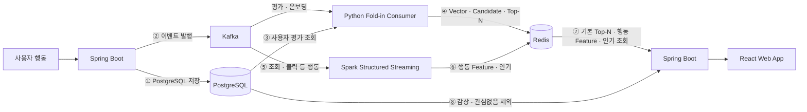

# 이벤트·Redis 계약 — Spring Boot ↔ Python Consumer ↔ Spark Structured Streaming

[ADR-0017](../adr/0017-python-foldin-spark-trending-split.md)에 따라 사용자 단위 Fold-in과 전역 인기 집계를
각각 Python Consumer와 Spark Structured Streaming으로 분리합니다. 이 문서는 Spring Boot, Python Consumer와
Spark가 주고받는 **Kafka 이벤트 스키마와 Redis 키 구조**의 계약 기준 문서입니다.

**클라이언트에 공개되는 API가 아니며**, 공개 계약은 [API 명세](./README.md)를 따릅니다.

> ADR-0012 시절의 [내부 API 명세](./internal.md)(Spring ↔ FastAPI)를 대체합니다. 해당 문서의 `inputVersion` 신호 분류,
> 세트 버퍼 운영, 장애 격리 기준은 이 문서에 계승했습니다.

## 1. 전체 흐름



**①이 ②보다 먼저**여야 합니다. 순서가 바뀌면 Python Consumer가 ③에서 조회할 때 방금 저장한 평가가 보이지 않습니다.
Python Consumer는 ④에서 `candidates`와 `topn`을 같은 `candidateVersion`으로 함께 갱신합니다.
이 경로가 끊기면 평가·온보딩 변경으로 `candidates`만 바뀌고 개인 추천 API가 이전 `topn`을 반환할 수 있습니다.

## 2. 책임 경계

| 항목 | 주체 | 근거 |
|---|---|---|
| 이벤트 발행 | Spring Boot | PostgreSQL 저장 성공 후 발행 |
| Fold-in · User Vector 계산 | Python Consumer | ADR-0017 |
| Candidate Top-500 갱신 | Python Consumer | ADR-0017 |
| 기본 Re-ranking · XAI 기본 근거 생성 | Python Consumer | 평가·온보딩 기반 사용자 1명 단위 갱신 |
| 행동 Feature 집계 | Spark Streaming | ADR-0017 |
| 전역 인기 영화 윈도우 집계 | Spark Streaming | FR-27, ADR-0017 |
| **행동 Feature 경량 Re-ranking · 최종 XAI 조립** | **Spring Boot** | 새 추천 세트 생성 시 기본 Top-N 100편에 적용 |
| **감상 기록 · 관심없음 제외 필터** | **Spring Boot** | 아래 2.1 |
| TASTE / DISCOVERY 인터리브 정렬 | Spring Boot | 제외 후에 적용해야 구성 비율이 유지됨 |
| 세트 버퍼 저장 · 노출 | Spring Boot | API-045 처리 규칙, `recommendation_items` |
| 파티 추천 집계 · OTT 구독 추천 집계 | Spring Boot | ADR-0017. Redis `candidates`를 읽어 요청 시점에 결합(5.1) |
| 유사 영화 조회 · 취향 분석 집계 | Spring Boot | ADR-0017 |

### 2.1 제외 필터를 Spring이 담당하는 이유

`API-045`는 "감상 기록이 있는 영화(`LINK_CLICKED` 포함)와 관심없음 영화는 제외한다"를 요구합니다.
이 데이터는 PostgreSQL이 원본이며 평가 저장과 프레임 생성이 단일 트랜잭션으로 묶여 있습니다(NFR-06).

Spark가 미리 제외하려면 제외 목록의 복제본을 상태로 유지해야 하며, 다음 문제가 생깁니다.

- Streaming 지연 중에는 방금 감상·관심없음 처리한 영화가 추천에 그대로 노출된다
- 원본과 복제본이 어긋날 때 판정 기준이 필요하다
- Checkpoint 유실 시 제외 목록이 통째로 사라져 이미 본 영화가 다시 추천된다

제외는 순위를 바꾸지 않고 항목만 덜어내므로, 제외 위치를 옮겨도 추천 품질은 달라지지 않습니다.
**추천 품질에 기여하는 관심없음의 부정 신호는 `DISMISS` 이벤트로 Spark에 전달**하고,
**최종 노출 필터만 Spring이 조회 시점에 적용**합니다.

### 2.2 Python Consumer가 PostgreSQL을 직접 조회하는 범위

Fold-in은 사용자의 평가 전체를 입력으로 하며, Python Consumer는 이를 **읽기 전용 롤**로 PostgreSQL에서 조회합니다.

- 대상: `ratings`(`user_id`, `movie_id`, `score`), `onboarding_preferences`(`user_id`, `movie_id`, `preference`), `movies`(`representative_flavor_id` — `DISCOVERY` 판정용, 아래)
- 쓰기 권한을 부여하지 않으며 서비스 테이블을 갱신하지 않는다
- 이벤트의 `movieId`·`score`는 로깅·디버깅용 참고값이며 계산에는 조회 결과를 사용한다

이 경계는 [내부 API 명세](./internal.md)에서 합의한 "pgvector 읽기 전용 롤 직접 조회" 패턴을 `ratings`까지 넓힌 것입니다.

#### `topn` 생성에 필요한 메타데이터의 출처

`topn`에는 Fold-in 입력에 없는 값(`flavorCode`, 장르 라벨, 유사 영화 제목, `TASTE`/`DISCOVERY` 구분)이
들어갑니다. 갱신 빈도가 달라 출처를 둘로 나눕니다.

| 데이터 | 출처 | 이유 |
|---|---|---|
| 영화 제목 · 장르 라벨 · 영화 대표 맛(`movies.representative_flavor_id` → `popcorn_flavors.code`) | **HDFS 야간 배치 산출물** | 기준정보에 가깝고 전체 영화가 대상이다. 이벤트마다 PG를 조회하면 부하가 크므로 배치가 만든 스냅샷을 Python Consumer가 로드해 사용한다 |
| 사용자 맛 분포(`ratings JOIN movies`의 사용자별 `representative_flavor_id` 집계) | **PostgreSQL 읽기 전용 롤** | 사용자 행동에 따라 실시간으로 바뀌고 대상이 사용자 한 명이다. Python Consumer의 `ratings` 조회와 같은 트랜잭션 시점을 쓴다 |

`DISCOVERY` 판정은 [취향 API](./taste.md)의 `newFlavorThreshold` 기준을 그대로 씁니다.
사용자의 `popcornCount`가 임계치 미만인 맛을 대표 맛으로 갖는 영화가 `DISCOVERY`, 나머지가 `TASTE`입니다.

맛 모델은 버전이나 재학습 없이 고정된 Centroid를 사용합니다(ADR-0015). 신규 영화는 기존 K-Means의
`predict`로 맛을 배정하고 `movies.representative_flavor_id`에 저장합니다. 배치 스냅샷과 PostgreSQL 집계는
동일한 `popcorn_flavors.code` 체계를 사용합니다.

- 배치 스냅샷의 신선도는 하루이며, 신규 영화는 다음 야간 배치 이후 추천 대상이 된다
- `movies` · `genres` · `movie_genres` · `popcorn_flavors`는 Python Consumer와 Spark가 PG에서 직접 조회하지 않는다

#### 매번 전체를 재계산해도 되는 이유

Fold-in은 `x = (Σ yᵢyᵢᵀ + λI)⁻¹ (Σ rᵢyᵢ)` 이며 A와 B가 모두 합이므로 증분 누적도 가능합니다.
그러나 누적값을 별도 저장소나 Streaming 상태로 유지해야 하고, 평가 수정·삭제 시 이전 값 차감,
재학습 시 무효화, 중복 이벤트에 대한 이중 반영 방지가 각각 필요합니다.

전체 재계산을 선택한 이유는 절약되는 비용이 크지 않기 때문입니다. 참고 측정값(단일 노드 numpy, `k=64`,
영화 87,000편 기준이며 EC2 실측이 아님)은 다음과 같습니다.

| 단계 | 평가 500편 | 평가 수에 비례 |
|---|---|---|
| Fold-in 재계산(A·b + 선형 풀이) | 약 0.12ms | 비례하나 미미 |
| 후보 전체 점수 계산 | 약 0.63ms | 무관(고정) |
| Top-500 추출 | 약 0.30ms | 무관(고정) |

지배적인 비용은 사용자 벡터가 바뀔 때마다 어차피 수행해야 하는 후보 점수 계산이며, 증분 방식으로
절약되는 부분은 전체의 10% 미만입니다. 실제로는 Structured Streaming의 micro-batch 고정 오버헤드가
이보다 훨씬 크므로, 상태를 두지 않는 단순한 구조를 우선합니다.

## 3. 공통 규약

- 직렬화: JSON UTF-8. 키는 camelCase, 열거형은 UPPER_SNAKE_CASE — 공개 API 규약과 동일
- 시각: ISO 8601 UTC 문자열. 예 `2026-08-31T07:21:00Z`
- 식별자: 64bit 정수. `movieId`는 **서비스 DB 영화 ID**이며 MovieLens ID는 모델 내부 매핑에만 사용한다(S15P21E106-118)
- Topic 이름: `feelm.<이벤트>.v1`. 계약이 깨지는 변경만 `v2`를 병행했다가 이전 버전을 제거한다
- 파티션 키: 사용자 단위 이벤트는 `userId`. 같은 사용자의 이벤트 순서를 보장한다
- Redis 키 이름: `feelm:<대상>:<식별자>:<용도>`
- Consumer Group: Python Fold-in과 Spark Streaming은 서로 다른 Group을 사용하며 Offset·Checkpoint를 공유하지 않는다

## 4. Kafka 이벤트

### 4.1 Topic 목록

| Topic | eventType | 발행 시점 | 처리 | 신호 |
|---|---|---|---|---|
| `feelm.rating.v1` | `RATING` | 별점 등록·수정·삭제 | Fold-in → Candidate → 기본 Re-ranking → Top-N | 강함 |
| `feelm.rating.v1` | `ONBOARDING` | 초기 취향 제출(API-024) | 위와 동일 | 강함 |
| `feelm.dismiss.v1` | `DISMISS` | 관심없음(API-047) | 부정 신호로 점수 반영 | 중간 |
| `feelm.view.v1` | `VIEW` | 영화 상세 조회 | 행동 Feature · 전역 인기 집계 | 약함 |
| `feelm.recommendation-click.v1` | `RECOMMENDATION_CLICK` | 추천 카드 클릭 | 행동 Feature 집계 | 약함 |
| `feelm.ott-click.v1` | `OTT_CLICK` | 보러가기 클릭(API-033) | 행동 Feature 집계 | 약함 |

별점 등록이 감상을 의미하므로 별도의 감상 이벤트는 두지 않습니다. 감상 기록 자체는 Spring이 PostgreSQL에서 직접 사용합니다.

### 4.2 공통 봉투

모든 이벤트는 같은 봉투 구조를 사용합니다.

```json
{
  "eventId": "0f3c9a1e-6b2d-4f77-9a10-5c2b8e41d0aa",
  "eventType": "RATING",
  "occurredAt": "2026-08-31T07:21:00Z",
  "userId": 1024,
  "payload": {}
}
```

| 필드 | 타입 | 설명 |
|---|---|---|
| `eventId` | string(UUID) | 발행 시 1회 생성. **멱등 처리 기준** |
| `eventType` | enum | 4.1의 값 |
| `occurredAt` | string | 사용자 행동 시각(UTC) |
| `userId` | number | 파티션 키와 동일 |
| `payload` | object | 이벤트별 본문 |

### 4.3 이벤트별 payload

**`RATING`**

```json
{ "action": "CREATE", "movieId": 550, "score": 5 }
```

- `action`: `CREATE` / `UPDATE` / `DELETE`. `DELETE`는 `score`를 생략한다
- Python Consumer는 `action`을 계산에 사용하지 않고 로깅에만 사용한다. 어떤 값이든 처리는 "해당 사용자 Fold-in 재계산"으로 동일하다

**`ONBOARDING`**

```json
{ "preferenceCount": 12 }
```

- 개별 선택 내용은 싣지 않는다. Python Consumer가 `onboarding_preferences`를 조회한다

**`DISMISS`**

```json
{ "movieId": 550, "recommendationItemId": 3301 }
```

- 노출 제외 용도가 아니라 **점수 감점 신호**다. 제외는 Spring이 `user_movie_dismissals`로 처리한다

**`VIEW`**

```json
{ "movieId": 550, "dwellMs": 8200 }
```

- `dwellMs`는 선택. 측정하지 않으면 생략한다

**`RECOMMENDATION_CLICK`**

```json
{ "movieId": 550, "recommendationItemId": 3301, "recommendationSetId": 7001, "position": 2 }
```

**`OTT_CLICK`**

```json
{ "movieId": 550, "ottId": 1, "watchRecordId": 5501 }
```

### 4.4 멱등 처리와 재처리

Kafka는 장애 상황에서 같은 메시지를 두 번 전달할 수 있습니다(at-least-once). 신호 종류별로 기준이 다릅니다.

| 신호 | 멱등 방식 |
|---|---|
| `RATING` · `ONBOARDING` | **자연 멱등.** Python Consumer가 PostgreSQL을 다시 읽어 전체를 재계산하므로 몇 번 처리해도 결과가 같다 |
| `DISMISS` · `VIEW` · `RECOMMENDATION_CLICK` · `OTT_CLICK` | 누적 집계라 중복 시 값이 부풀어 오른다. `eventId` 기준 중복 제거를 적용한다 |

- 중복 제거는 Structured Streaming의 watermark 기반 `dropDuplicates(["eventId"])`로 처리한다
- 중복 판정 창은 설정값(기본 10분). 창을 벗어난 재처리는 약한 신호 Feature가 소폭 부풀 수 있으나 허용한다
- Python Consumer의 재시작 위치는 전용 Consumer Group Offset으로, Spark의 재시작 위치는 전용 Checkpoint로 각각 보존한다(ADR-0017)
- Python Consumer가 연속된 같은 `userId`의 `RATING`을 함께 가져오면 `userId`로 묶어 마지막 DB 상태 기준 1회만 계산할 수 있다

Python Consumer는 **Redis `vector`·`candidates`·`topn` 기록이 모두 성공한 뒤** 원본 `RATING`/`ONBOARDING`
Offset을 커밋합니다. 중간 실패로 재시도되면 같은 DB 상태를 다시 읽고 같은 사용자 추천 결과를 다시 계산합니다.

### 4.5 순서 보장

- 파티션 키가 `userId`이므로 한 사용자의 이벤트는 발행 순서대로 도착한다
- 서로 다른 사용자 사이의 순서는 보장하지 않으며 필요하지도 않다
- Spring은 PostgreSQL 커밋 성공 후 발행한다. 커밋 실패 시 발행하지 않는다

### 4.6 Candidate·기본 Top-N 갱신과 서빙 재정렬

강한 신호의 최종 경로는 다음 순서로 고정합니다.

1. Spring이 `RATING` 또는 `ONBOARDING`을 발행한다.
2. Python Consumer가 PostgreSQL을 다시 읽어 User Vector와 Candidate Top-500을 재계산한다.
3. Python Consumer가 평가·온보딩 기반 기본 Re-ranking과 XAI 기본 근거를 생성한다.
4. Python Consumer가 `feelm:user:{userId}:vector`, `feelm:user:{userId}:candidates`, `feelm:user:{userId}:topn`을 같은 `candidateVersion`으로 기록한다.

Spark Streaming은 이 경로에 참여하지 않습니다. Spark는 여러 사용자 행동을 집계해 `behavior`와 전역 인기 결과를 갱신하고,
Spring은 **다음 개인 추천 세트 생성 시** 기본 `topn` 100편과 최신 `behavior`를 읽어 경량 가중치 재정렬을 수행합니다.
약한 신호만으로 현재 세트 버퍼를 무효화하지 않으므로 반영 시점은 Spark 집계 완료 후 사용자의 다음 세트 생성이며,
Python Consumer를 다시 실행하거나 전체 사용자를 주기적으로 재계산하지 않습니다.

Spring은 개인 추천 세트 생성 시 `topn.candidateVersion`과 `candidates.candidateVersion`을 비교합니다.
강한 신호로 세트 버퍼가 무효화된 뒤 두 값이 다르면 아직 Python Consumer의 추천 갱신이 끝나지 않았거나 부분 실패한 상태이므로,
이전 `topn`으로 새 세트를 만들지 않습니다. 버전이 맞으면 최신 행동 Feature로 재정렬한 뒤 새 세트를 만듭니다.
짧은 재시도 후에도 버전이 맞지 않으면 `503 RECOMMENDATION_UNAVAILABLE`을 반환하고,
이미 저장된 기존 세트의 이력은 변경하지 않습니다.

## 5. Redis 키

### 5.1 키 목록

| 키 | 타입 | 쓰기 | 읽기 | TTL |
|---|---|---|---|---|
| `feelm:user:{userId}:vector` | String(JSON) | Python Consumer | Python Consumer | 없음 |
| `feelm:user:{userId}:candidates` | String(JSON) | Python Consumer | Python Consumer · **Spring** | 없음 |
| `feelm:user:{userId}:behavior` | Hash | Spark | Spark · **Spring** | 키 단위 8일 · 필드는 일자 버킷(5.3) |
| `feelm:user:{userId}:topn` | String(JSON) | Python Consumer | **Spring** | 없음 |
| `feelm:model:current` | String(JSON) | Spark Batch | Python Consumer · Spring | 없음 |

**Spring이 읽는 추천 키는 `topn` · `candidates` · `behavior` · `model:current`입니다.** `vector`만
Python Consumer의 내부 상태이며 Spring이 의존하지 않습니다.

| Spring이 읽는 키 | 용도 |
|---|---|
| `topn` | 개인 홈 추천(API-045~048)의 평가·온보딩 기반 기본 순위와 XAI 근거 |
| `candidates` | 개인 추천의 `candidateVersion` 신선도 확인 · **파티 추천 집계**(party.md) · **OTT 구독 추천**(API-068). 파티원별·사용자별 원시 점수를 Spring이 합산·집계 |
| `behavior` | 새 개인 추천 세트를 만들 때 기본 `topn`에 적용할 최근 행동 Feature |
| `model:current` | `modelVersion` 확인과 이력 저장 |

`candidates`를 Spring이 읽는 이유는 두 기능이 **여러 사용자의 점수를 요청 시점에 결합**하기 때문입니다.
파티는 파티원 조합마다, OTT는 제공처 카탈로그마다 결과가 달라져 Spark가 미리 만들어 둘 수 없습니다.
개인 추천에서는 원시 후보 점수를 직접 사용하지 않고, `topn`이 최신 Candidate에서 생성됐는지 확인하는 용도로
`candidateVersion`만 비교합니다. `topn`은 단일 사용자용 기본 결과이며 Spring이 `behavior`로 최종 재정렬하므로
파티·OTT 집계에는 쓸 수 없습니다.

### 5.2 값 구조

**`feelm:user:{userId}:vector`**

```json
{
  "modelVersion": "als-2026-09-05",
  "vector": [0.132, -0.041, "... 64개"],
  "ratingCount": 42,
  "updatedAt": "2026-08-31T07:21:03Z"
}
```

**`feelm:user:{userId}:candidates`** — Spring이 파티·OTT 집계에 읽는 원시 점수

```json
{
  "modelVersion": "als-2026-09-05",
  "candidateVersion": 137,
  "items": [{ "movieId": 807, "score": 0.91 }],
  "updatedAt": "2026-08-31T07:21:03Z"
}
```

- ALS 예측 상위 500편(설정값). 제외 필터를 적용하지 않은 원시 후보다
- `score`는 ALS 예측 점수이며 사용자 간 절대 비교가 아니라 **같은 사용자 안의 상대 순위**를 의미한다.
  파티 집계식이 이를 어떻게 정규화할지는 party.md의 미정 사항으로 남는다
- `candidateVersion`은 party.md의 **Rating Candidate 버전**이다. Python Consumer가 실시간 이벤트나 전체 재구축 요청으로 이 키를 갱신할 때마다
  1씩 증가하는 단조 증가 정수이며, Spring은 읽기만 한다. party.md의 파티 점수 캐시 키
  (`partyId` + 파티원 목록 + 파티원별 버전) 구성 요소이며, party.md 미정 사항의
  "형식과 Redis 키 이름 — Redis 키 설계 문서에서 확정"을 여기서 확정한다
- OTT 구독 추천(API-068)은 이 `items`에서 임계치 이상인 영화를 OTT 제공처별로 집계한다.
  임계치 값은 recommendation.md의 미정 사항으로 남는다

**`feelm:user:{userId}:behavior`**

| 필드 | 의미 |
|---|---|
| `viewCount:{movieId}:{yyyyMMdd}` | 해당 일자의 상세 조회 횟수 |
| `genreAffinity:{genreCode}:{yyyyMMdd}` | 해당 일자의 조회·클릭 기반 장르 가중치 |
| `dismissedGenre:{genreCode}:{yyyyMMdd}` | 해당 일자의 관심없음 감점 가중치 |
| `updatedAt` | 최종 갱신 시각 |

**필드 이름에 일자(`yyyyMMdd`, UTC)를 포함합니다.** Redis는 Hash 필드 단위 만료를 제공하지 않으므로
"최근 7일"을 TTL로 표현할 수 없기 때문입니다. 대신 다음 세 가지를 조합합니다.

| 장치 | 동작 | 해결하는 문제 |
|---|---|---|
| 일자 버킷 필드 | 쓰기는 오늘 버킷에만 `HINCRBY` | 오래된 행동이 값에 섞이지 않는다 |
| 집계 시 최근 7개 버킷만 합산 | Spark가 오늘부터 6일 전까지의 필드만 읽는다 | 만료를 기다리지 않고 즉시 "최근 7일"이 성립한다 |
| 야간 배치의 `HDEL` 정리 | 7일보다 오래된 필드를 삭제 | 활성 사용자의 Hash가 무한히 커지지 않는다 |

키 단위 TTL 8일은 쓰기마다 갱신하며, **비활성 사용자의 키를 자동으로 없애는 용도**입니다.
집계 범위(7일)보다 하루 길게 둬 정리 배치가 돌기 전에 키가 사라지는 경우를 막습니다.

- 버킷 크기(일), 집계 창(7일), 키 TTL(8일)은 모두 설정값이다
- 구체적인 Feature 목록과 가중치는 Re-ranking 설계에서 확정한다([미정 사항](#미정-사항))

**`feelm:user:{userId}:topn`** — Spring 경량 재정렬의 입력이 되는 기본 추천 결과

```json
{
  "modelVersion": "als-2026-09-05",
  "tasteModelVersion": "taste-e5-kmeans-2026-09-05",
  "candidateVersion": 137,
  "candidateUpdatedAt": "2026-08-31T07:21:03Z",
  "generatedAt": "2026-08-31T07:21:03Z",
  "items": [
    {
      "movieId": 807,
      "type": "TASTE",
      "score": 0.91,
      "flavorCode": "FLAVOR_X",
      "rerankFeatures": { "genreCodes": ["THRILLER", "DRAMA"] },
      "reason": {
        "summary": "스릴러를 높게 평가하셨어요",
        "factors": [
          { "type": "GENRE", "label": "스릴러" },
          { "type": "SIMILAR_MOVIE", "label": "파이트 클럽", "movieId": 550 }
        ]
      }
    }
  ]
}
```

| 항목 | 규칙 |
|---|---|
| 정렬 | **점수 내림차순.** 인터리브하지 않는다 |
| 개수 | 제외 전 상위 100편(설정값 `recommendation.topn-size`) |
| `type` | `TASTE` / `DISCOVERY`. 판정 기준은 2.2. Spring이 구성 비율을 맞출 때 사용 |
| `rerankFeatures.genreCodes` | Spring이 `behavior.genreAffinity`·`dismissedGenre`와 결합할 정규화된 장르 코드. Python Consumer가 HDFS 메타데이터 스냅샷에서 채움 |
| `reason` | 평가·온보딩 기반 기본 점수의 XAI 근거. 행동 Feature가 최종 점수에 영향을 주면 Spring이 해당 근거를 추가해 `recommendation_items.reason`에 스냅샷으로 저장 |
| `modelVersion` | Spring이 `recommendation_sets`에 저장해 재현·디버깅에 사용 |
| `candidateVersion` | 이 `topn`이 어떤 Candidate 버전을 재정렬한 결과인지 표시. Spring은 stale 방지 비교에 사용 |

Spring은 이 목록을 읽어 **① 최신 `behavior`로 경량 재정렬 → ② 감상·관심없음 제외 → ③ TASTE 2 + DISCOVERY 1 인터리브 → ④ 앞에서 20편을 세트 버퍼로 저장**합니다.
재정렬은 최대 100편에 대한 설정 기반 가중치 합산과 정렬로 제한하며 ML 추론·Fold-in·후보 생성을 포함하지 않습니다.
기본 Top-N 밖의 후보를 승격할 수 없는 대신 Spring의 계산량과 Redis 전송량을 제한하며, 100편 기준은 실데이터 캘리브레이션 대상으로 남깁니다.
100편에서 제외 후 20편을 채우지 못하면 남은 만큼만 저장하고, 0편이면 5.4의 `503` 기준을 따릅니다.

**`feelm:model:current`**

```json
{
  "modelVersion": "als-2026-09-05",
  "embeddingModelVersion": "e5-2026-09-05",
  "factorDimension": 64,
  "trainedAt": "2026-09-05T18:00:00Z"
}
```

### 5.3 만료와 무효화

| 대상 | 정책 |
|---|---|
| `vector` · `candidates` · `topn` | TTL 없음. 담당 처리기가 이벤트마다 덮어쓴다 |
| `behavior` | 키 단위 슬라이딩 TTL 8일. 필드는 일자 버킷이며 집계는 최근 7일분만 사용한다(아래) |
| 모델 재학습 | 배치가 전체 사용자 키를 새 `modelVersion`으로 다시 쓴다. 별도 무효화 명령을 두지 않는다 |
| 비활성 사용자 | 야간 배치가 재생성 대상에서 제외하고 오래된 키를 정리한다(주기 미정) |

`inputVersion`은 [내부 API 명세](./internal.md)의 정의를 그대로 계승하며 **Spring이 소유**합니다.

| 신호 | 예 | Spring 처리 |
|---|---|---|
| 강한 신호 | 별점 등록·변경·삭제, 온보딩 변경 | `inputVersion` 증가 + 세트 버퍼 무효화 |
| 관심없음 | 추천 카드 관심없음 | 버전 유지, 세트 내 교체(API-047) |
| 약한 신호 | 상세 조회, 추천·OTT 클릭 | 버전 유지. Spark가 행동 Feature를 갱신하고 Spring이 다음 세트 생성 때 반영 |

### 5.4 야간 배치 재구축

ALS 재학습 배치가 끝나면 Python Consumer에 전체 사용자 추천 재구축을 요청해 Fold-in, Candidate와 Top-N을 다시 생성합니다.

- 재학습으로 Item Factor가 바뀌면 기존 User Vector와 후보가 모두 무효가 되므로 필수다
- 이벤트 유실이나 Redis 데이터 손실이 있어도 하루 한 번 정합이 회복된다
- 완료 후 `feelm:model:current`를 갱신한다
- 전체 재구축도 `candidates` 갱신이므로 `candidateVersion`은 사용자별 기존 값에서 이어서 증가시키며
  `1`로 초기화하지 않는다. 파티 점수 캐시 키가 이 값의 단조 증가에만 의존하기 때문이다
- 키가 없어 이어갈 기존 값을 읽을 수 없는 경우(신규 사용자, Redis 데이터 손실)의 시작값 결정
  방식은 미정이다

## 6. 지연과 장애 처리

### 6.1 허용 지연

| 신호 | 발행부터 Redis 반영까지 목표 |
|---|---|
| `RATING` · `ONBOARDING` → Candidate · `topn` | 10초 이내(설정값) |
| `DISMISS` | 30초 이내(설정값) |
| 약한 신호 → `behavior` | 60초 이내(설정값) |

초기값이며 실측 후 조정합니다. Structured Streaming의 트리거 주기가 `behavior` 반영 지연을 좌우합니다.
개인 추천 노출은 현재 세트 버퍼를 유지하고 **다음 세트 생성 시점**에 최신 `behavior`를 읽으므로,
60초 안에 기존 세트의 순서를 바꾸는 것을 보장하지 않습니다. 이 정책은 행동마다 Python 재정렬을 실행하는 계산량을 피하면서
새 세트를 만드는 사용자의 최대 100편만 정렬하기 위한 기준입니다.

### 6.2 유효 결과가 없을 때(NFR-05)

[ADR-0017](../adr/0017-python-foldin-spark-trending-split.md)에 따라 Python Consumer나 Streaming 지연·장애 시에도
**마지막으로 성공한 Redis 결과를 그대로 제공**합니다.
`generatedAt`이 오래되었다는 이유만으로 오류를 반환하지 않습니다.
단, 강한 신호로 세트 버퍼가 무효화되어 새 세트를 만들어야 하는데 `topn.candidateVersion`이
최신 `candidates.candidateVersion`보다 낮으면 이전 `topn`으로 새 세트를 만들지 않습니다.

`503 RECOMMENDATION_UNAVAILABLE`은 다음 경우에만 반환합니다.

- `feelm:user:{userId}:topn` 키가 없다(신규 사용자이며 아직 첫 계산이 끝나지 않음)
- 강한 신호 이후 `topn.candidateVersion`이 최신 `candidates.candidateVersion`보다 낮고 짧은 재시도 후에도 맞지 않는다
- 제외 필터 적용 후 남은 후보가 0편이다
- Redis 연결 실패

이때도 영화·검색·평가·필름·팝콘 기능은 정상 동작해야 합니다. 추천 API만 실패합니다.

### 6.3 콜드 스타트

온보딩과 평가가 모두 없는 사용자는 Fold-in 입력이 없어 벡터를 만들 수 없습니다.
인기 기반 후보로 `TASTE`를 채우는 것을 기본으로 하되(API-045 가정), Python 사전 생성과 Spring 폴백 중 처리 주체와 임계치는 미정입니다.

## 7. 미정 사항

이벤트 필드와 Redis 키의 나머지 값은 아래 항목이 확정된 뒤 갱신합니다.

- [ ] Kafka 파티션 수와 복제 계수 — 인프라 담당 협의(EC2 2대 구성)
- [ ] Python Fold-in Consumer와 Spark Streaming의 Consumer Group 이름·배포 환경변수 — 구현 업무에서 확정
- [ ] 행동 Feature 목록과 Re-ranking 가중치 — Re-ranking 설계에서 확정
- [ ] `topn` 후보 수 100편, `candidates` 500편 — 실데이터로 캘리브레이션
- [ ] 허용 지연 초기값과 Structured Streaming 트리거 주기 — 실측 후 확정
- [ ] 비활성 사용자 Redis 키 정리 주기
- [ ] `candidates` 키가 유실된 사용자의 `candidateVersion` 시작값 결정 방식 — 구현 단계에서 확정
- [ ] 콜드 스타트 처리 주체(Python 사전 생성 vs Spring 폴백)
- [ ] 추천 이유 문장 생성 방식(템플릿 vs LLM) — 내부 API 명세에서 이월
- [ ] Kafka 발행 실패 시 재시도·보상 정책(트랜잭셔널 아웃박스 도입 여부)
- [ ] Python Consumer가 사용할 PostgreSQL 읽기 전용 롤의 계정 발급(접근 대상 테이블은 2.2에서 확정)
- [ ] 인기 집계 윈도우·중복 처리·최소 사용자 수·점수식·반영 지연
- [ ] 인기 집계 결과의 Redis 키·값 구조와 장애 시 폴백·오류 기준
- [ ] 파티 점수 집계식과 사용자 간 `score` 정규화 방식 — party.md 미정 사항
- [ ] OTT 구독 추천의 점수 임계치 — recommendation.md 미정 사항
- [ ] 영화 메타데이터 HDFS 스냅샷의 산출 형식과 배치 시각 — 추천 모듈 환경(S15P21E106-130)에서 확정
