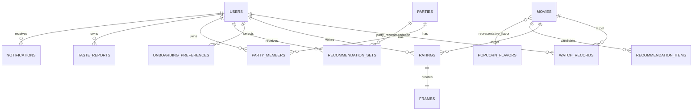
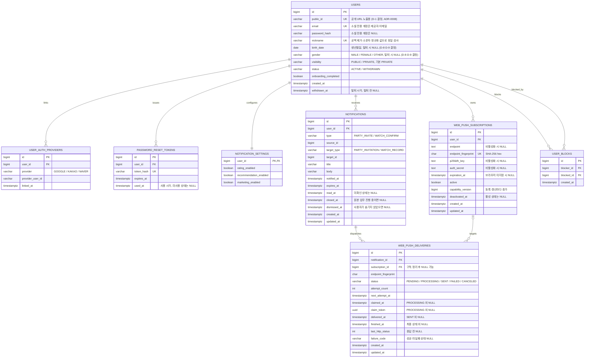
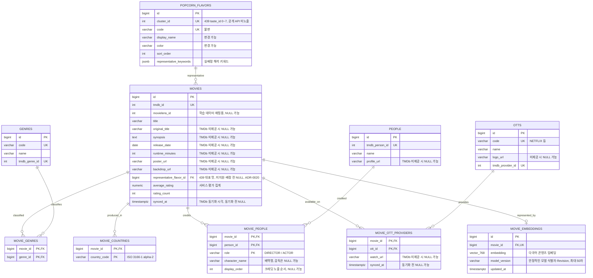
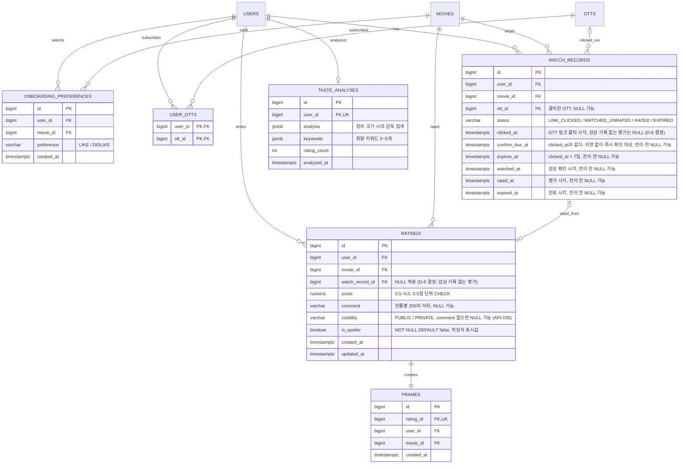
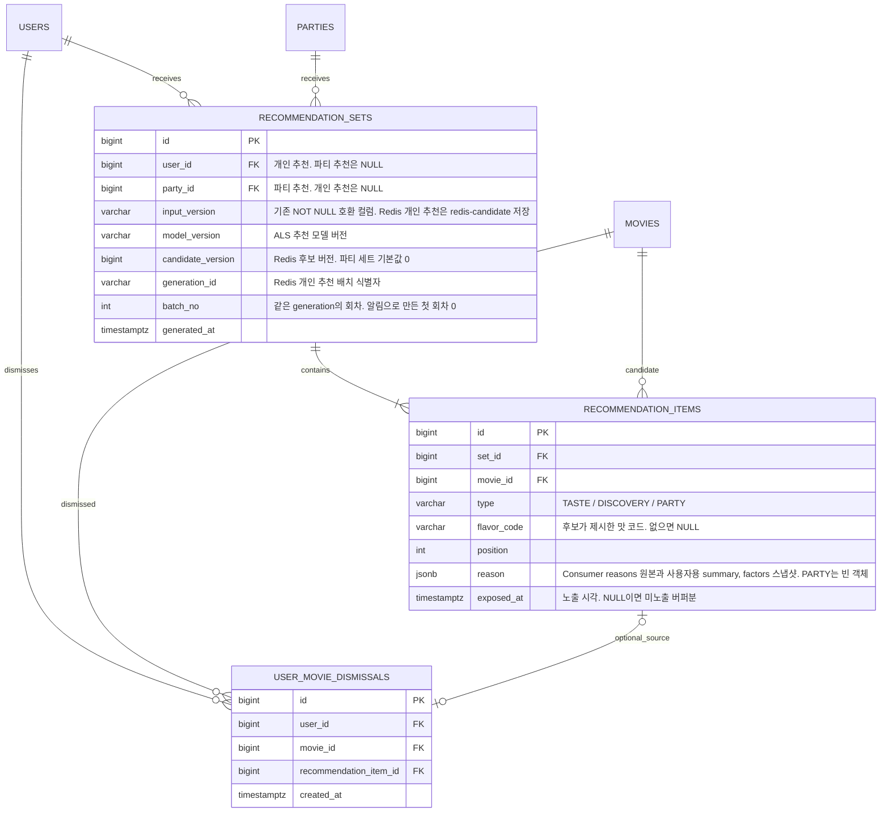
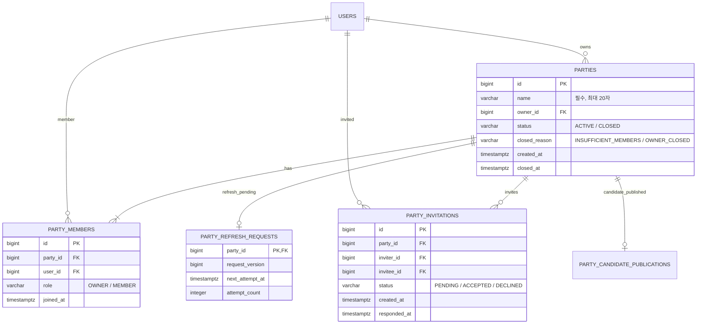
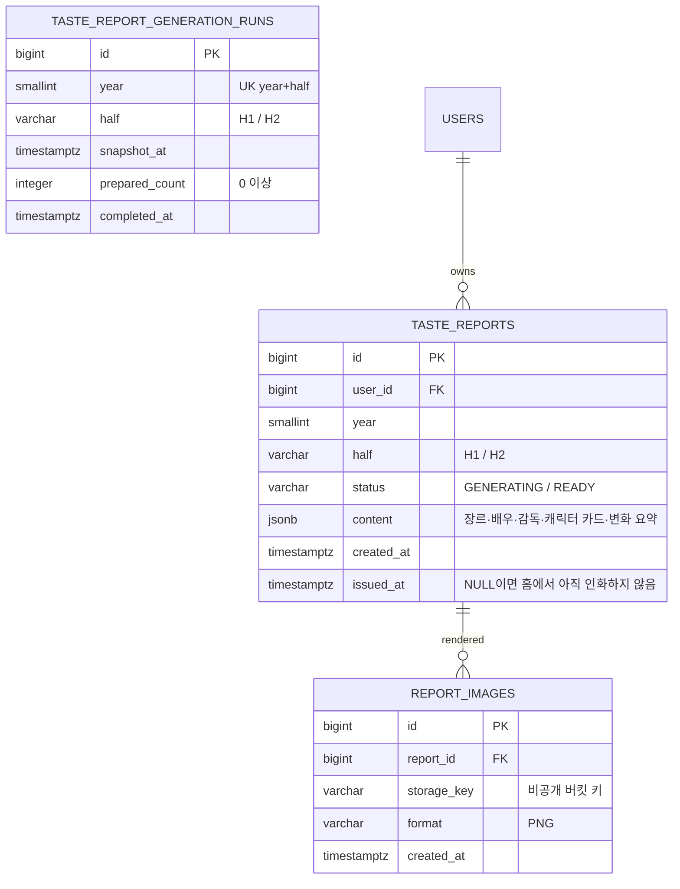
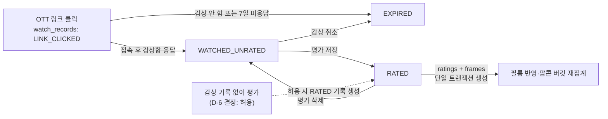

# 논리 ERD

FEELM 서비스 데이터베이스(PostgreSQL)의 논리 ERD입니다. [요구사항 정의서](./requirements.md)와 [API 명세](./api/README.md)에서
도출한 엔티티·관계·핵심 속성을 정리합니다. 물리 스키마(타입·제약·인덱스·마이그레이션)의 규칙은
[물리 스키마 규칙과 마이그레이션 정책](./db-schema-convention.md)에 있습니다.

## 범위

- **포함**: 서비스 영속 데이터(PostgreSQL). 사용자·기준정보·영화·온보딩·감상·취향·추천·파티·리포트
- **제외**: Redis 키 설계(후보 Top-500, 추천 캐시, Refresh Token), HDFS/Parquet 레이아웃(MovieLens·TMDb 원본, Item Factor). 저장 모델이 달라 별도 문서로 관리합니다.
- MovieLens 사용자와 서비스 사용자는 연결하지 않습니다(README 6장). 영화만 TMDb ID로 매핑합니다.

## 범례

- 다이어그램의 타입은 논리 수준 표기입니다. 식별자는 내부 `bigint`, 공개 URL 노출용은 `users.public_id`입니다(D-1 결정, ADR-0008).
- `PK` 기본키, `FK` 외래키, `UK` 유일 제약. 복합 유일 제약은 표의 **제약** 열에 적습니다.
- 열거형 값은 [API 명세 공통 규약 – 상태값](./api/README.md#상태값)과 동일한 코드를 사용합니다.
- **(가정)** 은 팀 결정 전 초안 기본값입니다.

---

## 1. 전체 구조

영역 사이의 핵심 관계만 표시합니다. 각 영역의 상세는 2장에 있습니다.

---

## 2. 영역별 ERD

### 2.1 사용자·인증·소셜

| 테이블 | 목적 | 제약·규칙 | 관련 |
|---|---|---|---|
| `users` | 서비스 계정 | `nickname`은 정규화 값(공백 제거·소문자)으로 유일. 같은 정규화식에 `text_pattern_ops`를 적용한 일반 인덱스를 따로 두어 사용자 검색(API-019)의 접두 조건이 인덱스를 타게 합니다. 탈퇴 시 `status=WITHDRAWN`으로 전환하고 이메일·닉네임을 치환해 즉시 재사용을 허용하며 생년월일·성별은 삭제합니다(D-9) | FR-01, FR-37, FR-38 · API-001~016, API-019, API-078, API-079 |
| `user_auth_providers` | 소셜 로그인 수단 | UK(`provider`, `provider_user_id`). 같은 이메일이어도 기존 계정에 자동 통합하지 않음 | FR-35 · API-007~009 |
| `password_reset_tokens` | 비밀번호 재설정 | 1회용, 만료 30분(가정). 성공 시 해당 사용자 Refresh Token 전부 폐기 | FR-37 · API-010, API-011 |
| `notification_settings` | 알림 수신 설정 | 사용자당 1행. 실제 인앱 사건 종류와 독립적인 수신 설정이며 푸시 채널 적용은 S15P21E106-582 범위 | FR-38 · API-017, API-018 |
| `notifications` | 인앱 알림 정본 | UK(`type`, `source_id`)로 원본 사건의 중복 생성을 막는다. 원본과 같은 트랜잭션에서 생성하고, `notified_at <= now < expires_at`이며 `closed_at IS NULL`, `dismissed_at IS NULL`인 행만 노출한다. 사용자 삭제 시 함께 삭제한다 | FR-41 · API-070~074 · ADR-0021 |
| `web_push_subscriptions` | 사용자·브라우저별 Web Push capability | canonical endpoint의 SHA-256 fingerprint가 유일하다. 등록·갱신 때 `capability_version`을 증가시켜 이전 전송 응답이 새 capability를 지우지 못하게 한다. 해제·만료·탈퇴 시 endpoint와 `p256dh`·`auth` 원문을 지우고 fingerprint만 감사용으로 남긴다 | FR-41 · API-078~077 · ADR-0022 |
| `web_push_deliveries` | 알림별 durable 발송 상태 | UK(`notification_id`, `endpoint_fingerprint`). 실제 전송 직전에 한 행씩 lease하고 claim token으로 stale worker 완료 경합을 막으며 최대 5회 지수 재시도한다. 구독 삭제 후에도 비민감 결과는 보존한다 | FR-41 · ADR-0022 |
| `user_blocks` | 사용자 차단 | UK(`blocker_id`, `blocked_id`). 양방향 필터는 조회 시 OR 조건 | FR-39 · API-019~022 |

> Refresh Token은 Redis에 TTL로 저장하며 별도 테이블을 두지 않습니다 (D-2 결정, ADR-0009).

### 2.2 기준정보·영화

| 테이블 | 목적 | 제약·규칙 | 관련 |
|---|---|---|---|
| `movies` | 영화 마스터 (TMDb 기준) | `tmdb_id` 유일. `average_rating`·`rating_count`는 평가 집계 반정규화 컬럼(D-10 결정) | FR-34 · API-028~031 |
| `movie_embeddings` | 영화별 현재 콘텐츠 임베딩 | 별도 `id` PK와 UK(`movie_id`). 확정된 `vector(768)` 및 50자 이내의 안정적인 `model_version`을 저장하고 코사인 HNSW로 검색한다. 전체 산출물 SHA는 파이프라인 manifest에서 관리한다. 영화 삭제 시 함께 삭제하며 Redis에 중복 저장하지 않는다 | FR-11 · API-031 · ADR-0014 |
| `genres` | 장르 기준정보 | TMDb 장르 ID 매핑 | FR-15 · API-029 |
| `movie_genres`, `movie_countries`, `movie_people` | 영화 속성 매핑 | `movie_people.role`로 감독·배우 구분 | FR-14, FR-15, FR-34 |
| `people` | 인물(감독·배우) | 검색 대상(FR-14) | API-028, API-030 |
| `otts` | OTT 기준정보 | 지원 목록 5종(API-025)을 새 Flyway seed로 초기화한다. 기존 식별쌍·ID·참조는 보존하고 이후 콘텐츠 적재는 같은 쌍의 표시 정보를 갱신한다 | FR-03, FR-16 · API-025 |
| `movie_ott_providers` | 영화별 시청 가능 OTT | TMDb watch provider 동기화 | FR-16 · API-030 |
| `popcorn_flavors` | 팝콘 맛 8종 기준정보와 439 상위 맛 매핑 | `cluster_id=taste_id`와 `code=FLAVOR_A..H`는 각각 유일하며 순서대로 1:1 대응한다. 표시명·색상은 변경 가능하고 실배정 해석 키워드도 함께 보관한다. 내부 `cluster_id`는 공개 API에 노출하지 않는다 | FR-06 · API-044 · ADR-0020 |

### 2.3 온보딩·감상·취향

| 테이블 | 목적 | 제약·규칙 | 관련 |
|---|---|---|---|
| `onboarding_preferences` | 초기 취향(LIKE/DISLIKE) | UK(`user_id`, `movie_id`). 추천 파이프라인의 원천으로 유지하며, API-024 제출 시 LIKE 4.0점·DISLIKE 2.0점 평가와 감상 기록·프레임을 함께 생성함. 기존 평가 영화는 평가 관련 상태를 덮어쓰지 않음 | FR-02 · API-023, API-024 |
| `user_otts` | 구독 OTT | 전체 교체(PUT) | FR-03 · API-026, API-027 |
| `watch_records` | 감상 상태 머신 | 사용자·영화별 **활성 기록**(EXPIRED 아님)은 1개 — 부분 유일 인덱스(D-6 결정). 만료 후 재클릭은 새 행 | FR-17, FR-18 · API-033~035 |
| `ratings` | 평가 + 한줄평 | UK(`user_id`, `movie_id`). 한줄평은 컬럼(별도 테이블 아님). `is_spoiler`는 NOT NULL·기본 false이며 기존 평가도 false. 삭제 시 프레임도 삭제되고 감상 기록은 `WATCHED_UNRATED`로 복귀 | FR-19, FR-26 · API-032, API-036~039 |
| `frames` | 필름의 프레임 | 평가와 1:1. 조회용 `user_id`·`movie_id`를 보관하고 인덱싱하며 애플리케이션이 평가와의 일치를 보장한다. 맛은 영화 조인으로 조회한다 | FR-07, FR-08 · API-042, API-043 |
| `taste_analyses` | 취향 분석 결과 캐시 | 별도 `id`와 UK(`user_id`), `rating_count >= 0` CHECK를 둔다. Spring이 평가 추가·수정·삭제 시 평가와 영화 정보를 집계해 갱신하며 평가가 없으면 행을 만들지 않는다. 기본 Re-ranking·XAI 근거는 Python Consumer, 행동 Feature 경량 재정렬·최종 XAI 조립은 Spring이 담당한다(D-4) | FR-04, FR-05 · API-040 |

> D-7 결정: 필름 중심 파생 기능(프레임 배치·메모·커버 등) 확장 가능성을 위해 `frames`를 별도 테이블로 유지합니다. 팝콘 버킷은 별도 팝콘 행 없이 `ratings`와 `movies.representative_flavor_id`를 집계합니다.

### 2.4 추천

| 테이블 | 목적 | 제약·규칙 | 관련 |
|---|---|---|---|
| `recommendation_sets` | 추천 세트(이력 단위) | `user_id`·`party_id` 중 하나만 NOT NULL(CHECK). Redis 개인 세트는 `generation_id`로 같은 배치를 식별하고, 소진 후 만든 회차는 `batch_no`로 구분한다. UK(`generation_id`, `batch_no`)는 사용자와 무관한 전역 고유이며 첫 회차는 0이다. `batch_no >= 0`(CHECK `ck_recommendation_sets_batch_no`). 파티 세트의 후보 버전 기본값은 0이고 generation ID는 NULL이다 | FR-10, FR-33 · API-045, API-048, API-058 |
| `recommendation_items` | 세트의 후보 영화 + 이유 스냅샷 | 유형은 `TASTE`·`DISCOVERY`·`PARTY`. nullable `flavor_code`는 Redis 후보 값을 스냅샷하며 PARTY의 `reason`은 빈 객체다. UK(`set_id`, `type`, `position`), UK(`set_id`, `movie_id`), `position >= 1`. TASTE·DISCOVERY를 각각 최대 20편, PARTY를 최대 10편 저장하고 `exposed_at`으로 실제 노출분을 구분한다 | FR-12, FR-13, FR-33 · API-045, API-047, API-048, API-058 |
| `user_movie_dismissals` | 사용자별 영화 관심없음 | UK(`user_id`, `movie_id`). 모든 화면의 모든 영화에 적용한다. `recommendation_item_id`는 선택적 출처이며 아이템 삭제 시 NULL로 전환한다 | FR-36 · API-047 |

> 종류별 후보 Top-500은 Redis, Item Factor는 HDFS에 있으며 이 ERD 범위 밖입니다. 추천 세트의 TASTE·DISCOVERY 후보를 각각 최대 20편 `recommendation_items`에 저장하고, 추천 이력 조회(API-048)는 `exposed_at IS NOT NULL`인 노출분만 반환합니다. Redis의 추천 결과 캐시는 선택적 조회 가속용입니다 (MR !22 합의: PostgreSQL 저장안).

### 2.5 파티

| 테이블 | 목적 | 제약·규칙 | 관련 |
|---|---|---|---|
| `parties` | 파티 | 이름 필수, 최대 20자. `ACTIVE`이면 종료 사유·시각이 모두 NULL이고 `CLOSED`이면 모두 NOT NULL이다. 오너가 나간 뒤 1명 이상 남으면 최초 가입자에게 승계하고, 마지막 멤버가 나가 0명이 될 때 `INSUFFICIENT_MEMBERS`로 종료한다 | FR-20 · API-049, API-050, API-055, API-056 |
| `party_members` | 파티 구성원 | 별도 `id`를 사용하고 UK(`party_id`, `user_id`)를 둔다. 활성 파티의 오너도 `OWNER` 역할로 저장한다. 파티별 OWNER는 부분 유일 인덱스로 최대 1명을 보장하고, `ACTIVE` 파티의 OWNER 존재·`parties.owner_id` 일치·최대 4명은 애플리케이션이 보장한다. 멤버가 0명인 `CLOSED` 파티의 `owner_id`는 마지막 오너 이력을 보존한다 | FR-20, FR-21 · API-057 |
| `party_invitations` | 초대 | 현재 멤버라면 누구나 초대 가능하다. 자기 자신 초대 금지 CHECK와 `PENDING` 중복 부분 유일 인덱스를 두며, 기존 멤버·초대 발신자의 현재 멤버 여부는 애플리케이션에서 검증한다. `PENDING`이면 `responded_at`은 NULL이고 응답 완료 시 NOT NULL이다 | FR-20 · API-051~054 |
| `party_refresh_requests` | 파티별 미처리 추천 입력 갱신 요청 | `party_id` PK·FK. 활성 구성 변경과 같은 DB 트랜잭션 또는 Candidate 알림 처리에서 저장한다. 같은 파티의 대기 요청은 `request_version` 증가와 함께 합치고, Redis 입력 장애 시 `next_attempt_at`에 재시도한다. 종료 파티는 요청을 정리한다 | S15P21E106-544 |
| `party_candidate_publications` | 파티 raw Candidate의 마지막 Redis 게시 완료 상태 | `party_id` PK·FK. `input_id`, 최대 50자 `model_version`, 생성 시각과 원본 `party-refresh` partition·offset을 저장한다. 같은 source partition의 더 큰 offset만 갱신하며 추천 세트 생성 여부와 분리한다. 파티 삭제 시 CASCADE한다 | S15P21E106-566 |

### 2.6 리포트 (2차 MVP)

| 테이블 | 목적 | 제약·규칙 | 관련 |
|---|---|---|---|
| `taste_reports` | 반기 취향 리포트 | UK(`user_id`, `year`, `half`). 생성 시점 스냅샷. nullable `issued_at`은 홈의 첫 인화 완료 시각이며 `status=READY`나 다음 반기 자동 목록 공개와 별개 | FR-23 · API-059, API-060, API-080 |
| `taste_report_generation_runs` | 반기 마감 준비의 정상 완료 기록 | UK(`year`, `half`). 대상 0명도 `prepared_count=0`으로 기록하며 리포트 생성과 같은 트랜잭션에서 저장 | FR-23 · S15P21E106-555 |
| `report_images` | 이미지 카드 | 파일은 S3 호환 스토리지, DB에는 키만. 다운로드 URL은 요청 시 서명 발급 | FR-24, NFR-07 · API-061 |

---

## 3. 주요 상태 전이와 데이터 규칙

### 감상 → 평가 → 프레임·팝콘 버킷

- `ratings` 저장·`frames` 생성·`watch_records.status=RATED` 전이는 **하나의 트랜잭션**으로 처리합니다(NFR-06).
- `ratings` 삭제 시 `frames`는 CASCADE 삭제되고 `watch_records`는 `WATCHED_UNRATED`로 되돌립니다(FR-18).
- 실수로 평가한 영화를 보지 않은 것으로 되돌릴 때는 평가 삭제 후 감상 취소(`WATCHED_UNRATED` → `EXPIRED`)를 수행합니다. 감상 시각은 비우고 만료 시각을 기록하며, `EXPIRED` 행은 이력으로 보존합니다(S15P21E106-721).
- 팝콘 버킷은 별도 행을 생성하지 않고 `ratings JOIN movies`를 맛별로 집계합니다.
- `movies.average_rating`·`rating_count`와 `taste_analyses`는 평가 변경 시 갱신되는 파생 데이터입니다.

### 차단·공개 범위

- 차단은 `user_blocks`에 단방향 행으로 저장하고, 조회 시 `(blocker=A AND blocked=B) OR (blocker=B AND blocked=A)`로 양방향 필터를 적용합니다(FR-39).
- 공개 한줄평(API-032)은 ACTIVE 작성자의 `PUBLIC` 한줄평을 작성자 프로필의 공개 범위와 무관하게 로그인 회원에게 노출하며, 스포일러 여부와 무관하게 원문을 반환합니다. blur/reveal은 FE 로컬 상태이고 별도 서버 상태를 저장하지 않습니다.
- `users.visibility=PRIVATE`인 사용자의 프로필·필름·팝콘·프로필의 평가 목록은 본인 외 조회 시 404로 처리합니다(NFR-07). 영화별 API-032의 `PUBLIC` 한줄평은 별개이며, 작성자 프로필에 접근하면 비공개 정책을 적용합니다. 같은 활성 파티의 현재 멤버에게는 API-057의 팝콘 집계만 공개하며, 개별 필름·프레임·프로필 평가 목록에는 이 예외를 적용하지 않습니다.
- 차단자는 파티장 여부와 관계없이 상대와 함께 속한 모든 활성 파티에서 탈퇴합니다. 차단 저장과 탈퇴·승계·종료는 하나의 트랜잭션으로 처리합니다(API-020). 초대·수락 시 현재 파티원 전원과의 양방향 차단 관계를 검사합니다.

### 파티 인원 변경

- 오너 탈퇴 후 남은 멤버가 1명 이상이면 `joined_at ASC, user_id ASC`의 첫 멤버에게 오너를 승계하고 `ACTIVE`를 유지합니다.
- 1인 파티도 `ACTIVE`이며 새 멤버를 초대할 수 있습니다. 마지막 멤버가 탈퇴해 0명이 될 때만 `INSUFFICIENT_MEMBERS`, 오너가 직접 종료하면 `OWNER_CLOSED`로 닫고 대기 중 초대를 모두 `DECLINED` 처리합니다.
- 종료된 파티의 `recommendation_sets`는 보존합니다(추천 이력).
- 파티장만 다른 현재 멤버를 강퇴할 수 있습니다(API-069). 해당 `party_members` 행 제거와 인원 검사를 같은 트랜잭션에서 처리합니다. 자기 강퇴는 허용하지 않으므로 강퇴만으로 파티가 0명이 되거나 종료되지는 않습니다.
- 강퇴는 차단을 생성하지 않고 재초대를 금지하는 별도 상태를 저장하지 않습니다. 기존 스키마를 사용합니다.

---

## 4. API 리소스 ↔ 엔티티 대응

| API 리소스 | 주 테이블 | 참조 테이블 |
|---|---|---|
| `/auth/*`, `/users/me`, `/users/nickname-availability` | `users`, `user_auth_providers`, `password_reset_tokens` | `frames`, `ratings`(API-014 `stats` 집계), `movies.representative_flavor_id`, `popcorn_flavors`(팝콘 수) |
| `/users/me/notification-settings` | `notification_settings` | — |
| `/notifications`, `/notifications/unread-count` | `notifications` | — |
| `/notifications/{notificationId}/read`, `/notifications/read-all`, `DELETE /notifications/{notificationId}` | `notifications` | — |
| `/notifications/push/config` | — | 배포 Web Push 공개 설정 |
| `/notifications/push/subscriptions*` | `web_push_subscriptions` | `notifications`, `web_push_deliveries` |
| `/users/search`, `/users/{userId}/block`, `/users/me/blocks` | `users`, `user_blocks` | — |
| `/onboarding/cards`, `/onboarding/preferences` | `onboarding_preferences` | `movies`, `popcorn_flavors` |
| `/otts`, `/users/me/otts` | `otts`, `user_otts` | — |
| `/movies/search`, `/movies/filter-options`, `/movies/{movieId}` | `movies`, `movie_genres`, `movie_countries`, `movie_people`, `movie_ott_providers` | `genres`, `people`, `otts`, `ratings`(집계) |
| `/movies/{movieId}/similar` | `movie_embeddings` | `movies` |
| `/movies/{movieId}/reviews` | `ratings` | `users`, `user_blocks` |
| `/movies/{movieId}/ott-clicks`, `/watch-records/*` | `watch_records` | `otts` |
| `/movies/{movieId}/ratings`, `/ratings/{ratingId}`, `/users/me/ratings` | `ratings`, `frames` | `watch_records`, `movies`, `popcorn_flavors` |
| `/users/me/taste` | `taste_analyses` | `ratings` |
| `/users/me/popcorn`, `/popcorn-flavors` | `popcorn_flavors`, `ratings` | `movies.representative_flavor_id` |
| `/users/me/frames`, `/frames/{frameId}` | `frames` | `ratings`, `movies`, `watch_records` |
| `/recommendations*`, `/movies/{movieId}/dismiss` | `recommendation_sets`, `recommendation_items`, `user_movie_dismissals` | `movies`, `popcorn_flavors` |
| `/parties*` | `parties`, `party_members`, `party_invitations` | `users`, `ratings`, `movies` |
| `/users/me/reports`, `/reports/*` | `taste_reports`, `report_images` | — |
| `/users/{userId}/profile`, `/users/{userId}/taste-comparison` | `users` | `frames`, `ratings`, `movies`, `user_blocks` |
| `/movies/trending` | Redis 실시간 인기 스냅샷(ADR-0017) | `movies`, Kafka `VIEW` 이벤트 |
| `/rankings/users`, `/recommendations/today`, 커뮤니티 | 미정 (확장) | `ratings`, `movies` 집계 |

---

## 5. 물리 스키마 전 결정 사항

2026-08-30~31에 대부분 결정되었습니다. 결정 근거·대안은 각 [ADR](./adr/README.md)과 A 회의 안건 페이지를 참조합니다.

| # | 결정 | 선택지 | 결정 결과 | 영향 범위 |
|---|---|---|---|---|
| D-1 | 식별자 타입 | `bigint` 시퀀스 / UUID(v7) / 혼합 | **내부 `bigint` + 공개 URL `users.public_id`** (08-30, ADR-0008) | 전 테이블, 전 API 응답 |
| D-2 | Refresh Token 저장소 | PostgreSQL / Redis(TTL) | **Redis** (08-31, ADR-0009) — `refresh_tokens` 테이블 제거 | 인증 API, 회전·폐기, 탈퇴 처리 |
| D-3 | 사용자당 활성 파티 수 | 1개 제한 / 복수 허용 | **최대 10개, 파티당 최대 4명 유지** (09-10 변경) | API-049·050·053, ⑧ 화면 |
| D-4 | 취향 분석·추천 이유 계산 위치 | Spring Boot / FastAPI / Python Consumer / Spark Streaming | **취향 집계와 행동 Feature 경량 재정렬·최종 XAI 조립은 Spring, 개인 Fold-in·Candidate·기본 Top-N/XAI는 Python Consumer, 행동 Feature 집계와 전역 인기는 Spark Streaming** (09-01, ADR-0017) | `taste_analyses` 갱신, Kafka 이벤트·Redis 결과 계약 |
| D-5 | 영화의 대표 맛 규칙 | 장르 규칙 / K-Means / 큐레이션 | **439의 `top_x=L2(concat(g,0×k,0×t))`와 고정 상위 중심의 최근접 taste 하나에 배정** (09-16 개정, ADR-0020) | `movies.representative_flavor_id`, 팝콘 집계 |
| D-6 | 감상 기록 없이 평가 허용 | 허용 / 불허 | **허용** (08-30) — `ratings.watch_record_id` NULL 허용 | `watch_records` 유일 제약, ⑩·⑪ 화면 |
| D-7 | 프레임·팝콘 저장 구조 | 별도 테이블 / 평가·영화에서 조회 | **프레임만 별도 유지**, 팝콘 버킷은 평가와 영화 맛을 집계 | 필름·팝콘 조회 |
| D-8 | 가입 시 나이 저장 형식 | 정수 / 연령대 / 출생연도 | **생년월일(`birth_date`)** (08-31, 08-30 출생연도에서 변경). 성별 3값이며 가입 시 필수 (09-05 `NULL 허용`에서 정정, 플랜 결정 11). 두 값 모두 컬럼은 탈퇴 파기를 위해 NULL을 허용한다(D-9) | `users`, API-001·008 |
| D-9 | 탈퇴 사용자 데이터 처리 | 즉시 삭제 / 기간 보존 / 익명화 | **계정 영역 확정: 이메일·닉네임 치환 + 즉시 재사용 허용** (09-02, BE-A). `password_hash`·`birth_date`·`gender`, 소셜 연결 수단과 인증 토큰은 삭제한다. 내부·공개 식별자 및 다른 사용자 데이터와의 연결이 남으므로 계정 행 전체가 익명정보라고 전제하지 않는다. API-032 노출은 ACTIVE 작성자로 제한하며, 공개 한줄평·학습 데이터의 보존 정책은 각 도메인 담당 결정 대기 | `users.status`, 공개 한줄평, 학습 데이터 |
| D-10 | 평균 별점 집계 방식 | 반정규화 컬럼 / 조회 시 집계 / MView | **반정규화 컬럼, 차단 미반영** (08-30) | 평가 트랜잭션 범위, API-030 |
| D-11 | 검색 엔진 | PostgreSQL full-text(`pg_trgm`) / Elasticsearch | **PostgreSQL full-text + `pg_trgm`** (08-31, ADR-0010) | 인덱스 설계 |
| D-12 | 팝콘 맛 8종 기준정보 | 고정 장르 그룹 / ML 취향 군집 | **439 `taste_id 0..7` ↔ `FLAVOR_A..H` 고정 매핑 + 실배정 해석 키워드**. 표시명·색상은 변경 가능하다 (ADR-0020) | `popcorn_flavors` 초기 데이터, 온보딩 카드 |
| D-13 | 신규 영화 맛 배정 | 전체 재학습 / 고정 중심 거리 | **재학습·estimator predict 없이 439와 같은 고정 131차원 전처리·거리로 배정** (ADR-0020) | `movies.representative_flavor_id`, 신규 영화 분류 파이프라인 |

맞춤은 사용자 평가·온보딩 선호 기반 개인 순위로 생성합니다. 발견은 D-5·D-12의 439 고정 그룹을
바탕으로 별도 선정하며, 선정 기준이 준비되기 전에는 발견 슬롯을
맞춤으로 채웁니다.
평점 범위·간격은 FR-19에 따라 0.5~5.0점·0.5점 단위입니다. 물리 스키마에서는 scale 없는
`numeric`과 범위·배수 CHECK를 사용합니다([물리 규칙](./db-schema-convention.md)).

미결은 D-9의 계정 외 영역(공개 한줄평, 학습 데이터),
맞춤·발견 판정 방식·기준값 등입니다.
