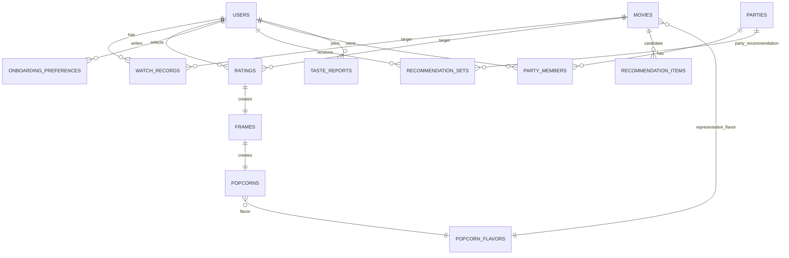
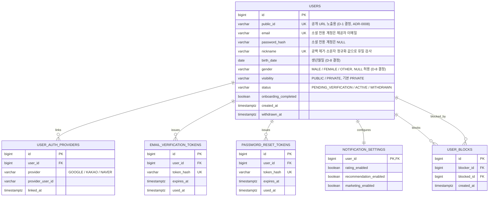
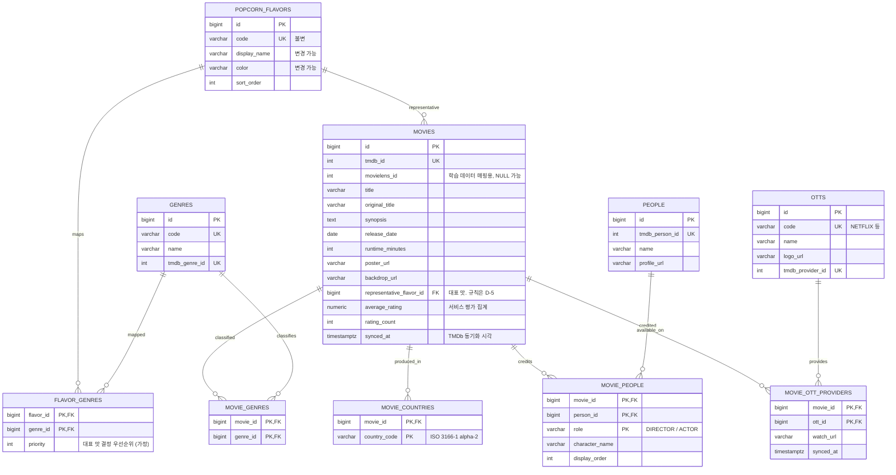
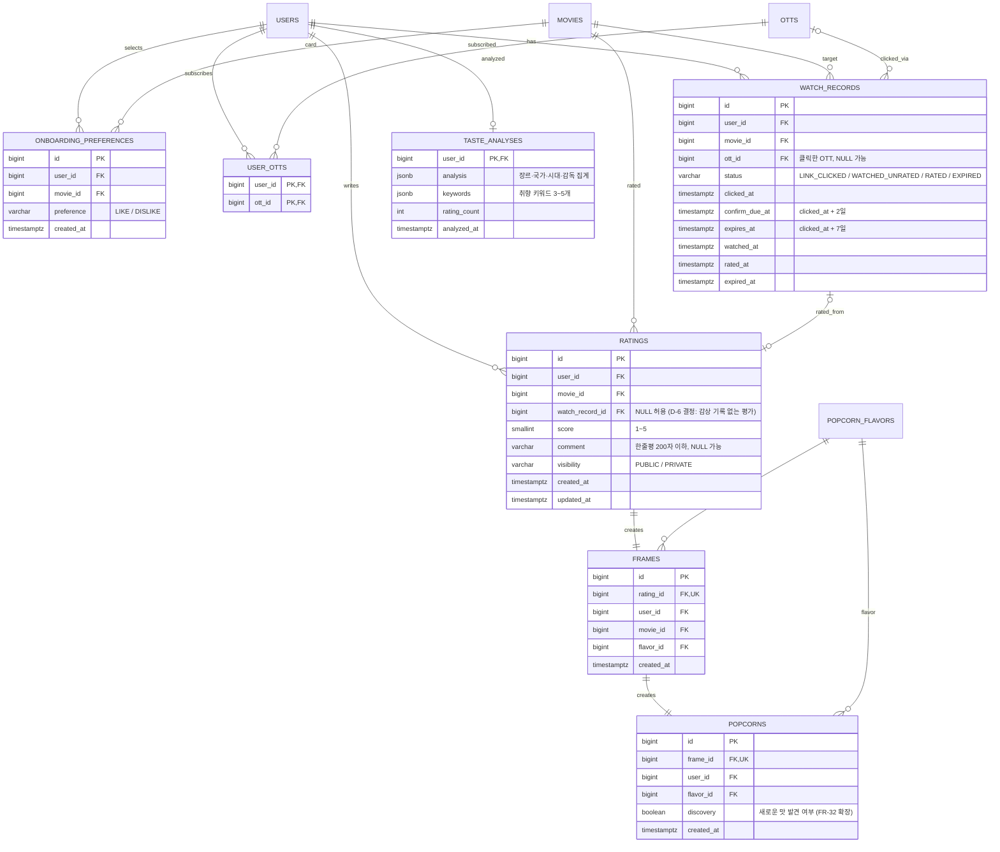
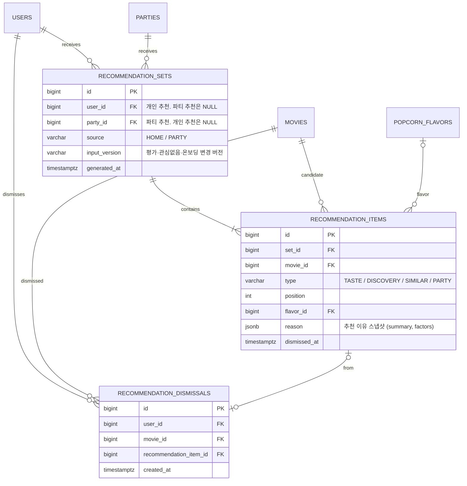
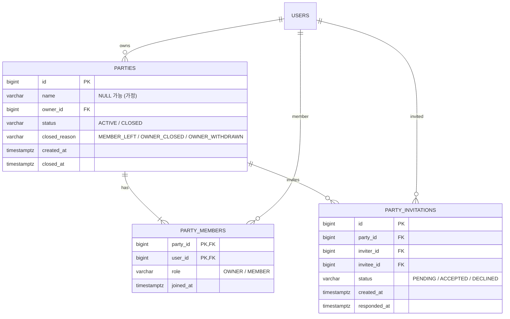
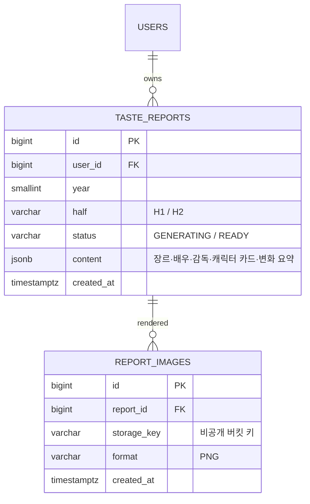
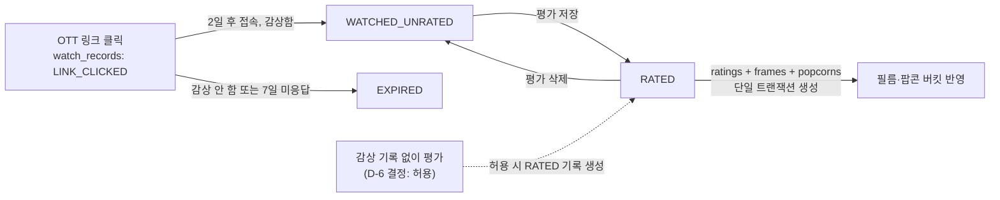

# 논리 ERD

FEELM 서비스 데이터베이스(PostgreSQL)의 논리 ERD입니다. [요구사항 정의서](./requirements.md)와 [API 명세](./api/README.md)에서
도출한 엔티티·관계·핵심 속성을 정리하며, 물리 스키마(타입·제약·인덱스·마이그레이션)는 [5. 물리 스키마 전 결정 사항](#5-물리-스키마-전-결정-사항)이
확정된 뒤 백엔드 첫 스프린트에서 작성합니다.

## 범위

- **포함**: 서비스 영속 데이터(PostgreSQL). 사용자·기준정보·영화·온보딩·감상·취향·추천·파티·리포트
- **제외**: Redis 키 설계(후보 Top-500, 추천 캐시, Refresh Token), HDFS/Parquet 레이아웃(MovieLens·TMDb 원본, Item Factor). 저장 모델이 달라 별도 문서로 관리합니다.
- MovieLens 사용자와 서비스 사용자는 연결하지 않습니다(README 6장). 영화만 TMDb ID로 매핑합니다.

## 범례

- 다이어그램의 타입은 논리 수준 표기입니다. 식별자는 내부 `bigint`, 공개 URL 노출용은 `users.public_id`입니다(D-1 결정, ADR-0008).
- `PK` 기본키, `FK` 외래키, `UK` 유일 제약. 복합 유일 제약은 표의 **제약** 열에 적습니다.
- 열거형 값은 [API 명세 공통 규약 – 상태값](./api/README.md#상태값)과 동일한 코드를 사용합니다.
- **(가정)** 은 팀 결정 전 초안 기본값입니다.

---

## 1. 전체 구조

영역 사이의 핵심 관계만 표시합니다. 각 영역의 상세는 2장에 있습니다.

---

## 2. 영역별 ERD

### 2.1 사용자·인증·소셜

| 테이블 | 목적 | 제약·규칙 | 관련 |
|---|---|---|---|
| `users` | 서비스 계정 | `nickname`은 정규화 값(공백 제거·소문자)으로 유일. 탈퇴 시 `status=WITHDRAWN`으로 전환하고 이메일·닉네임 재사용 허용 여부는 D-9 | FR-01, FR-37, FR-38 · API-001~016 |
| `user_auth_providers` | 소셜 로그인 수단 | UK(`provider`, `provider_user_id`). 같은 이메일이어도 기존 계정에 자동 통합하지 않음 | FR-35 · API-007~009 |
| `email_verification_tokens` | 가입 이메일 인증 | 1회용, 만료 24시간(가정). 해시만 저장 | FR-01 · API-002, API-003 |
| `password_reset_tokens` | 비밀번호 재설정 | 1회용, 만료 30분(가정). 성공 시 해당 사용자 Refresh Token 전부 폐기 | FR-37 · API-010, API-011 |
| `notification_settings` | 알림 수신 설정 | 사용자당 1행. 알림 **발송** 기능은 FR 부재 | FR-38 · API-017, API-018 |
| `user_blocks` | 사용자 차단 | UK(`blocker_id`, `blocked_id`). 양방향 필터는 조회 시 OR 조건 | FR-39 · API-019~022 |

> Refresh Token은 Redis에 TTL로 저장하며 별도 테이블을 두지 않습니다 (D-2 결정, ADR-0009).

### 2.2 기준정보·영화

| 테이블 | 목적 | 제약·규칙 | 관련 |
|---|---|---|---|
| `movies` | 영화 마스터 (TMDb 기준) | `tmdb_id` 유일. `average_rating`·`rating_count`는 평가 집계 반정규화 컬럼(D-10 결정) | FR-34 · API-028~031 |
| `genres` | 장르 기준정보 | TMDb 장르 ID 매핑 | FR-15 · API-029 |
| `movie_genres`, `movie_countries`, `movie_people` | 영화 속성 매핑 | `movie_people.role`로 감독·배우 구분 | FR-14, FR-15, FR-34 |
| `people` | 인물(감독·배우) | 검색 대상(FR-14) | API-028, API-030 |
| `otts` | OTT 기준정보 | 지원 목록은 미정(API-025) | FR-03, FR-16 · API-025 |
| `movie_ott_providers` | 영화별 시청 가능 OTT | TMDb watch provider 동기화 | FR-16 · API-030 |
| `popcorn_flavors` | 팝콘 맛 8종 기준정보 | `code` 불변, 표시명·색상 변경 가능(FR-06). 8종 값은 미정 | FR-06 · API-044 |
| `flavor_genres` | 맛 ↔ 장르 매핑 | 복수 장르 영화의 대표 맛 결정에 `priority` 사용(가정) — D-5 | FR-09 · API-044 |

### 2.3 온보딩·감상·취향

| 테이블 | 목적 | 제약·규칙 | 관련 |
|---|---|---|---|
| `onboarding_preferences` | 초기 취향(LIKE/DISLIKE) | UK(`user_id`, `movie_id`). 평가(1~5점)와 분리 저장, 프레임·팝콘 생성 안 함 | FR-02 · API-023, API-024 |
| `user_otts` | 구독 OTT | 전체 교체(PUT) | FR-03 · API-026, API-027 |
| `watch_records` | 감상 상태 머신 | 사용자·영화별 **활성 기록**(EXPIRED 아님)은 1개 — 부분 유일 인덱스(D-6 결정). 만료 후 재클릭은 새 행 | FR-17, FR-18 · API-033~035 |
| `ratings` | 평가 + 한줄평 | UK(`user_id`, `movie_id`). 한줄평은 컬럼(별도 테이블 아님). 삭제 시 프레임·팝콘 함께 삭제, 감상 기록은 `WATCHED_UNRATED`로 복귀 | FR-19, FR-26 · API-036~039 |
| `frames` | 필름의 프레임 | 평가와 1:1. 최초 저장 시 생성, 수정으로 변하지 않음 | FR-07, FR-08 · API-042, API-043 |
| `popcorns` | 팝콘 1알 | 프레임과 1:1. `flavor_id`는 영화 대표 맛. 맛별 집계는 `COUNT`·`AVG(score)`로 계산 | FR-06, FR-09, FR-32 · API-041 |
| `taste_analyses` | 취향 분석 결과 캐시 | 평가 변경 시 재계산(비동기 가정). FastAPI 도입 시 계산 위치 D-4 | FR-04, FR-05 · API-040 |

> D-7 결정: 필름 중심 파생 기능(프레임 배치·메모·커버 등) 확장 가능성을 위해 `frames`·`popcorns`를 별도 테이블로 유지합니다.

### 2.4 추천

| 테이블 | 목적 | 제약·규칙 | 관련 |
|---|---|---|---|
| `recommendation_sets` | 추천 세트(이력 단위) | `user_id`·`party_id` 중 하나만 NOT NULL(CHECK). 입력이 바뀌지 않으면 같은 세트 반환 | FR-10, FR-33 · API-045, API-046, API-048, API-058 |
| `recommendation_items` | 세트의 후보 영화 + 이유 스냅샷 | `reason`은 생성 시점 값을 JSONB로 보존(이후 영화 정보 변경과 무관) | FR-12, FR-13 · API-045~048 |
| `recommendation_dismissals` | 관심없음 | UK(`user_id`, `movie_id`). 평가와 분리. 해제 기능은 미정 | FR-36 · API-047 |

> 후보 Top-500과 최종 추천 캐시는 Redis, Item Factor는 HDFS에 있으며 이 ERD 범위 밖입니다. `recommendation_sets`는 사용자에게 **노출된 결과**의 이력만 저장합니다.

### 2.5 파티

| 테이블 | 목적 | 제약·규칙 | 관련 |
|---|---|---|---|
| `parties` | 파티 | 사용자는 여러 활성 파티에 속할 수 있고 1인당 상한(기본 5)은 설정값(D-3 결정). 파티 인원 변경 시 해당 파티를 `CLOSED` 처리하고 파티장이 새로 생성 | FR-20 · API-049, API-050, API-055, API-056 |
| `party_members` | 파티 구성원 | 파티장 포함 최대 4명은 애플리케이션 검증 | FR-20, FR-21 · API-057 |
| `party_invitations` | 초대 | 자동 만료 없음. 거절 후 재초대는 새 행. `PENDING` 중복은 UK(`party_id`, `invitee_id`) WHERE status=PENDING(부분 유일) | FR-20 · API-051~054 |

### 2.6 리포트 (2차 MVP)

| 테이블 | 목적 | 제약·규칙 | 관련 |
|---|---|---|---|
| `taste_reports` | 반기 취향 리포트 | UK(`user_id`, `year`, `half`). 생성 시점 스냅샷 | FR-23 · API-059, API-060 |
| `report_images` | 이미지 카드 | 파일은 S3 호환 스토리지, DB에는 키만. 다운로드 URL은 요청 시 서명 발급 | FR-24, NFR-07 · API-061 |

---

## 3. 주요 상태 전이와 데이터 규칙

### 감상 → 평가 → 프레임·팝콘

- `ratings` 저장·`frames`·`popcorns` 생성·`watch_records.status=RATED` 전이는 **하나의 트랜잭션**으로 처리합니다(NFR-06).
- `ratings` 삭제 시 `frames`·`popcorns`는 CASCADE 삭제, `watch_records`는 `WATCHED_UNRATED`로 되돌립니다(FR-18).
- `movies.average_rating`·`rating_count`와 `taste_analyses`는 평가 변경 시 갱신되는 파생 데이터입니다.

### 차단·공개 범위

- 차단은 `user_blocks`에 단방향 행으로 저장하고, 조회 시 `(blocker=A AND blocked=B) OR (blocker=B AND blocked=A)`로 양방향 필터를 적용합니다(FR-39).
- `users.visibility=PRIVATE`인 사용자의 필름·팝콘·평가는 본인 외 조회 시 404로 처리합니다(NFR-07). 파티원에게 팝콘 집계를 노출하는지는 API-057 미정 사항입니다.

### 파티 인원 변경

- 멤버가 나가거나 파티장이 종료하면 `parties.status=CLOSED`, `closed_reason` 기록, 대기 중 초대는 모두 `DECLINED` 처리합니다.
- 종료된 파티의 `recommendation_sets`는 보존합니다(추천 이력).

---

## 4. API 리소스 ↔ 엔티티 대응

| API 리소스 | 주 테이블 | 참조 테이블 |
|---|---|---|
| `/auth/*`, `/users/me`, `/users/nickname-availability` | `users`, `user_auth_providers`, `email_verification_tokens`, `password_reset_tokens` | — |
| `/users/me/notification-settings` | `notification_settings` | — |
| `/users/search`, `/users/{userId}/block`, `/users/me/blocks` | `users`, `user_blocks` | — |
| `/onboarding/cards`, `/onboarding/preferences` | `onboarding_preferences` | `movies`, `popcorn_flavors` |
| `/otts`, `/users/me/otts` | `otts`, `user_otts` | — |
| `/movies/search`, `/movies/filter-options`, `/movies/{movieId}` | `movies`, `movie_genres`, `movie_countries`, `movie_people`, `movie_ott_providers` | `genres`, `people`, `otts`, `ratings`(집계) |
| `/movies/{movieId}/similar` | — (추천 서비스) | `movies` |
| `/movies/{movieId}/reviews` | `ratings` | `users`, `user_blocks` |
| `/movies/{movieId}/ott-clicks`, `/watch-records/*` | `watch_records` | `otts` |
| `/movies/{movieId}/ratings`, `/ratings/{ratingId}`, `/users/me/ratings` | `ratings`, `frames`, `popcorns` | `watch_records`, `popcorn_flavors` |
| `/users/me/taste` | `taste_analyses` | `ratings` |
| `/users/me/popcorn`, `/popcorn-flavors` | `popcorns`, `popcorn_flavors` | `flavor_genres` |
| `/users/me/frames`, `/frames/{frameId}` | `frames` | `ratings`, `movies`, `watch_records` |
| `/recommendations*` | `recommendation_sets`, `recommendation_items`, `recommendation_dismissals` | `movies`, `popcorn_flavors` |
| `/parties*` | `parties`, `party_members`, `party_invitations` | `users`, `popcorns`(파티원 팝콘) |
| `/users/me/reports`, `/reports/*` | `taste_reports`, `report_images` | — |
| `/users/{userId}/profile`, `/users/{userId}/taste-comparison` | `users` | `frames`, `popcorns`, `ratings`, `user_blocks` |
| `/movies/trending`, `/rankings/users`, `/recommendations/today`, 커뮤니티 | 미정 (2차·확장) | `ratings`, `popcorns` 집계 |

---

## 5. 물리 스키마 전 결정 사항

2026-08-30~31에 대부분 결정되었습니다. 결정 근거·대안은 각 [ADR](./adr/README.md)과 A 회의 안건 페이지를 참조합니다.

| # | 결정 | 선택지 | 결정 결과 | 영향 범위 |
|---|---|---|---|---|
| D-1 | 식별자 타입 | `bigint` 시퀀스 / UUID(v7) / 혼합 | **내부 `bigint` + 공개 URL `users.public_id`** (08-30, ADR-0008) | 전 테이블, 전 API 응답 |
| D-2 | Refresh Token 저장소 | PostgreSQL / Redis(TTL) | **Redis** (08-31, ADR-0009) — `refresh_tokens` 테이블 제거 | 인증 API, 회전·폐기, 탈퇴 처리 |
| D-3 | 사용자당 활성 파티 수 | 1개 제한 / 복수 허용 | **복수 허용, 상한(기본 5) 설정값** (08-30) | API-049·050·053, ⑧ 화면 |
| D-4 | 취향 분석·추천 이유 계산 위치 | Spring Boot / FastAPI | **FastAPI** (08-31, ADR-0012) — 내부 API 명세 별도 작성 | `taste_analyses` 갱신 방식, 내부 API 계약 |
| D-5 | 복수 장르 영화의 대표 맛 규칙 | `flavor_genres.priority` / TMDb 순서 / 큐레이션 | 미정 — A-6과 함께 확정 | `movies.representative_flavor_id`, 팝콘 집계 |
| D-6 | 감상 기록 없이 평가 허용 | 허용 / 불허 | **허용** (08-30) — `ratings.watch_record_id` NULL 허용 | `watch_records` 유일 제약, ⑩·⑪ 화면 |
| D-7 | 프레임·팝콘 테이블 분리 | 별도 / `ratings` 흡수 | **별도 유지** (08-30) — 필름 파생 기능 확장 대비 | 필름·팝콘 조회, FR-32 저장 위치 |
| D-8 | 가입 시 나이 저장 형식 | 정수 / 연령대 / 출생연도 | **생년월일(`birth_date`)** (08-31, 08-30 출생연도에서 변경). 성별 3값 + NULL 허용 | `users`, API-001·008 |
| D-9 | 탈퇴 사용자 데이터 처리 | 즉시 삭제 / 기간 보존 / 익명화 | 미정 — 출시 전 개인정보 방침과 함께 확정 | `users.status`, 공개 한줄평, 학습 데이터 |
| D-10 | 평균 별점 집계 방식 | 반정규화 컬럼 / 조회 시 집계 / MView | **반정규화 컬럼, 차단 미반영** (08-30) | 평가 트랜잭션 범위, API-030 |
| D-11 | 검색 엔진 | PostgreSQL full-text(`pg_trgm`) / Elasticsearch | **PostgreSQL full-text + `pg_trgm`** (08-31, ADR-0010) | 인덱스 설계 |
| D-12 | 팝콘 맛 8종 기준정보 | 통합본 2.1 값 확정 | 미정 — A-6, 데이터 담당 초안 후 확정 | `popcorn_flavors`·`flavor_genres` 초기 데이터, 온보딩 카드 |

미결은 D-5·D-12(팝콘 맛 기준정보, A-6)와 D-9(출시 전 정책)뿐입니다.
