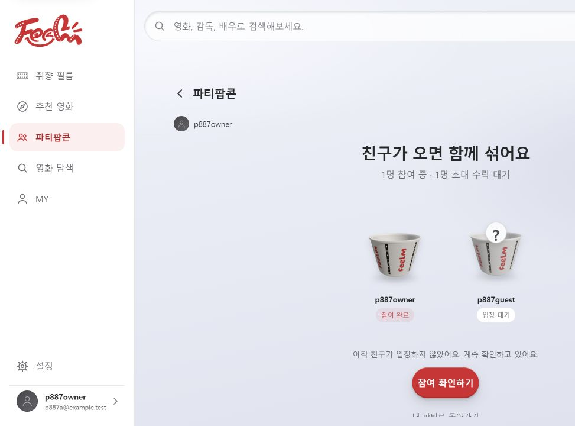
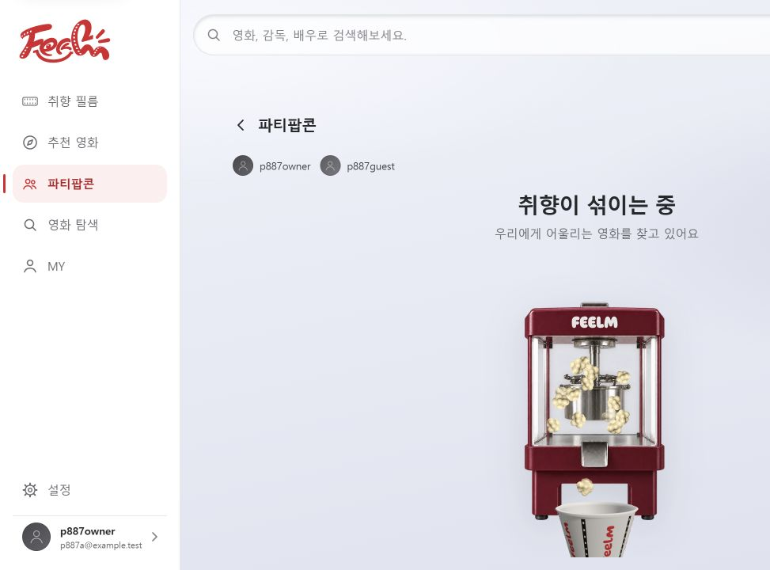

# S15P21E106-951 로컬 두 계정 SSE 검증

- 일시: 2026-09-27 (KST)
- 구현 커밋: `5c1027f7`
- 프런트: 해당 작업 브랜치의 Vite, `http://127.0.0.1:5188/app/`
- 백엔드: 같은 worktree의 Spring Boot local 프로필, 포트 8084
- DB: 기존 격리 테스트 DB `feelm_887_verify`, Redis: 테스트 전용 `feelm-redis-951`
- 인증 mock 비활성화. 두 테스트 계정 모두 실제 로그인 API 사용.

## 절차와 결과

1. 방장 `p887owner`와 친구 `p887guest`로 각각 로그인하고, 방장 API로 파티 6과 초대 6을 생성했다.
2. 방장은 브라우저에서 로그인해 `/parties/6/popcorn/mix`를 열었다. 1명 참여·1명 초대 대기를 확인했다.
3. 방장 계정으로 별도 SSE 관측 연결을 열고 최초 `notification-changed` 이벤트를 확인했다. 브라우저는 앱의 기존 SSE 연결을 그대로 사용했다.
4. 친구 계정의 Bearer 인증으로 실제 초대 수락 API를 호출했다. 수락 응답은 참여자 2명이었다.
5. 수락 API 호출 시작부터 별도 관측 연결의 후속 `notification-changed` 이벤트 수신까지 125ms였다. 이 수치는 API 처리와 SSE 전달 시간이며 브라우저 렌더링 시간은 아니다.
6. 방장 화면에서 새로고침이나 `참여 확인하기` 클릭 없이 참여자 2명과 `취향이 섞이는 중` 화면으로 전환됨을 확인했다.

### 수락 전

### SSE 수신 후

## 검증 범위와 제한

- 실제 두 계정의 초대 수락 → SSE → 브라우저 자동 섞기 시작을 검증했다. 친구의 수락은 API로 수행했으며 친구 초대 화면 UI 조작은 검증하지 않았다.
- 기존 관련 테스트 25개, 프런트 빌드와 변경 파일 ESLint·Prettier가 통과했다. 주기 조회 제거, 수동 확인, 연속 신호 병합, 늦은 응답 무효화와 섞기 중 재시작 방지는 자동 테스트로 검증했다.
- 해당 DB에는 추천 후보 데이터가 없고 로컬 Kafka도 실행하지 않았다. 섞기 연출 종료 후 기존 추천 준비 중 안내가 나왔다. 이번 검증은 추천 결과 생성 성공을 검증한 것이 아니다.
- 실제 네트워크 단절 후 재연결은 이번 수동 검증에서 수행하지 않았다.
