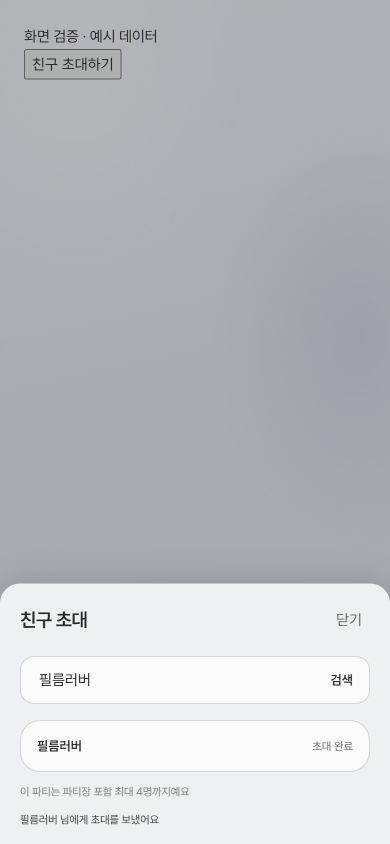

# S15P21E106-954 파티 인원별 안내와 초대 시트

## 변경

- 혼자인 파티의 모바일 대표 카드와 데스크톱 카드·패널에서 공통 취향 대신 참여 안내를 표시한다.
- 상세 화면의 참여 인원이 파티별 정원 이상이면 초대 버튼과 시트를 숨긴다.
- 팝콘 맛 목록의 폭을 제한하고 각 열 내용을 가운데 정렬한다.
- 친구 초대를 별도 시트로 옮기고 초대 완료 표시, 중복 선택 방지, 연속 초대와 오류 안내를 제공한다.
- 닫기·배경 클릭·Escape, 시트 안의 Tab 탐색 및 닫은 후 초점 복귀를 지원한다.

## 검증

- 파티 목록, 데스크톱, 상세, 생성, 참여 화면 테스트: 5개 파일 80개 통과.
- TypeScript 및 Vite production build 통과. 기존 PostCSS 및 번들 크기 경고 발생.
- 변경 TSX ESLint 및 git diff --check 통과.
- 390×844 브라우저에서 실제 PartyInviteSheet 컴포넌트의 검색 결과와 초대 완료 표시를 확인했다.
- 캡처는 예시 데이터와 로컬 초대 성공 처리로 만든 화면이며 운영 API 연동은 검증하지 않았다.

## 영향

- 공용 PartyInviteSearch에 선택적 isPickDisabled 속성을 추가한다. 기존 호출부 기본 동작은 유지한다.
- API, DB, 환경 변수, 의존성 및 CI/CD 계약 변경은 없다.
- 열린 MR !738(S15P21E106-950)은 파티 목록 SSE 갱신을 구현하므로 PartyListPage 파일 변경이 겹칠 수 있다.
