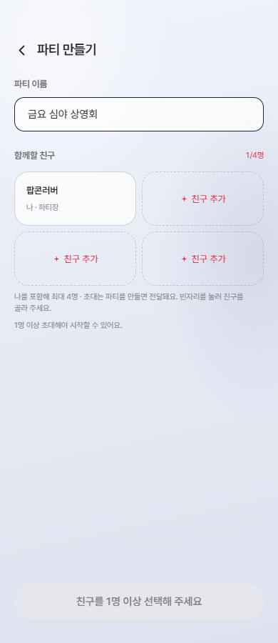
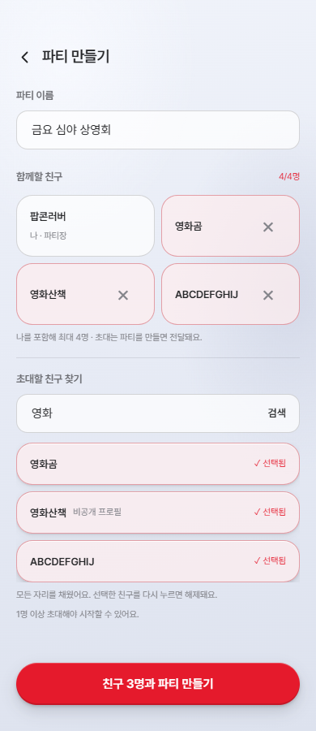

# S15P21E106-958 파티 만들기 친구 추가 UX

## 변경 결과

- 파티 이름 입력 위에 보이는 제목을 추가했다. 공용 TextField는 그대로 사용한다.
- 함께할 친구를 2열 카드로 표시하고 빈자리의 `＋ 친구 추가`에서 아래 검색을 연다.
- 처음 열 때와 빈자리를 다시 누를 때 입력에 포커스한다. 한 번 열린 검색은 유지하고
  선택 즉시 카드에 반영한다. 검색어·결과를 유지하므로 별도 완료 단계 없이 연속 추가한다.
- 결과는 `+ 추가` / `✓ 선택됨`, 카드 제거는 닉네임을 읽어주는 `×` 버튼이다.
- 정원이 차면 미선택 결과만 잠그고 선택 해제는 유지한다. 제출 중과 일부 초대 실패 후에는
  이름·검색·선택을 잠그며 기존 파티 번호를 사용해 중복 생성을 막는다.
- 카드 추가에 180ms 모션을 적용하고 prefers-reduced-motion에서 생략한다.
- 파티 생성(API-049) 후 초대(API-051), 정원과 최소 인원 계약은 유지했다.

## 검증

- `npm run test:run -- src/pages/party/PartySetupPage/PartySetupPage.test.tsx src/pages/party/PartyPopcornPage/PartyPopcornPage.test.tsx`: 38개 통과.
- `npm run build`: TypeScript 및 프로덕션 빌드 통과.
- `npm run lint`: 통과.
- `npm run format:check`: 프론트엔드 전체 통과.
- 실제 컴포넌트와 모바일 FullScreenLayout 스타일을 사용한 독립 QA 페이지에서
  320·390·1280px 폭의 가로 넘침, 초기 검색 숨김, 포커스, 연속 선택, 검색어 유지,
  선택 해제 및 움직임 줄이기를 확인했다. 브라우저 런타임 오류 없음.
- 브라우저 QA의 프로필과 사용자 검색 API는 목업으로 대체했다. 실제 두 계정 초대 전송,
  데스크톱 전체 셸 통합 및 모바일 가상 키보드는 검증하지 않았다.
- 빌드의 기존 PostCSS 경고와 500kB 청크 경고는 남아 있다.

## CI 실패 수정

- Job 649177에서 기존 PartyFlow 통합 테스트가 숨겨진 검색 입력을 바로 조회해 2개 실패했다.
- 검색 전 빈자리의 친구 추가 버튼을 누르고 변경된 생성 버튼 문구를 사용하도록 수정했다.
- 수정 후 `npm run test:run`: 125개 파일, 1,231개 테스트 전체 통과.
- `npm run lint` 및 `npm run format:check`: 통과.
- 최신 origin/develop과 병합 충돌 없음.

## 화면

## 영향

PartyInviteSearch에 기본 false인 autoFocus 옵션만 추가했다. 기존 파티 상세 초대의
isPickDisabled 옵션과 기본 동작은 보존했고 관련 화면 24개 테스트도 통과했다.
API·DB·의존성·환경 변수 및 공통 스타일 토큰 변경은 없다.
GitLab API 인증 오류(401)로 열린 MR 목록은 확인하지 못했다.
