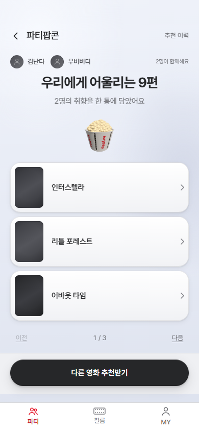

# S15P21E106-961 모바일 파티 추천 페이지 검증

사용자가 승인한 비교 시안에 따라 추천 결과를 화면에서 3편씩 나누고, 모바일 결과
본문과 새 추천 동작을 분리했다. 공용 PartyFlowShell의 footer는 결과 화면만 사용하며
모으기·섞기 화면은 기존 배치를 유지한다. API·DB·환경 변수·의존성 변경은 없다.

## 자동 검증

- `npm run test:run -- src/pages/party/PartyRecommendationPage src/pages/party/PartyPopcornMixPage src/hooks/usePartyRecommendationEntry.test.tsx`: 5개 파일, 39개 테스트 통과.
- `npm run build`: 타입 검사 및 프로덕션 빌드 통과.
- `npm run lint`: 통과.
- `npm run format:check`: 전체 검사 통과.
- `git diff --check`: 통과.

## 브라우저 검증

로컬 Vite 서버의 실제 라우터·레이아웃·화면을 Chrome에서 실행했다. 서버 요청은
검증용 응답으로 대체했으므로 실제 배포 API 연동 검증은 아니다.

| 화면 크기 | 검증 |
| --- | --- |
| 390×844 | 9편을 3페이지로 모두 보기, 경계 버튼 비활성화, 하단 추천 버튼 유지 |
| 320×568 | 가로 넘침 없이 페이지 이동과 하단 버튼 접근 |
| 390×500 | 낮은 높이에서도 의견 입력 확장 후 의견 보내기까지 스크롤 |
| 1280×800 | 데스크톱 셸 스크롤과 하단 추천 버튼 접근 |

모든 크기에서 페이지 이동에 따른 추가 추천 요청 없음, 의견 입력을 펼친 뒤 마지막
동작까지 접근 가능, 런타임 오류 없음도 확인했다. 이미지와 영화 정보는 검증용이다.

## 남은 확인

- 실제 iPhone Safari와 가상 키보드·노치 safe area 동작은 기기에서 확인해야 한다.
- GitLab API 인증이 거부되어 관련 열린 MR 목록은 직접 확인하지 못했다.
- 최종 fetch 시 최신 origin/develop을 fast-forward로 반영했고 수정 파일 충돌은 없었다.
- 기존 SP 3을 유지한다. 사용자 후속 요청에 따라 커밋·Push·리뷰어 없는 develop 대상 MR을 생성한다. 배포·병합은 수행하지 않는다.

## 화면

