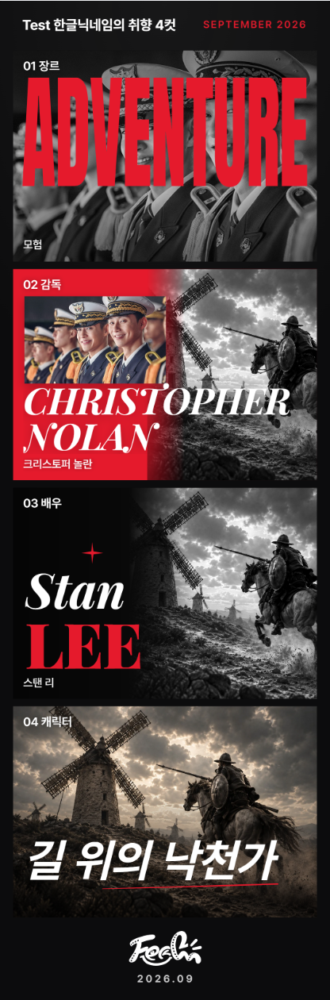
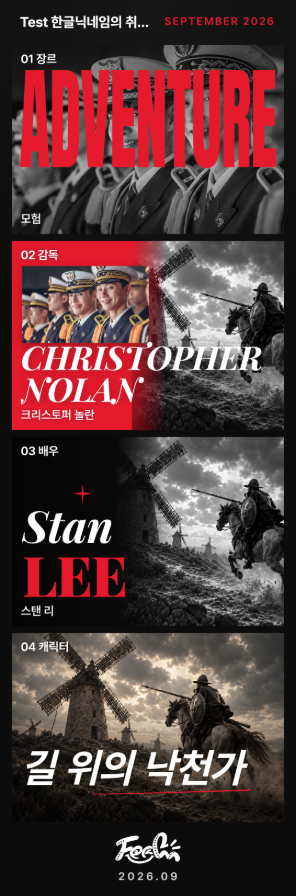

# S15P21E106-963 · iPhone 리포트 앞면 PNG 저장

- Jira: [S15P21E106-963](https://ssafy.atlassian.net/browse/S15P21E106-963)
- 작업 브랜치: `fix/S15P21E106-963-ios-report-export`
- 기준: `origin/develop`의 `b9cc15ed` (2026-09-27 최신화)

## 확정한 범위

저장과 공유는 기존 `captureReportImage` 앞면 함수를 함께 사용한다. 앞면의 사진·폰트
포함은 iOS에서만 수정한다. 갤럭시·웹은 기존 `captureReadyReportImage`를 그대로 호출하며
사진·폰트 준비와 렌더링 옵션도 바꾸지 않는다. `captureReportBackImage`, 뒷면 처리 함수, 공유 시트와 공유 버튼 동작,
`ReportFourCut` 공용 CSS는 기존 구현을 유지한다. 저장은 앞면 한 장만 내려받는다.

사용자 승인에 따라 iOS만 API-061 성공 후 이번에 캡처한 PNG를 내려받는다. 서버가 보관한
최초 PNG가 불완전하더라도 해당 서명 URL을 다시 다운로드하지 않는다. API-061 실패 시
로컬 다운로드도 실행하지 않는다. 서버의 최초 파일 한 장 보관·재사용 정책과 API 응답,
DB, 인프라, 의존성은 바꾸지 않는다. 반복 저장의 파일 수는 기존과 같다.
갤럭시·웹은 기존 API-061의 서명 URL PNG 다운로드를 유지한다. 처음에는 앞면 준비 처리와
현재 PNG 다운로드를 모든 환경에 적용했으나, 사용자의 범위 축소 요청에 따라 iOS만
보정하도록 수정했다.

## 구현

- iOS 앞면은 로드된 사진을 같은 출처의 TMDB 프록시 또는 기존 자산 경로로 읽고 PNG로
  정규화한다. 투명 부분을 보존하며 원본의 긴 변을 최대 2160px로 제한한다.
- iOS 앞면은 사진을 SVG에서 제외하고 Canvas에 직접 그린다. 기존 DOM에서 가져온
  배경·그라데이션·글자·로고를 겹쳐 화면의 모양을 유지한다. 사진 위치·크롭·확대·
  흑백·대비·투명 마스크는 원본 DOM의 배치와 계산된 CSS에서 읽는다.
- 장르 누끼는 큰 이름 앞에 그리며 반투명 픽셀도 보존한다. 대표작 사진·감독·배우 사진은
  기존 순서대로 그린다. 지원하지 않는 마스크나 자산 실패는 빈 사진으로 성공시키지 않는다.
- 기존 SVG 사진 배경·두 번 렌더링 방법은 Windows WebKit에서는 통과했지만 사용자의
  실제 iPhone에서 사진이 계속 누락됐다. 최종 구현은 그 방법을 사용하지 않는다.
- iOS 앞면 캡처 동안만 3D 합성층을 평면화하며 성공·실패 후 이미지 속성과 인라인 스타일을
  복원한다. 공용 컴포넌트 CSS는 변경하지 않는다.
- 숨겨진 긴 뒷면이 포함되는 `scrollHeight` 대신 앞면의 실제 경계를 측정한다. 상세 화면의
  앞면 높이 1028.73px에 숨겨진 뒷면까지 1185px로 계산되어 생기던 하단 검정 여백을 제거한다.
  이 보정은 iOS 앞면에만 적용하며 기존 웹·안드로이드 및 뒷면 크기 계산은 유지한다.
- 기존 리포트 서체인 Anton, Playfair Display 두 스타일과 Pretendard Variable을 포함한다.
  한글은 전체 WOFF2 한 파일을 캡처 시점에 읽어 수십 개의 동적 서브셋 수집을 피한다.
  폰트 실패나 자산 대신 HTML 응답이 오면 대체 서체로 저장하지 않고 실패를 알린다.
- 폰트 포함 CSS는 성공 시 재사용하고 실패 시 다음 시도에서 다시 읽는다. 전체 한글
  파일은 약 2.06MB이며 첫 앞면 캡처 때 추가로 읽는다.
- iOS 앞면은 전체 30초, 렌더링 시도당 10초 제한에 취소 신호를 전달한다. 시간 초과 시
  사진 요청과 캡처 대기를 중단하고 화면 스타일을 즉시 복원한 뒤 실패를 반환한다.
  재시도 전에 이전 렌더링을 취소하며 늦은 SVG·이미지 디코딩·PNG 결과는 사용하지 않는다.
  폰트의 공유 요청은 캐시를 위해 완료될 수 있지만 취소된 캡처의 후속 DOM 변경은 실행하지 않는다.

## 자동 검증

2026-09-27 로컬 Windows 환경에서 실행했다.

```text
npm run test:run -- src/utils/reportImage.test.ts src/utils/reportImageFonts.test.ts src/utils/reportImageIOS.test.ts src/pages/reports/ReportDetailPage/saveReportImage.test.ts src/pages/reports/ReportFlow.test.tsx src/components/ReportFourCut/ReportFourCut.test.tsx src/api/reports.test.ts
7개 파일 · 120개 테스트 통과
npm run build · 통과
npm run lint · 통과
npm run format:check · 전체 검사 통과
git diff --check · 통과
```

빌드의 기존 PostCSS `from` 경고와 500kB 청크 경고는 남아 있으며 빌드는 성공했다.
최신 `origin/develop`에 추가 커밋이 없음을 확인했다. 기존 뒷면 캡처 처리 함수부터
다운로드·공통 보조 함수까지의 소스가 기준 브랜치와 동일한지도 비교했다.

iOS 앞면 폰트 포함, Canvas 합성·재시도, 데스크톱 모드 iPad, 캡처 뒤 DOM 복원,
사진·폰트 실패, 서버 인가·업로드 실패, 기존 PNG URL 무시, 뒤집힌 칸을 복원한
앞면 한 장 저장을 확인한다. 기존 공유 흐름과 뒷면 규격도 검증한다. iPhone 뒷면은
기존처럼 폰트 생략·한 번 렌더링을 사용하며 새 앞면 폰트 함수를 부르지 않는다.
Canvas 합성 검증은 SVG 사진 제외, 글자층 배경 투명화, 누끼 앞뒤 순서와 자식 스타일,
cover/contain 크롭·확대 위치, 흑백·대비의 알파 보존, 마스크 실패 중단을 포함한다.
갤럭시·웹이 새 폰트/Canvas 합성 함수를 호출하지 않으며 기존 서명 URL로 다운로드하는
분기도 검증한다. 캡처·API·서명 파일 다운로드 실패를 성공으로 처리하지 않는다.
시간 초과 검증은 폰트·사진 요청 대기, 전체 제한 중 스타일 복원, 다음 캡처에 대한 늦은
작업의 간섭 방지, 이전 렌더링 취소 후 재시도, SVG·디코딩·PNG 인코딩의 늦은 완료를 포함한다.

## 시간 초과 브라우저 재현

Windows WebKit의 iPhone 13 조건에서 실제 폰트 응답과 SVG 디코딩을 보류했다.
두 시나리오는 별도 브라우저 컨텍스트에서 실행했으며 운영 API를 호출하지 않았다.

| 조건 | 실패 안내까지 | 안내 전 스타일 복원 | 늦은 완료 뒤 DOM 변경 | 다음 캡처 |
| --- | --- | --- | --- | --- |
| 전체 한글 폰트 응답을 30초 넘게 보류 | 30.43초 | 통과 | 0건 | 통과 |
| 폰트 응답을 25초 보류한 뒤 SVG 디코딩 보류 | 30.34초 | 통과 | 0건 | 통과 |

오류 안내 시 저장 버튼의 대기가 해제되고 원본 스타일·이미지 속성이 복원됐다.
보류한 응답을 풀어도 미리보기 생성이나 후속 화면 변경은 없었으며 재시도는 정상 PNG를 만들었다.
두 시나리오 모두 브라우저 런타임 오류가 없었다. 실제 iPhone의 느린 통신 환경 검증은 별도다.

## 브라우저 검증

수정 범위를 iOS만으로 좁힌 최종 코드에서 실제 설치된 Chrome·Edge와 Android 모바일
조건, Windows WebKit의 iPhone 조건을 검증했다. Android와 WebKit은 에뮬레이션이며
실제 갤럭시/Samsung Internet 또는 iPhone Safari 하드웨어 검증을 대신하지 않는다.
실제 `ReportFourCut`과 캡처·저장 함수를 사용하고 API-061/서명 파일만 브라우저에서
테스트 응답으로 처리했다. 운영 서버에는 업로드하지 않았다.

| 환경 | 실행 엔진 | 화면 조건 | 사진·서체·첫/반복 저장 |
| --- | --- | --- | --- |
| Windows Chrome | 설치된 Chrome 154.0.8037.57 | 1440×900 | 통과 |
| Windows Edge | 설치된 Edge 154.0.4258.37 | 1440×900 | 통과 |
| Android Chrome 모사 | 설치된 Chrome, Galaxy S9+ UA·터치·DPR | 320×658 | 통과 |
| Android Chrome 가로 모사 | 같은 모바일 조건 | 658×320 | 통과 |
| iPhone 회귀 모사 | Windows WebKit, iPhone 13 조건 | 390×664 | 통과 |

- 모든 환경에서 미리보기 2회·PNG 저장 2회·API 거절 시 중단을 확인했다. 출력은
  1080×3268이며 TMDB JPEG와 저장소 WebP 사진 네 컷, 한글·영문·날짜·로고가 포함된다.
- 갤럭시·웹은 기존 캡처/다운로드 보조 함수의 소스를 그대로 유지한다. 저장마다
  API-061이 반환한 서버 PNG를 내려받고, 이번 캡처 Blob으로 대체하지 않음을 확인했다.
  서버 PNG에는 픽셀을 바꾸지 않는 PNG 텍스트 청크를 추가해 캡처 파일과 구별했다.
  두 번의 다운로드가 서버 파일의 바이트와 정확히 일치했다.
- iOS는 서버 PNG URL을 요청하지 않고 이번 업로드 Blob과 바이트가 같은 파일을
  내려받는다. Blob 요청 본문을 제공하지 않는 드라이버에서는 브라우저 fetch에 실제로
  넘긴 Blob을 읽어 비교했다.
- 사진 영역 네 곳에서 원본 화면과 캡처의 평균 RGB 차이가 각각 15/255 미만이다.
  각 환경의 이미지 URL·srcset·인라인 스타일도 캡처 후 복원됐다.
- 가로 화면의 반복 캡처에서 글자 가장자리 2픽셀이 1 RGB 단계만 달라지는 Chromium
  합성 차이를 확인했다. 비교는 최대 100픽셀·2 RGB 단계 이하만 허용하며 사진·글자
  위치 변화는 허용하지 않는다. 다운로드와 서버/업로드 파일의 일치는 여전히 바이트로
  엄격히 비교한다.
- 테스트에서 의도한 API-061 403 거절 외에는 런타임/자산 오류가 없었다. 거절된 요청은
  파일 다운로드와 성공 안내로 이어지지 않는다.
- 시간 초과 수정 후 첫 전체 검사에서는 iOS 반복 PNG의 TMDB 사진 영역 픽셀 비교가 한 번
  실패했다(414,816픽셀, 최대 24 RGB 단계). 사진 누락은 아니며 원인은 확정하지 못했다.
  iOS 개별 검사와 전체 5환경 재검사는 통과했고 마지막 반복 PNG는 바이트까지 같았다.
  실제 iPhone에서 반복 저장을 다시 확인한다.
- 추가 iOS 누끼 검증에서는 투명·반투명 PNG의 확대·가로 위치와 장르 글자 앞에 그리는
  순서를 확인했다. WebKit 출력은 1,830,066바이트이며 원본 URL도 복원됐다.

| Windows Chrome 앞면 | Android 세로 모사 앞면 |
| --- | --- |
|  |  |

[WebKit iPhone 회귀 결과](S15P21E106-963/webkit-front.png)
[WebKit 투명 누끼와 겹침 검증](S15P21E106-963/webkit-cutout.png)

## 배포용 빌드의 실제 상세 화면 추가 검증

2026-09-27 Linux `frontend/Dockerfile`로 최신 코드와 앞면 경계 보정을 빌드하고, 로컬
Nginx 컨테이너에서 `/app/my/reports/301`의 실제 번들을 실행했다. 샘플 페이지 대신
운영 상세 화면의 로그인 복원·프로필 조회·앞면 복원·저장 버튼을 사용했다. API는
브라우저에서 테스트 응답으로 처리하며 운영 서버의 사진 프록시는 GET만 확인했다.
운영 서버에는 업로드하지 않았다. 새 서비스 워커 등록은 이 자동 검사에서 차단했으며,
기존 서비스 워커가 fetch나 Cache Storage를 사용하지 않는 것도 확인했다.

| 조건 | 저장 횟수 | 반복 PNG | 서버 실패 후 재시도 | 토큰 갱신 후 저장 | 새로고침 후 저장 |
| --- | --- | --- | --- | --- | --- |
| WebKit iPhone 원본 JPEG·WebP | 6 | 바이트 동일 | 통과 | 통과 | 통과 |
| WebKit iPhone 누끼 배치·위치·확대 | 6 | 바이트 동일 | 통과 | 통과 | 통과 |
| 설치된 Windows Chrome | 6 | 바이트 동일 | 통과 | 통과 | 통과 |
| Android Chrome 모바일 모사 | 6 | 바이트 동일 | 통과 | 통과 | 통과 |

- 출력 24개 모두 1080×3268 PNG이며 iOS는 해당 업로드 본문, 웹·안드로이드는 최초 서버
  PNG의 바이트와 같았다. iOS는 서버 PNG URL을 요청하지 않았다.
- iOS 폰트 요청에 200 HTML을 응답하거나 사진 프록시에 502를 응답했을 때 다운로드하지
  않고 버튼 대기를 해제했다. 요청을 정상화하면 저장됐다. API-061 500도 다운로드를
  중단하고 정상화 후 재시도됐다. 401 뒤 토큰 갱신·같은 PNG 재전송도 성공했다.
- 장르 뒷면을 연 뒤 저장해도 앞면 한 장만 내려왔다. 이미지 URL·srcset·인라인 스타일이
  복원됐다. 브라우저 런타임 오류는 없었다.
- iOS 공유는 원래 버튼을 사용해 앞면·뒷면 PNG 두 개를 `navigator.share` 테스트 대역에
  전달했고 API-061 업로드는 없었다. 실제 OS 공유 시트·공유 취소 검증은 별도다.
- 사진 네 영역의 원본 화면 대비 평균 RGB 차이는 iOS 원본 2.54/9.38/2.07/3.91,
  iOS 누끼 배치 8.13/3.87/5.46/3.91, Chrome 4.36/14.05/2.24/4.65,
  Android 모사 3.21/10.94/3.59/6.97로 모두 기준 15/255 미만이었다.
  비교 사진 영역은 글자·뒤집기 버튼을 제외했다. PC·Android 화면 캡처는 스플래시가
  사라진 뒤 스크롤 컨테이너 전체가 보이도록 높이를 늘렸다. 이들의 저장본은 기존
  숨겨진 뒷면 높이 계산을 유지하므로 화면과 비교할 때 실제 앞면 영역만 비교했다.
- Nginx 설정 검사, 한글·영문 WOFF2 네 파일의 200/MIME/파일 시그니처, 운영 TMDB
  프록시 JPEG 응답을 확인했다. 백엔드·인프라·의존성·공유 버튼 실행 코드·뒷면 및
  기존 캡처/다운로드 보조 함수 소스는 기준 브랜치와 동일했다.

마지막 앞면 경계 보정은 위 자동 검사에서 통과했으며 실제 iPhone 확인은 아직이다.
최종 확인용 같은 Wi-Fi 샘플 주소를 다시 열었다. 이 추가 검증 시점에는 MR·Push·Merge·배포를 진행하지 않았다.

## 실제 iPhone 확인

사용자가 같은 Wi-Fi의 로컬 샘플 페이지에서 저장한 PNG를 확인했다. 최종 사진 합성
방식의 결과에 대해 “어 된다”라고 답했고, 첨부 이미지에서 네 컷 사진과 실제 서체가
모두 표시됨을 확인했다. 로컬 저장 요청도 3,339,692바이트의 1080×3268 PNG로 확인됐다.

샘플은 로그인 없이 같은 `ReportFourCut`·캡처·저장 함수를 사용하며 테스트 이름과
임의 사진을 고정해 둔 화면이다. 이름과 사진의 불일치는 샘플 데이터 때문이며 실제
리포트 데이터 선택 로직은 변경하지 않았다. API-061 요청은 로컬에서만 응답해 운영
업로드, 파일 추가, 서버 변경은 없었다.

시간 초과 취소 처리를 적용한 최신 코드에서도 같은 Wi-Fi의 Safari 테스트 페이지를 안내했다.
첫 저장·반복 저장 3회·새로고침 후 저장 결과를 묻는 질문에 사용자가 “잘 되는데”라고 답했다.
최신 로컬 샘플의 실제 iPhone 저장 확인 결과이며 운영 API·배포 후 확인 결과는 아니다.

## 병합 전 확인

- 샘플 저장은 실제 iPhone에서 통과했다. 운영 반영 후 실제 계정의 리포트와 반복 저장도
  확인한다. 운영 배포는 이번 로컬 검증에 포함하지 않았다.
- 같은 iPhone에서 기존 공유하기의 앞면·뒷면 전달과 취소를 확인한다.
- 실제 갤럭시가 없어 Chrome·Samsung Internet의 기기 다운로드/파일 열기는 확인하지
  못했다. 갤럭시를 확보하면 같은 로컬 샘플에서 첫 저장·반복 저장·파일 열기를 확인한다.
- 이 기록은 MR 준비 단계의 구현·검증 결과다. 병합과 배포는 검증에 포함하지 않았다.
- Jira 담당자와 진행 중 상태는 MR 준비 시 다시 확인했다. GitLab 열린 MR 조회는 API
  인증 오류로 확인하지 못했으며 공용 캡처 함수의 동시 작업 여부는 리뷰 시 확인한다.
