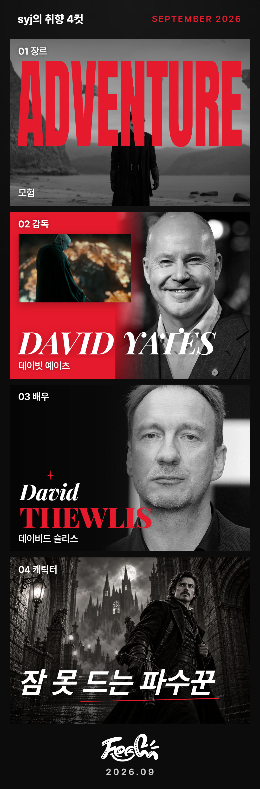

# S15P21E106-970 갤럭시·웹 리포트 앞면 저장 비율

## 변경과 원인

숨겨진 캐릭터 뒷면의 긴 설명이 앞면 DOM의 `scrollHeight`를 늘렸다. 앞면을 그 높이로
캡처하고 1080×3268 캔버스에 맞추면 네 칸이 세로로 압축되고 하단 검정 여백이 커졌다.
갤럭시·웹 앞면은 화면의 `getBoundingClientRect()` 경계를 사용한다. iOS 앞면은 이미
같은 경계를 사용하므로 이번에 수정하지 않았다.

뒷면 캡처 호출과 높이 계산, ReportFourCut 컴포넌트·CSS, 뒤집기·공유 흐름은 유지했다.
공유가 재사용하는 앞면 캡처에도 비율 보정이 적용된다. 서버·Nginx·폰트·사진 에셋과
의존성은 변경하지 않았다.

기존 서버 PNG가 불량이면 새 캡처만 고쳐도 기기에 옛 파일이 내려왔다. 사용자 승인에
따라 모든 기기에서 API-061 성공 후 이번 앞면 Blob을 내려받는다. 서버에는 최초 한 장만
보관하고 덮어쓰거나 누적하지 않는다. API 실패는 계속 다운로드를 차단한다. 현재 닉네임을
쓰는 기기 저장본과 서버의 최초 스냅샷을 구분하도록 API 문서도 맞췄다.

## 자동 검사

- `npm run test:run -- src/utils/reportImage.test.ts src/utils/reportImageIOS.test.ts src/utils/reportImageFonts.test.ts src/components/ReportFourCut/ReportFourCut.test.tsx src/components/ReportFourCut/characterCards.test.tsx src/pages/reports/ReportFlow.test.tsx src/pages/reports/ReportDetailPage/saveReportImage.test.ts --maxWorkers=1 --no-file-parallelism`: 7개 파일, 128개 테스트 통과.
- `npm run build`, `npm run lint`, `npm run format:check`, `git diff --check`: 통과.
- `origin/develop`의 `fe378efb36dc55ebb3ba6893e4f4924c73a16848`을 충돌 없이 작업 브랜치에 반영했다.
- 빌드의 기존 PostCSS `from` 경고와 500kB 청크 경고는 유지된다.

초기에는 다른 worktree의 node_modules를 연결해 Vitest의 폰트 파일 접근 검사가 실패했다.
연결을 제거하고 이 worktree에서 `npm ci` 후 검사를 다시 수행했다. 변경된 저장 계약을
가정하지 못한 기존 화면 테스트 4개도 실패했으며, 새 다운로드·실패 동작에 맞춰 수정한
후 전체 관련 128개가 통과했다.

## 빌드된 앱에서 같은 데이터 비교

운영 397번 화면의 DOM에서 확인한 표시 필드와 동일한 TMDB 사진을 사용했다. 인증과
API-061은 별도 브라우저 문맥에서 모킹했다. 원본 API JSON 자체를 조회한 것은 아니다.
비교 기준은 이번 수정 전 운영 main `274d9cdb`와 새 작업 빌드다. 사용자가 제시한 예전
정상 PNG의 리포트 번호·저장 조건은 확인하지 못했으므로 그 과거 조건까지 재현했다고
해석하지 않는다.

Chrome 154에서 PNG 파일을 실제로 내려받고 1080×3268 규격을 검사했다. 데스크톱과
Galaxy S9+ 기반 모바일 환경의 화면 폭 320·360·412px를 사용했다.

| 환경 | 날짜 스탬프 아래 여백: 수정 전 → 후 | 뒷면 PNG |
| --- | --- | --- |
| PC 웹 | 352px → 60px | 데스크톱 공유는 기존대로 지원 불가 |
| 갤럭시 조건 320px | 633px → 59px | 전후 바이트 동일, 1080×5817 |
| 갤럭시 조건 360px | 404px → 58px | 전후 바이트 동일, 1080×5235 |
| 갤럭시 조건 412px | 352px → 60px | 전후 바이트 동일, 1080×5066 |

58~60px는 원래 디자인의 하단 여백이다. 앱 DOM의 전체 앞면 높이와 각 칸·뒷면 높이는
수정 전후 동일했다. 저장 PNG만 원래 앞면 비율을 회복했다. 공유 시 기기 공유 API는
모킹했으며 전달된 뒷면 PNG를 SHA-256과 실제 바이트로 비교했다. 화면 캡처를 먼저 하면
자동화 브라우저의 pointer 조건이 달라져 공유 지원 불가로 끝났으므로, 저장·공유 검증 후
스크린샷을 찍어 모바일 입력 조건을 유지했다. 제품의 공유 코드는 변경하지 않았다.

이 스크린샷은 397번의 화면 표시 필드를 재구성한 목업 API와 공개 사진을 사용한 자동화
결과이며, 운영 앱에서 직접 저장한 파일은 아니다.

## 저장 흐름 회귀

빌드된 앱의 별도 목업 데이터로 WebKit 26.5의 iPhone 13 조건(원본 사진 및 위치·확대·
누끼 조건), PC Chrome, Android Chrome에서 각각 다음을 확인했다.

- 첫 저장, 반복 저장, 뒤집힌 칸을 앞면으로 복원한 저장, 새로고침 후 저장.
- API 500에서 다운로드 없이 실패 안내 후 재시도 성공, 401 토큰 갱신 후 저장 성공.
- 서버가 최초 파일 URL을 계속 반환해도 기기 PNG는 이번 업로드 Blob과 바이트 동일하며
  서버 파일 다운로드 요청은 0회.
- iPhone 조건의 사진 프록시·폰트 실패 시 다운로드 차단, 앞면·뒷면 공유 파일 준비.
- 저장 후 사진 원본 URL과 DOM 스타일 복원, 예상 밖 API와 런타임 오류 없음.

갤럭시 조건의 첫 반복 실행은 약 353만 픽셀 중 9개 픽셀에서 RGB 채널 값 1 차이가 있어
엄격한 바이트 동일 단정이 실패했다. 차이는 글자 영역의 미세한 렌더링 차이로 확인했고
검정 여백·배치·사진 누락이 아니었다. 픽셀 최대 채널 차이 1 이하를 별도로 검사하면서
다운로드 파일과 이번 업로드 Blob의 바이트 동일 검사는 유지했다. 후속 실행에서는
반복 PNG가 바이트까지 동일했다. 브랜드 색상 CSS는 변경하지 않았다.

비교 파일과 자동화 스크립트는 로컬의 Git 제외 경로 `plans/ratio-qa/`에 보관했다.

## 실제 기기와 배포 제한

사용자는 같은 Wi-Fi에서 로컬 테스트 페이지를 갤럭시로 열어 저장한 뒤 "잘 되는 것 같음"이라고
확인했다. 이 페이지는 새 빌드와 목업 API를 사용하므로 운영 서버에 쓰지 않는다. 실제 기기의
브라우저 버전과 반복 저장 횟수는 확인하지 않았으며, 운영 앱/WebView 검증으로 간주하지 않는다.
Wi-Fi HTTP 테스트 주소에서는 기기 공유 API를 사용할 수 없어 실제 공유창 전송은 미검증이다.
자동 검증에서는 공유 파일 준비와 뒷면 PNG 보존까지 확인했다.

이번 수정은 실제 갤럭시 앱/WebView나 Samsung Internet에서 확인하지 않았다.
WebKit 자동 검증도 실제 iPhone 테스트를 대체하지 않는다. 운영 백엔드에 수정 PNG를
업로드하거나 기존 저장 파일을 삭제·교체하지 않았다. 검증용 목업 서버는 운영 API에 쓰지 않았다.

실기기에서는 같은 리포트를 열어 앱 사진과 저장 PNG의 사진·이름, 네 칸 세로 비율,
하단 로고·날짜 여백을 비교하고 첫 저장·반복 저장·새로고침 후 저장을 확인한다.
기존 불량 PNG가 있었던 리포트도 새 저장본이 정상인지 확인한다. 공유는 기존처럼
앞면·뒷면 두 파일이 전달되고 닫은 뒤 원래 뒤집기 상태가 복원되는지 확인한다.
