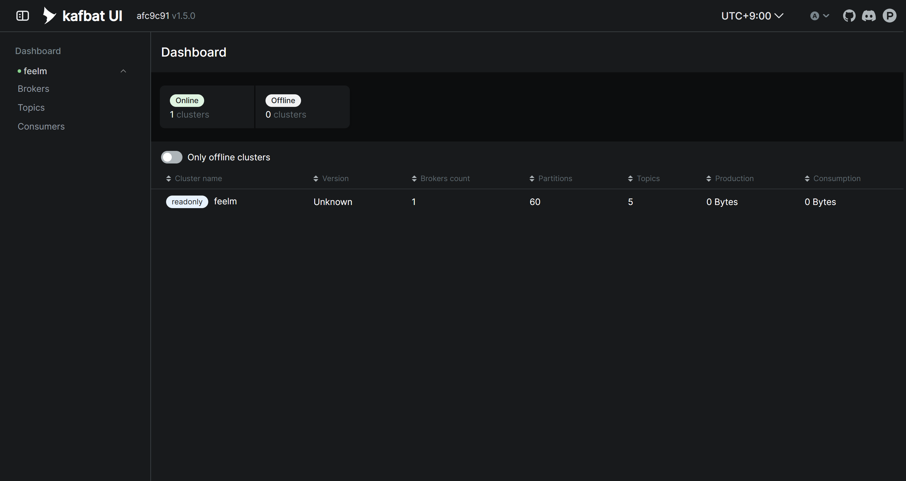
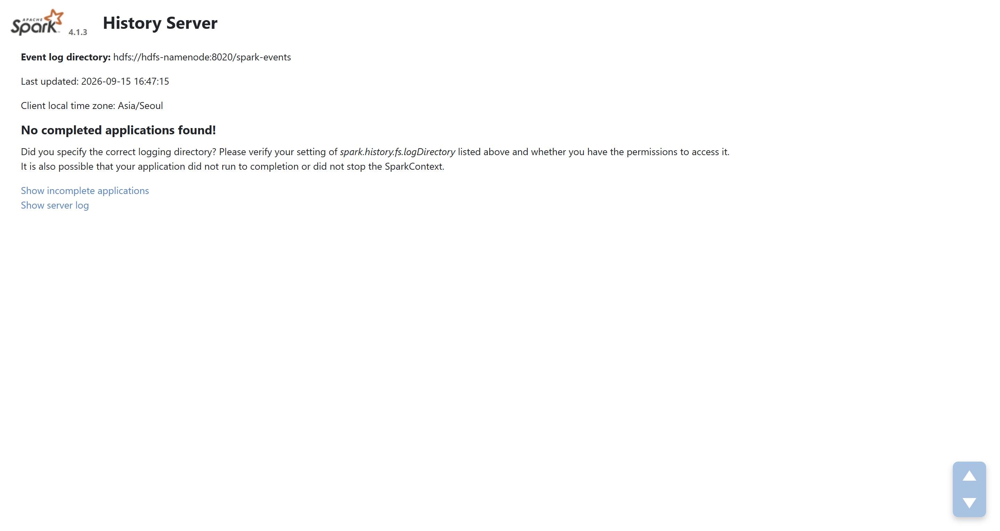
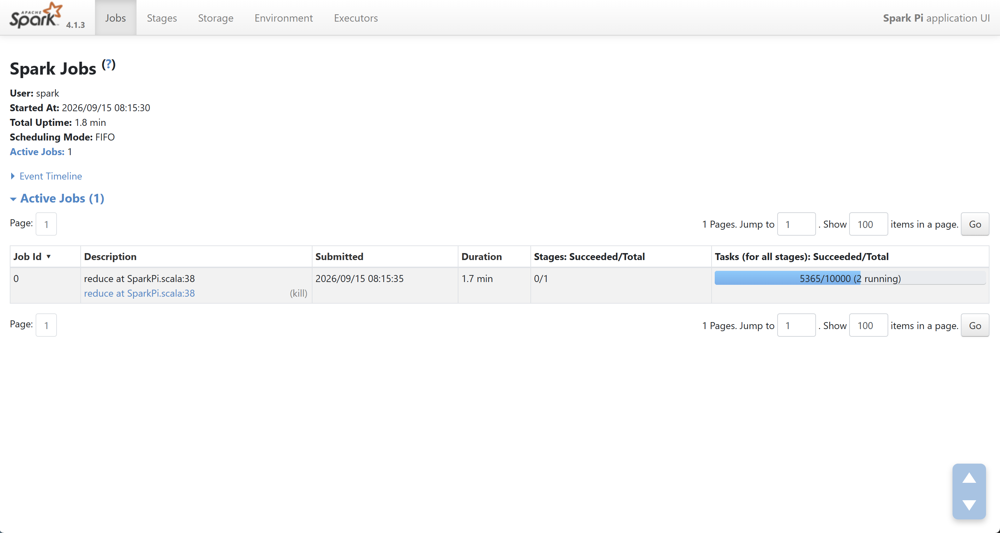

# S15P21E106-444 Kafka·Spark 관제 환경 검증 기록

검증일: 2026-09-15

이 기록은 운영자가 서비스·분산 노드와 SSH 터널을 통해 제공한 명령 출력 및 화면을
근거로 한다. 실제 사설 IP와 인증정보는 기록하지 않는다.

## 검증 결과

| 항목 | 결과 |
| --- | --- |
| Kafbat UI 기동 | `v1.5.0`, health `UP` |
| Kafka 연결 | `feelm` 클러스터 Online, broker 1개 조회 |
| Kafka 조회 화면 | read-only 표시, topic 5개와 partition 60개 조회 |
| Spark History Server | Spark 4.1.3, HDFS `/spark-events` 조회 성공 |
| Spark 클러스터 복구 | Master와 두 Worker가 동일 운영 이미지로 재생성된 뒤 Worker 2개 ALIVE 확인 |
| 실행 중 Spark UI | Spark Pi Job의 Jobs·Stages·Executors 화면과 10,000개 Task 진행 상태 확인 |
| 종료 Job 이력 | Spark Pi 3건이 History API에서 `completed: true`로 조회됨 |
| Event log 영속 경로 | HDFS `/spark-events`에 애플리케이션별 event log 3건 생성 확인 |
| 사설망 접근 | 서비스 노드에서 Kafka UI와 History API 응답 확인 |
| 방화벽 영속화 | 전용 systemd unit enabled/active, 분산·서비스 노드 허용 규칙이 기타 출발지 DROP보다 먼저 적용됨 |

## 화면 증빙

### Kafka 조회 UI

### Spark History Server

### 실행 중 Spark Job

## 검증 중 보완한 문제

- NameNode Web UI healthcheck가 RPC 준비보다 먼저 통과하던 경합을 발견해 RPC 포트 확인과
  Safe Mode 대기를 추가했다.
- host network에서 History Server hostname이 해석되지 않던 문제를 self-host 매핑으로
  수정했다.
- History Server가 전체 인터페이스에 바인딩되던 문제를 `SPARK_LOCAL_IP` 사설 주소
  바인딩으로 수정했다.
- 방화벽 DROP이 분산 노드 자신의 관리 요청도 막던 문제를 self-source 허용 규칙으로
  보완했다. 서버별 실제 주소가 포함된 unit은 호스트 설정으로 관리한다.

## 미검증 범위

- Consumer가 배포되지 않아 Consumer Group과 파티션별 실제 Lag 조회는 확인하지 못했다.
- 허용되지 않은 제3 호스트에서 관리 포트 연결 실패를 직접 시험하지 못했다. 사설 IP
  바인딩과 허용 출발지 규칙 뒤의 명시적 DROP 순서는 확인했다.
- 서버 전체 재부팅 후 관제 컨테이너와 방화벽 unit의 자동 복구는 확인하지 않았다.

위 미검증 항목 중 Consumer Lag와 재부팅·접근 차단 운영 검증은 후속 업무
`S15P21E106-452`에서 수행한다.
