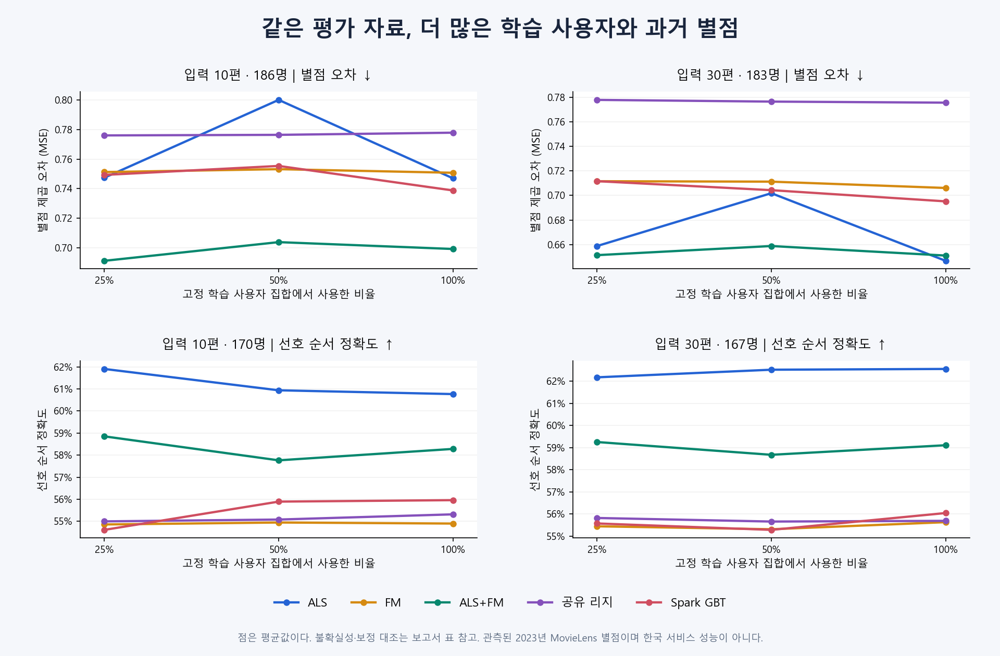

# 추천 모델 5종과 학습량 비교

Jira: [S15P21E106-337](https://ssafy.atlassian.net/browse/S15P21E106-337)

**ALS를 전체적으로 대체할 모델은 아직 정하지 못했다.** 학습 이력이 있는 영화와 입력이
충분한 사용자는 ALS를 유력 후보로 유지한다. 입력이 적거나 영화의 학습 평점이 부족한
구간은 콘텐츠 모델·혼합을 별도로 볼 이유가 있다. 서비스 모델과 전환 K는 보류한다.

완료된 로컬 실험 REC046, 평가 자료 구성 감사, REC047을 함께 공유한다.
앞선 [ALS 기준선](als-baseline.md) 이후의 비교다. 연구 완료와 MR 리뷰·병합은 별개다.

## 결과를 어떻게 읽으면 되나

같은 평가 사용자에게 입력 별점 K편을 제공하고 이후 실제 관측한 별점을 예측했다.
MSE는 사용자별 평균 제곱 오차를 다시 사용자마다 같은 비중으로 평균한다. 낮을수록 좋다.
선호 순서는 실제 별점이 다른 두 영화의 순서를 맞힌 비율이다. 예측 동점은 절반으로 센다.
미평가 영화는 UNKNOWN이다. 전체 서비스 카탈로그 Top-N 적중률을 측정한 결과가 아니다.

REC047의 지정 학습 pool 100% 결과다. 입력 10편의 오차/순서 평가자는 186/170명,
30편은 183/167명이다. 서로 다른 K의 점수 차이를 입력 증가 효과만으로 해석하지 않는다.

| 모델 | K10 MSE ↓ | K10 순서 ↑ | K30 MSE ↓ | K30 순서 ↑ |
|---|---:|---:|---:|---:|
| ALS | 0.747 | 60.8% | 0.647 | 62.6% |
| FM | 0.751 | 54.9% | 0.706 | 55.6% |
| ALS+FM | 0.699 | 58.3% | 0.651 | 59.1% |
| 공유 리지 | 0.778 | 55.3% | 0.776 | 55.7% |
| Spark GBT | 0.739 | 56.0% | 0.695 | 56.0% |

사전에 고정한 사용자 짝 비교와 다중비교 보정에서 K30의 ALS 순서는 FM·리지·GBT보다
높았다. 혼합과의 차이는 미확정이다. K30 오차에서는 리지만 ALS보다 나빴다.
K10 혼합의 평균 오차가 가장 낮아도 ALS 대비 개선을 확정하지 못했다.
혼합은 검증에서 선택한 ALS 25% + FM 75%이며 ALS 직접 점수가 없으면 FM을 쓴다.

## 초기 비교의 문제를 함께 확인했다

| 완료 분석 | 얻은 결론 |
|---|---|
| REC046: 5종 비교 | ALS 보조가 FM의 K10/30 오차를 2.70/3.24% 줄였지만 순서 개선은 미확정이었다. 단일 승자는 없었다. |
| REC046 구성 감사 | 학습 평점 사용량 제한과 고활동 평가자 편중, 비어 있는 활동량×영화 지원량 구간을 확인했다. 이 초기 순위표만으로 결정하면 안 됐다. |
| REC047: 전체 과거 이력·학습량 비교 | 지정 학습 사용자 pool의 이력을 모두 사용하고 중첩 25/50/100%를 비교했다. 학습량 대조 10개 모두 개선을 확정하지 못했다. 효과가 없다는 증명은 아니다. |

REC047 100%는 39,859명·6,261,195평점·56,026영화다. MovieLens 3,200만 행 전체가 아니다.
검증·평가 사용자는 학습에서 제외한다. 검증은 2022-07-05~2023-01-01,
평가는 2023-01-01~2023-06-30(UTC, 끝 시각 제외)이다. 학습은 각 시점 이전 과거 이력을 쓴다.
REC046과 REC047은 기간·대상·표현도 달라 두 실험의 점수 차이를 학습량 효과로 읽지 않는다.

| 주의할 표본 | 확인된 범위 |
|---|---|
| 적게 평가한 사용자 | REC047 입력 1편 조건에서 과거 1~29편 사용자는 4명뿐이다. 이들의 목표 영화는 모두 학습 평점 50건 이상이다. |
| 영화 학습 평점 0건 | ALS는 사용자별 기본값을 쓰므로 영화 순서를 구별하지 못한다. 낮은 MSE가 추천 구별 능력을 뜻하지 않는다. |
| 학습 사례의 개인화 입력 | 학습 목표 82.3%는 K0이다. 전체 626만 건을 입력이 있는 개인화 사례라고 부르지 않는다. |

영화 지원량·활동량별 기술통계는 [집단별 표](assets/model-comparison/rec-ev-047/strata.csv)에 있다.
빈 칸은 자료 없음이며 소수 사용자 셀의 우열을 채택하지 않는다.

## 무엇을 학습했고 어디까지 검증했나

FM·리지·GBT는 영화 속성과 그 속성에 연결된 입력 별점 반응을 168개 특징으로 썼다.
장르·키워드·국가/언어·연대/길이·감독·배우·제작사/시리즈의 원래 연결을 유지했다.
특정 인물 ID의 전역 효과를 각각 학습하는 전체 ID 기반 FM은 아니다.
REC047에는 현재 TMDB 인기·평점 수치가 들어가지 않았다. 8개 분류는 이 분석의 전제가 아니다.
실제 별점 0.5 단위를 보존하고 예측은 오차 계산 시 0.5~5 범위로 제한한다.

REC047의 실제 학습 24개를 이 데스크탑에서 완료했다. 학습 함수 시간 합 88.0분,
최대 컨테이너 메모리 10.28GiB다. Spark local[4] 결과이며 다중 노드·EC2 성능은 아니다.
원본 정답 18,960건, 사용자 지표 54,225행, 집계·구간 926개를 독립 검산했다.
현재 설정의 최적 수렴·모델 계열의 최고 성능을 입증하지는 않았다.

현재 TMDB와 과거 MovieLens 개발 관측을 사용했다. 새 확증용 평가 표본도 아니며,
2026년 한국 사용자·신작·전체 서비스 카탈로그의 정답은 확보하지 못했다.
학습된 모델을 고정한 사용자 재표집 구간이며 학습 seed·분할 변화까지 측정한 구간은 아니다.

## 근거와 재현

- [초기 비교 그림](assets/model-comparison/rec-ev-046/comparison.png), [표본 감사 그림](assets/model-comparison/rec-ev-046/data-audit/population-audit.png)
- [최종 평균·95% 구간](assets/model-comparison/rec-ev-047/metrics.csv), [사전 보정 대조 26개](assets/model-comparison/rec-ev-047/contrasts.csv)
- [최종 독립 결과 감사](assets/model-comparison/rec-ev-047/result-review.json), [초기 감사](assets/model-comparison/rec-ev-046/result-review.json)
- [고정 설정 기록](../configs/model-comparison.json), [외부 산출물](../artifacts/model-comparison.json)
- [연구 코드·재현 조건](assets/model-comparison/source/README.md), [출처·게시 변환 해시](assets/model-comparison/provenance.json)
- [발표 원고](presentation/model-comparison.md), [게시 검증](assets/model-comparison/publication-review.json)

API·DB·모델 저장·Consumer 계약을 확정하거나 바꾸는 문서가 아니다. 119번 모델 통합과
315번 후보 생성 구현에는 참고 근거로 전달하며, 기존 업무를 완료 처리하는 근거로 사용하지 않는다.
