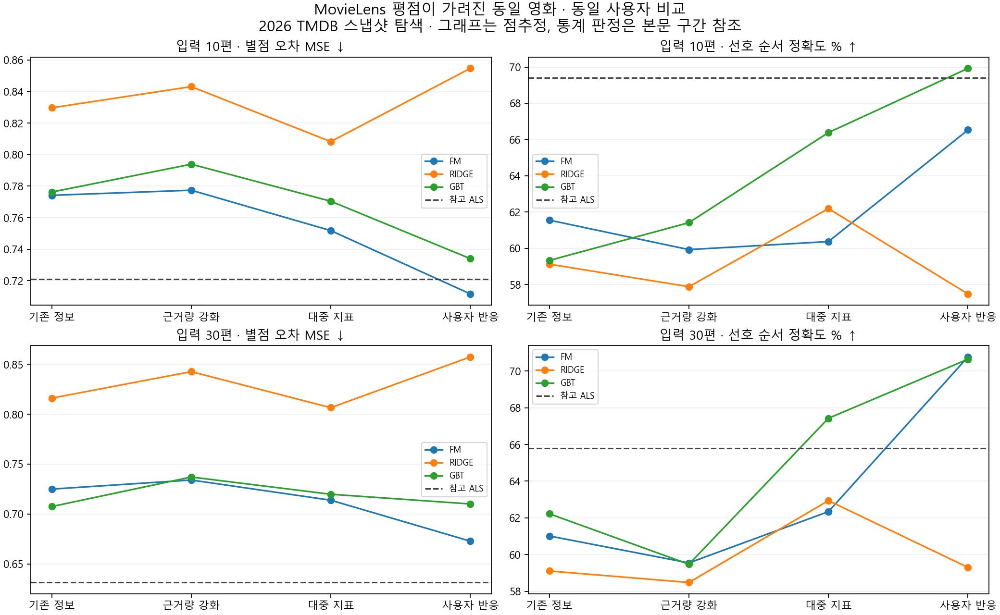

# 평점 이력 미지원 영화 발표 원고

**핵심 문장:** “영화 평점 이력을 가린 조건에서 사용자의 대중성 반응이 도움 되는 구간을 확인했다.”

1. 목표 영화의 평점은 참고 ALS에 남기고 콘텐츠 학습에서만 가렸다. 같은 입력과 실제 별점을 비교해 ‘ALS 재현도’와 ‘실제 별점 품질’을 구분했다.
2. FM의 입력 10편 조건에서 대중성 반응을 추가하자 선호 순서가 60.4→66.5%로 올랐다. 71명의 제한적 근거이며 보정 구간은 +0.14~+14.26%p다.
3. ALS 대비 차이는 모두 미확정이며 동급 증거가 아니다. FM·GBT를 후보로 유지하고 최종 채택은 보류한다.

[수치·분모·검증 근거](../cold-item-content.md). 현재 TMDB와 과거 MovieLens 개발 관측의 비교이며 실제 한국 신작 서비스 효과는 아직 모른다.
