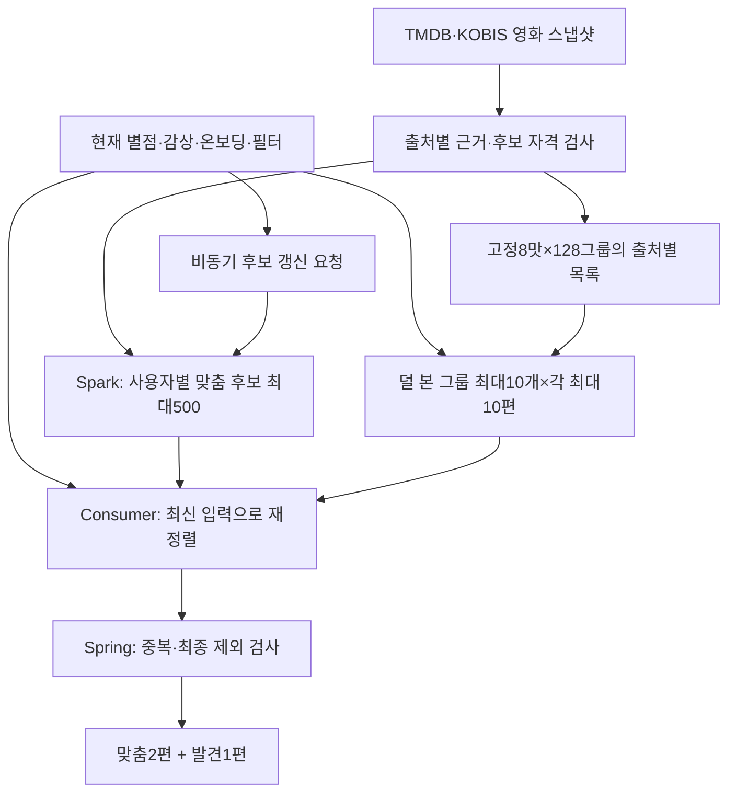

# FEELM 추천 시스템 v1

상태: **PARTIALLY SUPERSEDED** · 2026-09-18.
서비스 구성과 과거 근거는 보존하지만 모델 입력·특징·학습/배포 경계는
[현재 개발 방향](CURRENT-DIRECTION.md)과 [0~N 계약](../../contracts/zero-n-learning-evaluation.md)을 우선한다.
팀 저장소의 구현·모델 학습·배포가 완료되었다는 뜻은 아니다.

**GBT·FM과 현재 기준선을 0~N 이력에서 비교한 뒤 노출 모델을 결정한다. 맞춤 후보는 배치에서
만들고 현재 사용자 입력으로 재정렬한다. 한 번에 맞춤2편과 발견1편을 제공하는 기존 서비스
구성 및 발견10×10 후보 예산은 모델 입력10편 제한과 별개다.**

영화 상세에는 [비슷한 영화 기본10편](SIMILAR-MOVIES.md)을 추가한다. 기존 콘텐츠 벡터·
pgvector 검색·영화별 공용 캐시를 사용하며, 맞춤2+발견1 세트와 별도로 제공한다.

이 폴더가 추천의 첫 서비스 명세 v1이다. 앞서 작성한 `service-final-20260913`,
`service-popularity-v2-20260913`은 연구·중간 설계 이력으로 보존한다. 구현에서는 이 문서를
우선한다. 기존 문서의 ALS 기본/자동 혼합, 유형별2편, 전체 카탈로그 요청 시 추론,
발견25편씩 공급, 대중 지표가 모두 없는 영화의 콘텐츠 보충 규칙을 이어받지 않는다.

Jira: [S15P21E106-387](https://ssafy.atlassian.net/browse/S15P21E106-387).

먼저 [팀 인계 안내](HANDOFF.md)에서 구현 순서·현재 준비 상태·자료 위치를 확인한다.
[ALS·FM·GBT 비교](MODEL-COMPARISON.md), [재현·EC2 준비](REPRODUCTION.md), [게시 검증](VERIFICATION.md)을 함께 제공한다.
[621 실험 사전점검](readiness/S15P21E106-621-READINESS.md),
[621 기계 판독 readiness manifest](readiness/READINESS-MANIFEST.json),
[노트북 인계](readiness/LAPTOP-HANDOFF.md),
[노트북 시작 프롬프트](readiness/LAPTOP-BOOTSTRAP-PROMPT.md)는 본 학습 전에 코드·자료·장비·서버/HDFS의
현재 상태를 다시 판정하는 실행 인계다.

## 읽는 순서

| 문서 | 구현할 내용 |
| --- | --- |
| [현재 개발 방향](CURRENT-DIRECTION.md) | 0~N 입력, 모델별 특징, 로컬 학습, 서버/HDFS·CI/CD 경계와 Jira 책임 |
| [정책](POLICY.md) | K·이력·후보 자격·맞춤·발견10×10·맞춤2+발견1·부족 처리 |
| [KOBIS 데이터 연결](KOBIS-DATA.md) | 확대 수집72,700행, 영화 식별 제안/확정, 누적 기준일, 후보·학습에 쓰는 조건 |
| [모델과 특징](MODELS.md) | GBT/FM/ALS adapter, TMDB·KOBIS 반응 특징, 학습·보정·비교·산출물 |
| [ALS 결합 비교군](HYBRID-COMPARISONS.md) | ALS+GBT·ALS+FM의 전환/혼합, 미지원 처리, 기여도 비교와 구현 검수 |
| [legacy 비교 registry](../../configs/service-v1/comparison-registry.v1.json) | 단독3개+결합4개의7개 점수 경로. 당시 기본 노출 GBT 재현 |
| [고정 그룹](GROUPS.md) | 전처리·8×128 중심·평균 대표·신규 영화 배정·0벡터·원파일 선택 |
| [상세의 비슷한 영화](SIMILAR-MOVIES.md) | GKT131 재사용·pgvector HNSW·공용50편 캐시·기본10편·로그인 제외·오류·갱신 |
| [유사 영화 설정](../../configs/service-v1/similar-movies.v1.json) | API 크기·검색/캐시 상한·버전·검수 예산. 기존 settings.py와 모델 설정은 유지 |
| [API·DB·이벤트 계약](CONTRACTS.md) | 실제 팀 코드와의 차이, payload·저장 구조·버전·수정 범위 |
| [배치와 운영](OPERATIONS.md) | 후보500·실시간 재정렬·신규 사용자·이벤트·게시·장애·배포 순서 |
| [legacy 설정 snapshot](../../configs/service-v1/config.v1.json) | 2026-09-13 게시 해시 보존 자료. `defaultModel=GBT`와 `originalHistoryLimit=10`을 현재 기본값으로 사용하지 않음 |
| [legacy 특징 목록](../../configs/service-v1/feature-schema.v1.json) | 재현용으로 순서가 고정된245열과 원230열 출처. 새 GBT/FM profile의 공통 입력 계약이 아님 |
| [학습 설정](../../configs/service-v1/training-recipe.v1.json) | 고정 역할·학습 파라미터·결측 증강·순차 실행 한도 |
| [그룹 구성 설정](../../configs/service-v1/group-recipe.v1.json) | 원본 파일·배열 해시와 복사할 키. 과거 추천 정책은 제외 |
| [구현 검수 기준](ACCEPTANCE.md) | 정상·부족·결측·동시 요청·모델 교체에 대한 요구사항과 판정 |
| [평가 지표 계약](EVALUATION.md) | 정답·UNKNOWN·공통 분모·MSE/순위식·bootstrap·안전 한계 |
| [0~N 학습·평가 계약](../../contracts/zero-n-learning-evaluation.md) | GBT·FM episode, 사용자·시점 분할, 특징 lineage, 이력별 평가·분모 |

데이터의 수집 범위·관계·표준편차·그래프는 [별도 데이터 분석 문서](data-analysis/tmdb-kobis-v1-20260913/REPORT.md)에 둔다.
서비스 정책 숫자와 데이터에서 확인한 통계 수치를 서로 다른 문서로 관리한다.
[발표 자료 6장](presentation/feelm-recommendation-v1.pptx)은 데이터 차이·모델 선택·맞춤·발견 흐름을 요약한다.
발표 파일은 결합 비교군과 KOBIS 확대 수집을 반영하기 전의 기본 구성 요약이다. 최신 내용은 이 폴더의 문서를 따른다.

KOBIS는 연도별 전체72,700개 영화·연도 기록까지 수집·검산을 마쳤다. 고유 영화72,700편이
아니며, 직접 코드2,176개와 TMDB 대응 제안도 서비스 영화와의 확정 연결과 다르다.
이번 확대 자료의 확정 출처 간 연결은0개이므로 수집 완료가 KOBIS245 모델의 준비 완료는 아니다.
관객 수의 기준일·영화 연결·평가 교집합을 확인하는 순서는 [KOBIS-DATA](KOBIS-DATA.md)에 정리한다.

독립 [통계 검토](../assets/service-v1/records/outputs/recommendation-evidence/tmdb-kobis-v1-20260913/result-review.md),
[모델·정책 검토](../assets/service-v1/records/outputs/recommendation-evidence/service-v1-implementation-20260913/model-policy-review.md),
[후속 모델 검토](../assets/service-v1/records/outputs/recommendation-evidence/service-v1-implementation-20260913/model-policy-review-r2.json),
[평가 설계 검토](../assets/service-v1/records/outputs/recommendation-evidence/service-v1-implementation-20260913/evaluation-design-review-r2.json),
[최종 파일 검증](../assets/service-v1/records/outputs/recommendation-evidence/service-v1-implementation-20260913/delivery-review.json)을 함께 남긴다.
이 검토는 문서·자료의 정확성에 대한 것이며 새 모델 학습이나 구현 테스트 PASS를 뜻하지 않는다.
위 검토는 각각 당시 버전에 대한 기록이다. ALS 결합 비교군 추가의 최신 검토/변경 파일은
[확장 검증 기록](../assets/service-v1/records/outputs/recommendation-evidence/hybrid-comparison-extension-20260913/delivery-review.json)에 연결한다.
KOBIS 확대 수집 반영 이후 문서의 정합성은 [이번 문서 검토](../assets/service-v1/records/outputs/recommendation-evidence/kobis-document-update-20260913/document-review.json)를 따른다.
이전 문서 원본은 같은 작업 폴더의 `before/`에 보존하며, 과거 수치·그래프·모델 결과의 봉인을 갱신 문서의 검증으로 대체하지 않는다.

후속 유사 영화 기능의 최신 설계 검토는 [상세 유사 영화 확장 검토](../assets/service-v1/records/outputs/recommendation-evidence/similar-movies-design-20260913/design-review.json)다.
이전 검토의 문서 원본은 해당 확장 폴더 `before/`에 보존한다. 검색 인덱스·실제 추천 품질의 검수 완료와 구분한다.

## 전체 흐름

실제 평가0편은 콘텐츠·대중 초기 경로를 사용한다. 1편 이상은 승인된 0~N 모델이 지원하면
개인화할 수 있으며 10편을 서비스 진입 게이트로 사용하지 않는다. 채택 모델은 625의 봉인 평가
전에는 확정하지 않는다. 모델 미준비·후보 부족은 응답 상태로 구분한다.

## 확정한 서비스 구성

| 결정 | v1 |
| --- | --- |
| 기본 모델 | 미확정. GBT·FM·현재 기준선을 622·623·625에서 비교한 뒤 결정 |
| 비교 모델/정책 | FM·ALS와 ALS+GBT·ALS+FM의 전환/혼합. shadow 결과 저장, 노출 모델 자동 변경 없음 |
| 반환 | 맞춤2 + 발견1. 추가 요청도 같은 구성 |
| 상세의 비슷한 영화 | 별도 목록 기본10편. 기존131차원 벡터로 검색하고 공용 결과 캐시. 새 모델 학습 없음 |
| 맞춤 후보 | Spark 배치가 사용자별 최대500편 생성, Consumer가 현재 입력으로500편 전부 재정렬 |
| 발견 후보 | 8맛×맛당128개 하위 그룹 중 최대10개 공급 그룹, 그룹당 최대10편, 총≤100 |
| 대중성 | TMDB·KOBIS 출처별 근거를 상호 보완. 후보에서는 OR, 개인 예측에서는 별도 특징 |
| 거의 근거 없는 영화 | 두 출처 모두 최소 근거를 충족하지 못하면 추천 후보에서 제외 |
| 입력 | 실제 별점0.5 단위. K는 현재 실제 별점 영화 수, 개인화 모델은 0~N 전체 이력 의미를 보존 |
| 업데이트 | 사용자 반응·예측·순위는 입력에 맞춰 갱신. 매 평가마다 모델을 재학습하지 않음 |

반환 구성·배치 후 재정렬·발견10×10·대중성 상호 보완은 계속 검토한다. K10은 폐기된 모델
입력 게이트다. 후보500, TMDB21표/KOBIS1만 관객, 일별06:00, 세트10라운드는 legacy 운영
기본값이며 최적성을 실험으로 입증한 숫자라고 발표하지 않는다.

## legacy v1에서 GBT를 기본으로 선정했던 이유

MovieLens·TMDB·KOBIS는 시점·이용자·영화 접근 경로와 관측 단위가 다르다. 데이터 분포
차이는 MovieLens의 오차만으로 현재 한국 서비스 적합성을 결정하기 어렵다는 근거다.
그 그래프가 GBT의 한국 사용자 만족도 우위를 직접 증명하는 것은 아니다.

GBT는 영화 속성과 사용자가 그 속성에 보인 반응으로 계산하므로, MovieLens factor가 없는
영화에도 입력 특징이 있으면 점수를 만들 수 있다. 새 서비스의 작은 이력으로도 공유 모델에
사용자 특징을 제공할 수 있다. 이 성격과 기존 개발 비교에서 유지한 점수 수준을 함께 고려해
당시 GBT를 v1 기본 후보로 두었다. 현재는 GBT와 FM의 모델별 특징을 다시 검증하고 625에서
노출 모델을 결정한다.

| 기존 개발 결과 | 값과 의미 |
| --- | --- |
| 전체 관측 후보 FM/GBT 3seed 평균 MSE | 0.6890 / 0.6793 |
| 전체 관측 후보 NDCG@2 | FM0.8373 / GBT0.8359 |
| ALS 지원 목표 MSE | ALS0.6938. 위 전체 후보와 분모가 달라 직접 빼면 안 됨 |
| ALS 미지원 목표 | ALS0/624행 점수화. FM·GBT는 같은624행을 계산 |

위 수치는 [기존 hybrid345 결과](MODEL-COMPARISON.md)의 서로 다른 표에서 가져왔다.
FM/GBT의 확실한 통계적 승자는 확인되지 않았다. **새 KOBIS245열 모델의 점수도 아니다.**
과거 router 성능으로 새 GBT 단독·10×10·배치500·맞춤2+발견1 정책의 검증을 대신하지 않는다.

## 구현 가능 상태와 남은 산출물

기존 GBT/FM230열 모델·ALS factor·GKT128 분류 자료는 로컬 연구 산출물로 존재한다.
KOBIS 영화 정보와 사용자 반응을 포함한245열 계약은 legacy 비교 기준선이다. 최종 GBT·FM
특징은 622·623에서 별도로 선택하며, 아직 학습하지 않은 모델의 파일·해시·보정 계수를 채워 넣지 않는다.

개발자는 지금 문서로 수집 adapter·후보 배치·특징 생성·공통 scorer·Consumer·세트 API·
검수 코드를 작성할 수 있다. 새 모델 파일이 필요한 통합 검수는 fixture로 먼저 수행하고,
실제 활성화는 [모델 준비 조건](MODELS.md)을 통과한 산출물만 허용한다. 기존230열을245열인
것처럼 로드하거나 준비가 안 됐다는 이유로 ALS를 기본으로 바꾸지 않는다.

실제 팀 API·DB 변경은 CONTRACTS의 변경 목록을 해당 코드와 함께 이행해야 한다.
이 인계는 S15P21E106-387에서 GitLab에 게시한다. API·DB·ADR 실제 변경과 새 모델 학습·배포는 후속 구현 업무다.

상세 유사 영화는 별도 `SIMILARITY_NOT_READY`/준비 상태를 가진다. GKT 벡터 export·서비스 ID 연결·
pgvector 인덱스·Spring API/캐시 검수로 준비하며 GBT/FM245 학습이나 발견 중심 배정 완료를 기다리지 않는다.
현재 팀의 E5 잠정 표현을 GKT로 재사용하는 차이는 SIMILAR-MOVIES §6에 명시했고 팀 계약은 아직 수정하지 않았다.
